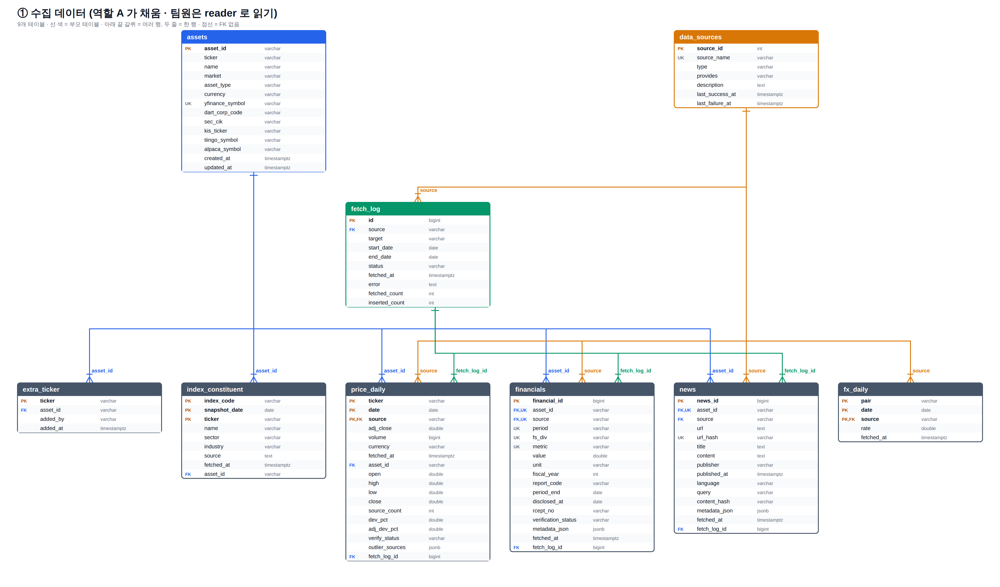
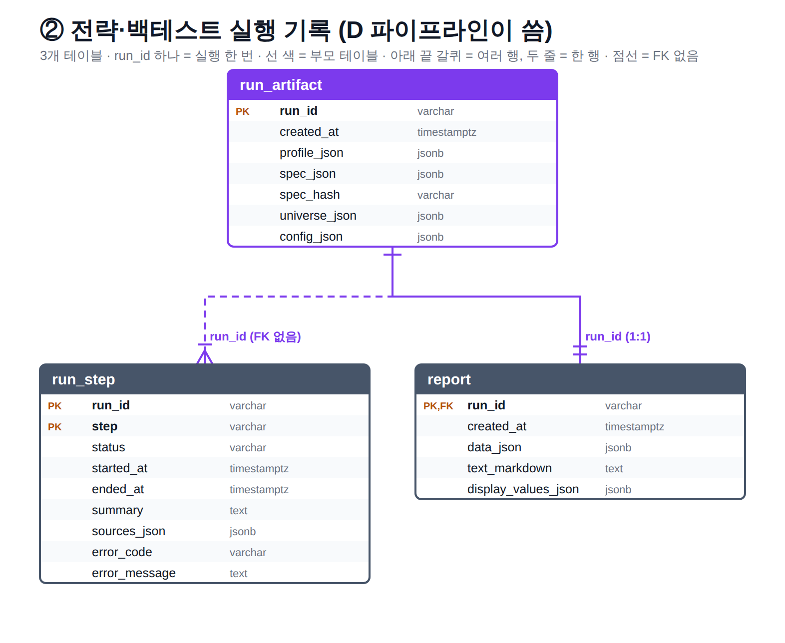

# 데이터 DB ERD

공용 DB(AWS Lightsail PostgreSQL) 12개 테이블을 두 묶음으로 나눔.
코드 기준은 `src/myfinsight/data/repository/tables.py`, 칸 설명은 `역할A_모듈명세.md` 7절.

| 묶음 | 테이블 | 쓰는 쪽 | 읽는 쪽 |
|---|---|---|---|
| ① 수집 데이터 | `assets`, `data_sources`, `price_daily`, `fx_daily`, `index_constituent`, `financials`, `news`, `extra_ticker`, `fetch_log` (9개) | 역할 A 정기 수집 (GitHub Actions), 데이터 API | 팀원 전체 (reader 계정), B·C 전략·백테스트 입력 |
| ② 전략·백테스트 실행 기록 | `run_artifact`, `run_step`, `report` (3개) | D 파이프라인 (M08-01·M08-02), M06-02 Report | D (재현·기록 조회), 서비스 화면 |

두 묶음 사이에는 FK 가 없음. ②는 실행할 때 ①을 읽은 결과(입력·단계·Report)를 `run_id` 단위로 남김.

## 1. 수집 데이터

| 테이블 | 내용 | 키 |
|---|---|---|
| `assets` | 종목 마스터. 시장·종류(STOCK/ETF/INDEX)·통화, 출처별 코드 | `asset_id` (`US-AAPL`, `KR-005930`) |
| `data_sources` | 출처 목록 (YFINANCE, KIS, ALPACA, TIINGO, DART, SEC_EDGAR, 뉴스 3곳, CONSENSUS, WIKIPEDIA, KRX) | `source_name` |
| `price_daily` | 일별 가격. 출처마다 한 행, `CONSENSUS` 행이 교차검증 기준값 | (`ticker`, `date`, `source`) |
| `fx_daily` | USD/KRW 환율 | (`pair`, `date`, `source`) |
| `index_constituent` | 지수 구성종목 스냅샷 (SP500·NDX·KOSPI200), GICS 섹터·산업 | (`index_code`, `snapshot_date`, `ticker`) |
| `financials` | 재무 지표 (DART·SEC). `disclosed_at` 이전 값만 백테스트에 씀 | (`asset_id`, `source`, `period`, `fs_div`, `metric`) |
| `news` | 종목별 기사 | (`asset_id`, `url_hash`) |
| `extra_ticker` | API 요청으로 늘어난 수집 대상 종목 | `ticker` |
| `fetch_log` | 수집 시도 기록 (성공·실패, 받은 행 수) | `id` |

- `source` 칸은 모두 `data_sources.source_name` 을 가리킴. `index_constituent.source` 만 출처 이름 + URL 글자라 FK 아님.
- `price_daily.ticker` 는 yfinance 표기라 `assets.yfinance_symbol` 과 같음.

## 2. 전략·백테스트 실행 기록

| 테이블 | 내용 | 키 |
|---|---|---|
| `run_artifact` | 실행 한 번의 재현 입력: UserProfile, StrategySpec(+해시), UniverseResult, AppConfig | `run_id` |
| `run_step` | 파이프라인 단계별 기록 (constituents, fetch_prices, data_quality, 전략, 백테스트 …): 상태·시각·요약·오류 | (`run_id`, `step`) |
| `report` | M04-03 검사를 통과한 Report (데이터 JSON, 마크다운 본문, 표시값) | `run_id` (1:1) |

- `run_step` 은 실행 중에 먼저 쌓일 수 있어서 `run_artifact` FK 를 두지 않음.
- 저장·조회는 저장소 메서드로만 함: `save_run_artifact`·`save_step`·`save_report`, `get_run_artifact`·`get_steps`·`get_report`.
