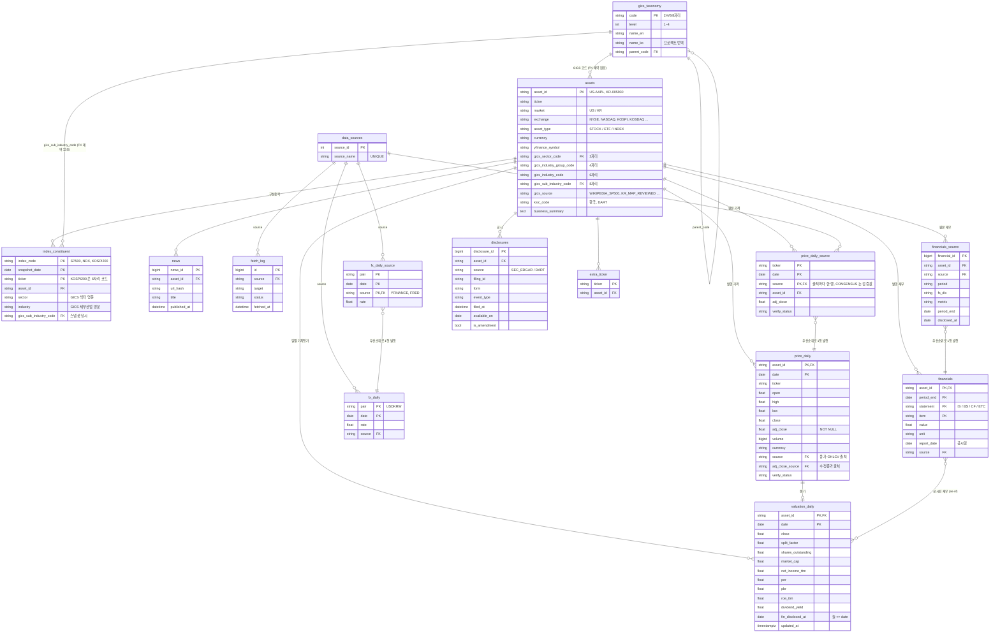
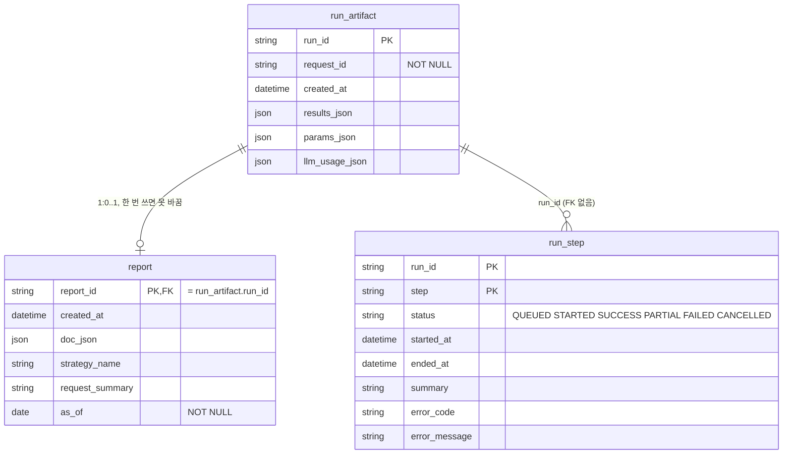

# 데이터 DB ERD

공용 DB(AWS Lightsail PostgreSQL) 18개 테이블을 여섯 묶음으로 나눔 (새 데이터 계약 module_prototype2 2.2절 기준).
코드 기준은 `backend/db/tables.py`, 계약 대응·칸 설명은 `DB_설계.md` 0·2절.

| 묶음 | 테이블 | 쓰는 쪽 | 읽는 쪽 |
|---|---|---|---|
| ① 계약 읽기 (발행) | `assets`, `index_constituent`, `price_daily`, `fx_daily`, `financials`, `news` (6개) + `fetch_log` | 역할 A 정기 수집 (GitHub Actions) | 분석 쪽 읽기·쓰기 계정, 팀원 reader 계정 |
| ② 계약 쓰기 (실행 기록) | `run_artifact`, `run_step`, `report` (3개) | 분석 쪽 쓰기 계정 (SELECT·INSERT·UPDATE, DELETE 없음) | 분석 쪽, 서비스 화면 |
| ③ 수집기 내부 | `price_daily_source`, `financials_source`, `fx_daily_source`, `data_sources`, `extra_ticker` (5개) | 역할 A 수집기 | 역할 A (검증·발행·점검). 분석 쪽 계정에는 권한 없음 |
| ④ 파생 | `valuation_daily` (1개) | 역할 A 수집기 (①의 `price_daily`·`financials` 로 계산) | 분석 쪽 읽기·쓰기 계정, 팀원 reader 계정 |
| ⑤ 참조 | `gics_taxonomy` (1개) | 역할 A 수집기 (`backend/data/reference/gics_taxonomy.json` 그대로) | 분석 쪽 읽기·쓰기 계정, 팀원 reader 계정 |
| ⑥ 공시 | `disclosures` (1개) | 역할 A 수집기 (SEC EDGAR·DART) | 분석 쪽 읽기·쓰기 계정, 팀원 reader 계정 |

- ③의 원본 테이블(`*_source`)에서 출처 우선순위로 한 값을 골라 ①의 `price_daily`·`financials` 에 발행함 (같은 트랜잭션, 값이 바뀐 행만).
- 분석 쪽 읽기·쓰기 계정(`myfinsight_read`·`myfinsight_write`)은 2026-10-17 운영 DB 에 아직 없음 (마스터 `myfinsight` 와 팀원 `reader` 뿐, `DB_설계.md` 0-3절 5번).
- 옮긴 DB 에는 옛 실행 기록 보관 `run_artifact_v1`·`run_step_v1`·`report_v1` 이 더 있음 (그림 밖).
- ①과 ② 사이에는 FK 가 없음. ②는 실행할 때 ①을 읽은 결과를 `run_id` 단위로 남김.
- 그림 파일 `DB_ERD_데이터.png`, `DB_ERD_실행기록.png` 는 **옛 스키마(v1)** 그림임 (가격 키 `(ticker, date, source)`, 옛 실행 기록 칸). 새 구조는 아래 mermaid 그림이 기준.

## 1. 계약 읽기 + 수집기 내부

| 테이블 | 내용 | 키 |
|---|---|---|
| `assets` | 종목 마스터. 시장(US/KR)·거래소·종류·통화, 출처별 코드 | `asset_id` |
| `index_constituent` | 지수 구성종목 스냅샷 (SP500·NDX·KOSPI200), GICS 섹터·산업. KOSPI200 `ticker` 는 6자리 코드 | (`index_code`, `snapshot_date`, `ticker`) |
| `price_daily` | 발행 일별 가격: 종목·날짜마다 한 행 (출처 우선순위로 고름, 한국은 종가 KIS·수정종가 yfinance 로 칸마다 출처가 다름, `verify_status` 는 CONSENSUS 행에서) | (`asset_id`, `date`) |
| `fx_daily` | USD/KRW 환율, 날짜마다 한 행 | (`pair`, `date`) |
| `financials` | 발행 재무: 기간말·재무제표·항목마다 한 값, `report_date` 는 공시일 | (`asset_id`, `period_end`, `statement`, `item`) |
| `news` | 종목별 기사 | `news_id` (`asset_id`, `url_hash` 유일) |
| `fetch_log` | 수집 시도 기록 (성공·실패, 받은 행 수) | `id` |
| `price_daily_source` | 원본 일별 가격. 출처마다 한 행, `CONSENSUS` 행이 교차검증 기준값 | (`ticker`, `date`, `source`) |
| `financials_source` | 원본 재무 지표 (DART·SEC, 한국 2004~2014 KIS_FIN), 연결/별도·보고서별 | `financial_id` (자연키 유일) |
| `fx_daily_source` | 원본 환율 (YFINANCE `KRW=X`, FRED `DEXKOUS`) | (`pair`, `date`, `source`) |
| `data_sources` | 출처 목록 | `source_id` (`source_name` 유일) |
| `extra_ticker` | API 요청으로 늘어난 수집 대상 종목 | `ticker` |
| `gics_taxonomy` | 참조: GICS 분류표 2023-03 판 (섹터 11·산업그룹 25·산업 74·세부산업 163). `assets`·`index_constituent` 의 GICS 코드 이름·상위 분류 (`DB_설계.md` 4-7) | `code` |
| `valuation_daily` | 파생: 일별 시가총액·PER·PBR·ROE(TTM)·배당수익률. 그날까지 공시된 재무만 씀 (`DB_설계.md` 4-6) | (`asset_id`, `date`) |
| `disclosures` | 공시 목록 (SEC EDGAR·DART, 2000년~), 유형·쓸 수 있는 첫 거래일 (`DB_설계.md` 4-9) | `disclosure_id` (`source`, `filing_id`, `asset_id` 유일) |

- `source` 칸은 모두 `data_sources.source_name` 을 가리킴. `index_constituent.source` 만 출처 이름 + URL 글자라 FK 아님.
- `price_daily_source.ticker` 는 yfinance 표기라 `assets.yfinance_symbol` 과 같음.
- GICS 코드 칸과 `gics_taxonomy` 사이에는 DB FK 제약을 두지 않음 (분류표 개편 때 예전 코드가 남아도 행을 지우거나 막지 않게). 코드로 이름을 찾을 때 조인.

## 2. 계약 쓰기 (실행 기록)

| 테이블 | 내용 | 키 |
|---|---|---|
| `run_artifact` | 실행 한 번의 결과·입력값·LLM 사용량 | `run_id` |
| `run_step` | 파이프라인 단계별 상태·시각·요약·오류 | (`run_id`, `step`) |
| `report` | 실행 결과 문서. 같은 `report_id` 로 다시 쓰면 거부 (immutable) | `report_id` (→ `run_artifact.run_id`) |

- `run_step` 은 실행 중에 먼저 쌓일 수 있어서 `run_artifact` FK 를 두지 않음.
- 저장·조회는 저장소 메서드로만 함: `save_run_artifact`·`save_step`·`save_report`, `get_run_artifact`·`get_steps`·`get_report`.
