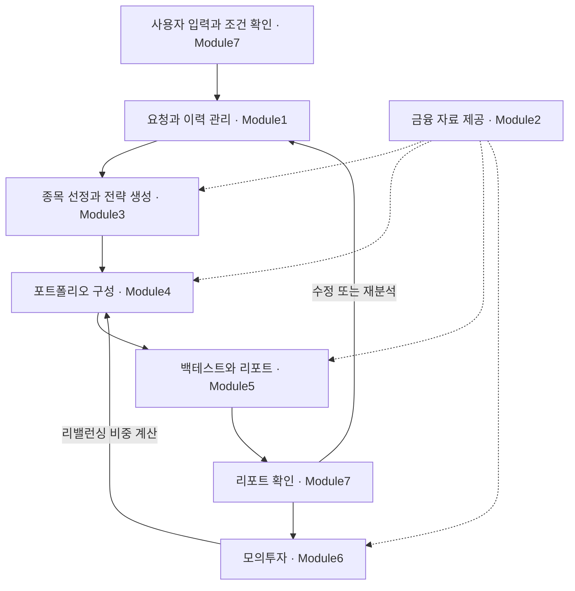

# MyFinSight 프로토타입 설계 명세

## 1. 서비스가 하는 일

MyFinSight는 사용자의 투자 아이디어를 개인 조건에 맞는 포트폴리오 전략으로 구체화하고, 과거 데이터로 검증한 결과를 리포트로 설명하는 서비스다. 사용자는 투자금, 투자기간, 위험 성향과 제약을 저장한 뒤 자연어로 아이디어를 입력한다. 시스템은 아이디어에 맞는 종목을 찾고 비중과 운용 규칙을 정한 다음, 성과와 위험을 계산해 판단에 필요한 자료를 제공한다.

예를 들어 사용자가 “반도체 산업에 투자하고 싶지만 특정 기업에 너무 집중하고 싶지는 않다”고 입력하면, 시스템은 산업 범위와 분산 조건을 확인한다. 이후 조건에 맞는 기업을 검색하고 정량 지표로 선정하며, 비중을 계산하고 백테스트를 수행한다. 최종 리포트에는 선정 과정, 기업별 근거, 포트폴리오 구성, 과거 성과와 판단의 한계가 함께 담긴다.

리포트에서 선택한 전략은 가상 자본으로 모의투자를 시작할 수 있다. 실제 계좌 연결, 주문 전송, 자동매매, 수익 보장은 구현 범위에 포함하지 않는다.

## 2. 문서 구성

이 문서는 서비스의 전체 구조와 구현 방향을 설명한다. 필드 정의, 계산식, 단계별 산출물, 오류 처리와 화면 규칙은 아래 상세 문서에서 확인한다. 기존 문서의 세부 기능 번호는 없애고, 각 모듈 안에서 하나의 처리 흐름으로 설명한다.

| 파일 | 담당 범위 |
| --- | --- |
| [Module1.md](Module1.md) | 사용자 프로필, 분석 요청, 이전 실행 이력, 수정 요청 |
| [Module2.md](Module2.md) | 금융 데이터 조회, 품질 검사, 종목 검색용 정보, 뉴스 근거 |
| [Module3.md](Module3.md) | 투자 의도 해석, 후보 검색과 분류, 정량 선정, 기업별 설명 |
| [Module4.md](Module4.md) | 기준 비중, 뉴스 기반 투자 의견, Black–Litterman, 날짜별 비중 구성 |
| [Module5.md](Module5.md) | 백테스트, 성과 지표, 조건 검증, 결과 비교, 리포트 생성 |
| [Module6.md](Module6.md) | 모의투자 등록, 일별 평가, 리밸런싱, 운용 기록 |
| [Module7.md](Module7.md) | React 화면, 사용자 동선, 백엔드 연동, 표시 규칙 |

설정, 데이터 검증, 저장소, LLM 호출과 실행 관리는 일곱 모듈이 함께 사용하는 기반 기능이다. 별도의 사용자 기능 모듈로 세지 않고 이 문서의 공통 구현 방식에 포함한다.

## 3. 전체 흐름

사용자가 화면에서 프로필과 아이디어를 입력하면 Module1이 이번 분석 조건을 조립한다. 이때 Module3의 의도 해석을 먼저 사용해 부족하거나 모호한 조건을 확인한다. 필요한 질문에 답하고 조건을 확인한 뒤 사용자가 분석을 시작하면 실행 대기열에 요청이 등록된다.

본 분석에서는 Module3이 종목과 전략 규칙을 정하고, Module4가 비중을 계산한다. Module5는 그 전략을 과거 시장에서 시뮬레이션하고 사용자 조건과 대조한 뒤 리포트를 만든다. Module2는 모든 분석 단계에 금융 자료를 제공하며, Module7은 입력부터 결과 확인까지의 화면을 담당한다. 사용자가 모의투자를 시작하면 Module6이 같은 구성 로직을 사용해 이후 성과를 기록한다.

모듈은 모두 한 줄로 실행되는 구조가 아니다. 데이터 갱신은 분석과 별도로 진행되고, 요청을 확정하는 동안에도 의도 해석을 호출한다. 모의투자는 리포트 작성 후 사용자가 따로 시작하는 기능이다.

## 4. 모듈별 역할과 구현 방향

### Module1. 사용자 정보와 분석 요청

사용자 프로필 하나를 버전별로 저장하고, 자연어 아이디어와 이번에 변경한 조건을 합쳐 분석 요청을 만든다. 수치 범위나 포함·제외 종목의 충돌은 코드로 검사한다. 해석이 필요한 조건은 Module3에 전달해 보충 질문을 만들며, 한 번에 한 질문씩 최대 다섯 번 확인한다.

조건이 확정되면 요청에 식별자를 부여하고 실행 대기열에 넣는다. 프로필, 요청, 실행 결과와 리포트를 연결해 이력을 관리한다. 재분석은 기존 요청을 최신 자료로 다시 실행하고, 수정 요청은 변경 내용을 확인한 뒤 별도 실행과 리포트로 남긴다. 프로필이나 요청을 수정해도 과거 리포트는 바뀌지 않는다.

### Module2. 금융 데이터

분석에 필요한 가격, 환율, 재무, 구성종목과 뉴스는 팀 DB에서 읽는다. 외부 자료 수집은 팀의 수집 배치가 담당한다. 분석 도중 yfinance나 웹 검색으로 부족한 자료를 보충하지 않는다.

조회할 때 기준일을 적용하고 결측과 이력 부족을 검사한다. 한국 종목은 한화로 계산한다. 미국 종목은 USD 기준으로 계산한다. 종목별 산업분류, 키워드와 사업 소개를 정리한 검색용 사전을 만들고, 뉴스에는 근거 식별자와 출처 정보를 붙인다. 과거 분석은 당시 구성종목 스냅샷을 사용한다.

### Module3. 종목 선정과 전략 생성

자연어 아이디어를 산업분류와 검색 키워드, 선정 지표와 위험 기준으로 바꾼다. LLM은 의도를 해석하고 후보의 테마 적합성을 분류한다. 후보 검색과 최종 순위 결정은 코드가 수행한다.

검색된 후보에 제외 조건, 규모와 유동성 기준을 적용한 뒤, 모멘텀·저변동성·저PER·퀄리티·고배당 중 선택한 지표로 순위를 정한다. 최종 종목과 함께 선정 지표, 제외 사유, 비중 계산 방식과 리밸런싱 규칙을 넘긴다. 기업별 설명은 DB 자료를 인용해 작성하되, 정량 선정 이유와 뉴스에 따른 해석을 구분한다.

### Module4. 포트폴리오 구성

선정 종목의 과거 수익률로 공분산과 변동성을 추정하고, 동일비중·시가총액비중·역변동성·최소분산 포트폴리오를 만든다. 사용자에게 지정된 방식이 기준 비중이 된다.

뉴스 반영이 활성화된 경우에는 구성일 직전 14일의 DB 뉴스를 LLM에 전달해 투자 의견과 신뢰도를 얻는다. 코드는 근거와 값의 범위를 확인한 뒤 Black–Litterman으로 기대수익률을 갱신하고 비중을 최적화한다. 뉴스가 부족하면 투자 의견을 만들지 않고 기준 비중을 사용한다.

핵심 구현은 `construct()`라는 공통 구성 함수다. 백테스트 시작일, 과거 리밸런싱일, 분석 기준일의 현재 구성, 모의투자 리밸런싱이 모두 이 함수를 호출한다. 백테스트 시작 시에는 종목을 당시 기준으로 다시 선정하며, 이후 리밸런싱에서는 종목을 유지하고 비중만 갱신한다.

### Module5. 백테스트와 리포트

포트폴리오와 비교지수를 같은 기간, 초기자본과 적립 조건으로 시뮬레이션한다. 고정 목표 비중을 복원하는 방식과 날짜별로 다시 계산한 비중을 적용하는 방식을 함께 평가한다. 거래비용, 적립과 리밸런싱 기록을 남기고 수익률, 최대낙폭, 변동성과 Sharpe 등을 계산한다.

계산 결과를 사용자의 손실 감내 수준, 비중 상한과 종목 수 등으로 검증한다. 조건을 통과한 포트폴리오 중 비교 우선안을 정하고, 통과안이 없으면 그 사실과 현금 혼합 대안을 설명한다. 수정안은 동일한 평가 조건에서 원안과 비교한다.

리포트의 표, 차트와 수치는 코드가 만들고, 해석 문단은 LLM이 작성한다. 숫자와 출처를 검사한 뒤 검증을 통과한 문서만 제공한다. 리포트는 기업별 근거, 포트폴리오 운용, 과거 성과와 재검토 조건을 포함한 일곱 섹션으로 구성한다.

### Module6. 모의투자

사용자가 리포트의 전략과 시작 조건을 확인하면 가상 보유 자산을 등록한다. 시작 비중은 리포트의 현재 구성을 사용하며, 시작일이 분석 기준일보다 늦으면 그 날짜의 자료로 비중을 다시 계산한다.

새 거래일 자료가 들어오면 평가액, 수익률, 낙폭과 비교지수 성과를 저장한다. 리밸런싱일에는 Module4의 구성 함수를 호출해 비중을 조정하고 가상 거래와 비용을 기록한다. 자료가 없으면 해당 날짜의 갱신을 보류하고 마지막 성공 기준일을 표시한다. 모의투자 성과와 과거 백테스트는 별도로 보여 준다.

### Module7. 사용자 화면

PC용 React 화면으로 홈, 투자 프로필, 분석 리포트와 모의투자를 제공한다. 사용자는 아이디어 입력, 보충 질문, 조건 확인, 분석 진행, 리포트 확인의 순서로 이동한다. 리포트에서 출처 확인, 조건 수정, 재분석과 모의투자로 이어진다.

화면은 API가 반환한 결과를 표시한다. 금융 지표와 비중은 백엔드에서 계산하고, 화면은 숫자 형식과 반올림만 담당한다. 진행 화면에는 실제 실행 상태를 표시하며, 근거 부족이나 데이터 지연도 해당 상태에 맞게 설명한다.

## 5. 모듈 사이에 전달하는 정보

| 전달 정보 | 생성 또는 관리 | 사용처 |
| --- | --- | --- |
| 확정 요청: 아이디어, 프로필 버전, 이번 조건, 기준일 | Module1 | Module3~6 |
| 가격·환율·재무·구성종목·검색 사전·뉴스 근거 | Module2 | Module1, Module3~6 |
| 의도: 산업 범위, 검색 규칙, 선정 지표, 위험 기준 | Module3 | Module1, Module4, Module5 |
| 선정 결과와 전략 사양: 종목, 지표, 근거, 운용 규칙 | Module3 | Module4, Module5 |
| 목표 비중: 시작일 구성, 날짜별 경로, 현재 구성 | Module4 | Module5, Module6 |
| 통합 결과와 리포트: 성과, 검증, 비교, 출처 | Module5 | Module1, Module6, Module7 |
| 가상 보유 자산, 일별 평가, 리밸런싱 기록 | Module6 | Module7 |

백테스트에 사용한 과거 구성과 분석 기준일의 현재 구성은 구분해 저장한다. 현재 비중을 과거부터 보유한 것으로 계산하거나, 현재 구성에 과거 구성의 성과를 직접 붙이지 않는다.

## 6. 공통 구현 방식

### 실행과 데이터 검증

백엔드는 Python 3.13을 기준으로 설계한다. pandas·numpy·pyarrow는 데이터 처리, Pydantic v2는 객체 검증, scipy·scikit-learn은 최적화와 추정, bt는 백테스트, SQLAlchemy·psycopg는 DB 연동, openai는 LLM 호출에 사용한다. 실제 의존성 버전은 `pyproject.toml`에서 확정해야 한다.

확정된 요청은 FIFO 대기열에 넣고 단일 워커가 `run_pipeline.py`를 실행한다. 실행마다 `run_id`와 결과 디렉터리를 생성한다. 단계별 출력은 저장 전에 검증하며, 실행 상태와 오류는 단계별로 기록한다. 취소는 단계 경계에서 처리한다. 브라우저를 닫아도 서버 실행은 계속되고, 재접속 시 상태를 다시 조회한다. 중단된 작업을 자동으로 재개하지 않는다.

실행 상태는 대기, 실행 중, 성공, 경고를 포함한 완료, 실패, 취소로 구분한다. 필수 자료 누락, 반복된 LLM 출력 오류나 최종 수치 검증 실패는 실행을 중단한다. 일부 종목 제외나 뉴스 부족처럼 처리 가능한 문제는 기록을 남기고 계속한다. 사용자 조건을 충족하는 포트폴리오가 없다는 결과는 시스템 실행 실패와 구분한다.

### 저장소와 식별자

| 저장 위치 | 저장 내용 |
| --- | --- |
| 팀AWS DB 읽기 테이블 | 시장 자료와 뉴스 |
| PostgreSQL `run_step` | 단계 상태, 시각, 요약과 오류 |
| PostgreSQL `run_artifact` | 통합 결과, 설정과 LLM 사용량 |
| PostgreSQL `report` | 완성한 리포트 |
| `module_mockup/store/data/` | 프로필, 요청, 실행 색인, 비교와 모의투자 |
| `output/<run_id>/` | 단계별 JSON, 백테스트 패널과 실행 자료 |

서비스 저장용 DB 테이블은 위 세 개를 사용한다. 새 테이블은 추가하지 않는다. 로컬 저장은 `store.py`, DB 접근은 `db.py`로 모으고 읽기·쓰기 계정을 분리한다. 로컬 JSON은 검증 후 임시 파일을 교체하는 방식으로 저장하며, JSONL 기록은 과거 줄을 수정하지 않는다. 대기열과 저장 파일을 여러 요청이 갱신할 때에는 직렬화해 기록 유실을 막아야 한다.

프로필, 요청, 실행, 리포트와 모의투자는 각 식별자로 연결한다. 단계 JSON에는 `request_id`, `stage`, `warnings`를 공통으로 둔다. 로컬 저장 객체에는 `schema_version`을 둔다. 날짜는 `YYYY-MM-DD`, 시각은 시간대를 포함한 ISO 8601, 비중은 소수로 저장한다. 금액 계산의 기준 통화는 USD다. 표시 직전까지 반올림하지 않는다.

### 설정과 LLM 호출

경로와 환경 변수는 `common.py`, 구성 파라미터는 `portfolio_config.py`, 백테스트 조건은 `backtest_config.py`, LLM 설정은 `llm_config.py`에서 관리한다. 실행에 사용한 설정 전체를 결과와 함께 저장한다. API 키와 DB 접속 정보는 `.env` 또는 환경 변수에 두고 코드와 로그에는 기록하지 않는다.

모든 LLM 호출은 `llm.py`를 거친다. 프롬프트를 저장하고 모델·단계·입력으로 캐시 키를 만든다. 같은 입력에는 저장된 응답을 재사용한다. 응답 형식이 틀리면 오류 내용을 전달해 한 번 재시도하고, 다시 실패하면 해당 단계를 중단한다. 호출별 토큰, 비용과 시간을 기록한다. 기존 결정에 따라 요청당 비용 상한은 두지 않는다. 개발 중에는 저장된 응답을 반환하는 stub 모드를 지원한다.

LLM은 의도 해석, 테마 분류, 근거 서술과 투자 의견 생성에 사용한다. 실제 성과, 재무 사실과 비중 계산은 코드가 담당한다. 투자 의견의 수익률과 신뢰도는 LLM이 제안하는 가설 값이며, 관측된 사실과 구분한다. 뉴스 제목과 URL 등 근거 정보는 DB의 값을 그대로 사용한다.

### 기준일과 통화

분석 기준일은 요청 시점에 DB에서 사용할 수 있는 최신 완료 거래일이다. 혼합 시장에서는 두 시장의 자료가 모두 완료된 기준을 사용한다. 백테스트는 기준일에서 사용자가 지정한 연수만큼 거슬러 올라가며 기본은 3년이다. 데이터 범위가 부족하면 기간을 줄이고 기록한다.

한국 종목은 거래일 환율로 USD 환산한다. 초기자본과 월 적립의 백테스트 환산은 기존 설계대로 창 시작일 환율을 사용하고, 현재 배분은 분석 기준일 환율을 사용한다. 환율에는 항상 “1 USD = X KRW”와 기준일을 붙인다. 미국·한국 거래일과 체결 시점의 세부 정책은 Module2·4·5의 확인 사항에 남긴다.

## 7. 구현 상태와 확인 사항

구현 상태는 첨부된 기존 명세에 적힌 기록을 기준으로 정리했다. 실제 저장소를 확인한 결과는 아니다. 
종목 검색·분류·정량 선정, 기준 비중·BL 계산, 백테스트·지표·검증의 핵심 코드는 기존 구현이 있다. 
DB 조회 통일, 요청 질문 흐름, 근거 인용, 공통 구성 함수와 리포트 연동은 보완이 필요하다. 
프로필·이력·수정 요청, 서비스 API, 모의투자와 화면은 설계 단계이다.

이 문서 묶음은 설계 명세다. 코드 파일명은 기존 구현과의 연결을 위해 유지했으며, 확인하지 못한 코드의 동작을 새로 보증하지 않는다.
