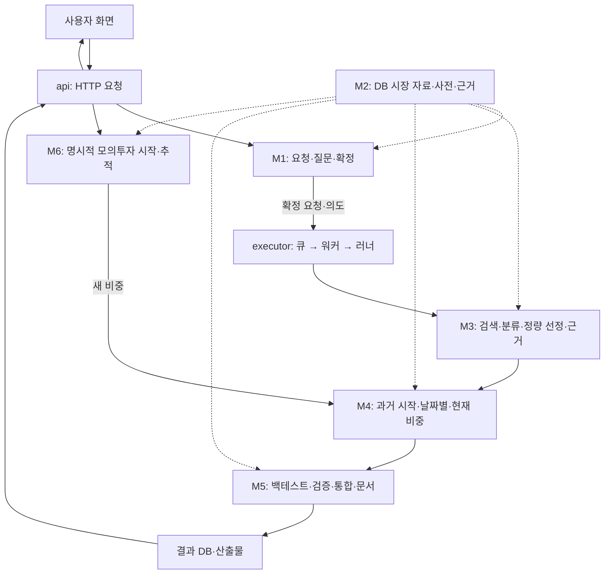

# 분석 패키지 구현보고서

`backend/analysis`의 현재 코드를 처음 접하는 개발자를 위한 구현 문서입니다. 2026-10-25 작업 공간의 실제 함수 본문·모델·호출 지점·관련 테스트를 기준으로 작성했습니다. 기존 설계 문서의 구현 상태를 그대로 옮기지 않았습니다.

## 1. 문서 구성과 읽는 순서

먼저 이 안내에서 요청의 전체 흐름을 읽고, 실행기의 의존 관계와 공통 설정·자료 계약을 확인한 뒤 관심 업무 모듈을 읽으면 됩니다. 각 보고서는 역할·파일 구성·처리 예시·클래스·전체 함수·모듈 연계·오류/검증 근거 순서입니다.

| 보고서 | 주 내용 | Python 파일 | 클래스 | 함수·메서드 |
| --- | --- | ---: | ---: | ---: |
| [api_구현보고서.md](api_구현보고서.md) | 화면이 요청하고 결과를 읽는 HTTP 입구 | 11 | 9 | 57 |
| [common_구현보고서.md](common_구현보고서.md) | 설정·경로·예외 포함 공통 기반 | 13 | 36 | 105 |
| [executor_구현보고서.md](executor_구현보고서.md) | 큐·워커·단계 의존·기록 | 8 | 6 | 55 |
| [schemas_구현보고서.md](schemas_구현보고서.md) | 입출력 모델·검증·참조 계약 | 10 | 79 | 13 |
| [m1_request_구현보고서.md](m1_request_구현보고서.md) | 프로필·대화·확정·수정 | 9 | 1 | 48 |
| [m2_data_구현보고서.md](m2_data_구현보고서.md) | 시장 view·환산·품질·근거 | 7 | 5 | 73 |
| [m3_selection_구현보고서.md](m3_selection_구현보고서.md) | 의도·후보·분류·선정·기업 설명 | 6 | 0 | 24 |
| [m4_portfolio_구현보고서.md](m4_portfolio_구현보고서.md) | 시장모형·기준 비중·BL 공통 구성 | 7 | 1 | 32 |
| [m5_backtest_report_구현보고서.md](m5_backtest_report_구현보고서.md) | 백테스트·검증 순위·리포트·저장·비교 | 12 | 2 | 169 |
| [m6_tracking_구현보고서.md](m6_tracking_구현보고서.md) | 가상 투자·평가·적립·중지/재개 | 2 | 2 | 26 |
| [eval_구현보고서.md](eval_구현보고서.md) | 시나리오·요구사항·자동 지표·채점 | 4 | 1 | 45 |

총 Python 파일 **89개**, 클래스 **142개**, 함수·메서드·중첩 함수 **647개**를 설명합니다. 이름이 같은 조건부 중첩 함수는 정의 위치를 각각 셉니다. 별도의 `def`가 없는 람다는 이 647개에 포함하지 않으며 소속 함수·설정 해설에서 역할을 설명합니다. 루트 4개 Python 파일은 common 보고서에 포함했습니다.

권장 순서: README → executor의 처리 흐름 → common·schemas → m1~m6 → api의 경로별 상세 → eval입니다. 소스 이름을 이미 안다면 각 보고서의 함수 제목에서 바로 찾아볼 수 있습니다.

## 2. 전체 시스템 흐름

사용자는 프로필과 투자 아이디어를 입력합니다. M1은 코드 검증·시장 기준일 계산·M3 의도 해석을 반복하여 조건을 확인합니다. 확정 전에도 LLM 해석과 후보 점검이 실행될 수 있습니다. 확정은 요청을 파일로 고정하고 FIFO 큐에 새 실행을 등록하는 시점입니다.

본 실행은 01 요청·자료 → 02 의도 → 03 후보 → 04 분류 → 05 정량 선정 이후, 06 기업 설명 / 07 과거 사양 / 10f 현재 구성을 독립 처리합니다. 07 이후 10 시작일 구성과 10w 날짜별 구성을 처리하고, 11 백테스트 → 12 검증 → 13 통합 → 14 문서로 이어집니다. 정확한 의존와 파일명은 executor 보고서에 있습니다.

## 3. 처음 읽을 때 구분할 개념

| 구분 | 의미 |
| --- | --- |
| 선정 방식 / 비중 방식 | 어떤 지표로 종목을 고를지 / 그 종목에 얼마씩 나눌지 |
| 현재 선정 / 과거 시작 재선정 | 분석 기준일 목록 / 백테스트 첫날 자료로 다시 고른 목록 |
| 시작일 고정 / 날짜별 경로 / 현재 구성 | 과거 초기 비중을 반복 복원 / 날짜마다 비중 재추정 / 현재일 제안 |
| 시장 상한 / 공통 기준일 | 시장별 마지막 가격일의 최솟값 / 실제 모두 거래한 날짜로 추가 보정 |
| 추정 / 체결 | 기본 t-1까지 정보 / t 종가 가격 |
| USD 계산 / 원화 표시 | 한국 가격은 날짜별 환율로 USD 환산 / 결과 화면용 원화 금액은 별도 환율 기준 |
| index / value_usd / XIRR | 유입 분리 성과 지수 / 납입 포함 평가액 / 현금흐름 시점 반영 수익 |
| 사용자 조건 판정 / 문서 게이트 | 추천 순위·주의·무결성 / 문서 구조·인용·표현의 제공 가능 여부 |
| warning user/info/debug | 사용자 확인 필요 / 참고 / 개발 원문 |
| request_id / run_id / report_id | 대화 요청 / 실행 시도 / 정상 저장 리포트(현재 run_id와 동일) |

LLM은 의도·질문 제안·테마 판정·근거 의견·서술을 맡습니다. 조회·필드 변경·지표·비중·성과·추천 순위는 코드가 수행합니다. ev/dc/fin/calc 인용 ID는 설명과 실제 DB 메타·계산값을 연결합니다. 이는 문장의 모든 인과관계를 증명하는 장치는 아닙니다.

## 4. 코드에서 확인한 현재 정책과 한계

- 질문 상한에 닿으면 남은 조건을 기본값으로 두고 ready로 진행합니다. 현재 경로를 과거의 blocked 정책으로 설명하지 않습니다.
- 최대낙폭 초과는 flag와 순위 신호이고 후보가 있으면 1위 하나를 선택합니다. 낙폭 맞춤안은 실제 일정으로 재평가한 정식 후보이며 같은 과거 창에 비율을 맞춘 사후 비교라는 한계가 있습니다.
- 리포트 인용·섹션·금지 표현 오류는 최종 실패를 만들지만 숫자 대조는 기본 경고입니다. 모든 무결성 실패 후보를 자동 삭제하는 추천 정책은 아닙니다.
- 과거 시작 재선정도 고정 사전과 재사용한 테마 분류의 영향을 받습니다. 과거 사전이 없으면 가장 오래된 버전을 경고와 함께 써 생존 편향이 남습니다.
- 모의투자 preview는 저장된 승인 계획이 아니며 create가 다시 계산합니다. 상태 JSON·거래/평가 JSONL은 한 트랜잭션이 아니고 적립일의 기존 보유 조정 방식도 백테스트와 차이가 있습니다.
- 운영 DB와 유료 LLM 없이 문서·코드 구조를 검증했습니다. 관련 테스트의 존재·시나리오 확인과 실제 테스트 실행 결과는 구분합니다.

## 5. 확인 범위와 유지보수

문서 범위는 [backend/analysis](../../backend/analysis/)와 그 리소스입니다. 외부 [DB 읽기](../../backend/db/analysis_readers.py)·[저장](../../backend/db/sql.py)·[품질](../../backend/pipeline/quality.py)·[사전](../../backend/pipeline/descriptor.py)·[기존 테스트](../../backend/tests/analysis/)는 연계 계약을 확인하는 범위로 읽었습니다. Front나 데이터 수집기 전체를 이 보고서의 별도 구현 모듈로 포함하지 않았습니다.

각 함수·클래스에는 상대 소스 링크, 실제 시그니처, 처리 설명, 확인 가능한 내부 직접 호출·호출자 링크를 제공합니다. 동적 의존성 주입·Repository·콜백의 모든 실행 가능 경로를 정적 호출 목록이 완전히 표현하지는 않으며 모듈 흐름 설명과 함께 읽습니다. 각 소스 심볼의 경로·정의 위치를 문서 내부 메타로 보관해 구문 분석 목록과 누락을 대조했습니다.

이번 검증은 789개 정의(클래스 142 + 함수 647)의 일대일 문서 대응, 전체 Python 파일 책임 표 포함, 로컬 소스/테스트/리소스 링크, 문서 간 앵커, API 경로·실행 단계·모델 기본값 대조입니다. 실제 금융 데이터 정확성·운영 결과·성능·LLM 서술 품질을 실행 검증한 기록은 아닙니다.

코드가 바뀌면 해당 함수·클래스뿐 아니라 소비 모듈, 기본값 표, API 경로, 단계 의존, 리소스 계약, 검증 근거도 함께 갱신해야 합니다. 소스 링크의 줄 번호는 작성 시점 위치이므로 이후 줄 이동 시 갱신이 필요합니다.
