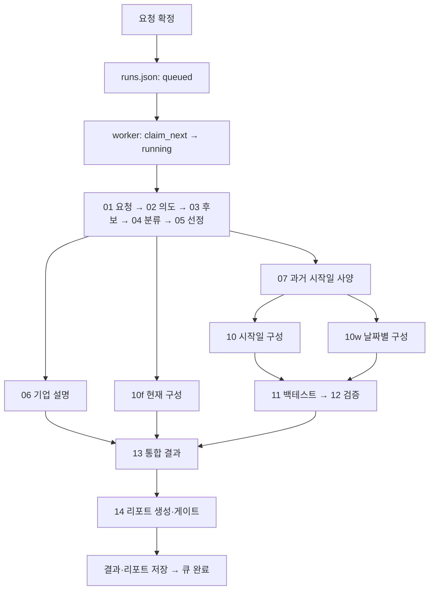

# executor 구현보고서

[전체 안내](README.md)

> 작성 기준: 2026-10-25 작업 공간의 실제 소스. 기존 설계 문서는 배경 참고용이며 아래 동작 설명은 구현을 기준으로 합니다.

대상: Python 파일 8개 · 클래스 6개 · 함수/메서드 55개(중첩 함수와 비공개 보조 함수 포함).

[역할](#role) · [파일 구성](#files) · [처리 흐름](#flow) · [클래스](#classes) · [함수](#functions) · [모듈 연계](#interactions) · [오류·검증](#verification)

<a id="role"></a>
## 1. 모듈의 역할과 용어

`executor`는 확정 요청을 언제·어떤 순서로 실행하고 어떻게 기록할지를 담당합니다. Queue는 대기 순서, worker는 실제 작업 프로세스, runner는 한 실행의 단계 순서·상태, Stage는 개별 단계의 정의입니다. `RunContext`는 한 실행의 입력과 중간 결과를 공유합니다.

FIFO는 먼저 등록한 작업부터 처리한다는 뜻입니다. 이 구현은 워커 실행 한 건을 선점하면서 그 실행 내부의 독립 단계·날짜·배치를 여러 스레드로 처리할 수 있습니다. 의존 관계가 끝난 단계 묶음을 코드에서는 wave라고 부릅니다.

서비스 진입은 `worker.run_once()` → `execute_run()` → `runner.run()`입니다. 개발 CLI는 큐와 확정 대화를 거치지 않고 runner를 직접 부릅니다.

<a id="files"></a>
## 2. 파일 구성과 책임

| 파일 | 책임 | 문서 내 해설 |
| --- | --- | --- |
| [executor/__init__.py](../../backend/analysis/executor/__init__.py) | 패키지 목적 설명; 독립 함수·클래스 정의 없음 | 정의 없음 |
| [executor/cli.py](../../backend/analysis/executor/cli.py) | 큐 없는 개발용 직접 실행 | [클래스 0 · 함수 1](#file-executor-cli-py) |
| [executor/context.py](../../backend/analysis/executor/context.py) | 실행별 입력·중간 결과·근거·경고 공유 | [클래스 1 · 함수 7](#file-executor-context-py) |
| [executor/parallel.py](../../backend/analysis/executor/parallel.py) | 입력 순서 보존·예외/취소를 갖춘 스레드 병렬 도우미 | [클래스 1 · 함수 3](#file-executor-parallel-py) |
| [executor/queue.py](../../backend/analysis/executor/queue.py) | runs.json 기반 FIFO·선점·취소·죽은 워커 복구 | [클래스 1 · 함수 14](#file-executor-queue-py) |
| [executor/runner.py](../../backend/analysis/executor/runner.py) | 의존 단계 묶음 실행·상태·산출물·메타 기록 | [클래스 2 · 함수 7](#file-executor-runner-py) |
| [executor/stages.py](../../backend/analysis/executor/stages.py) | Stage 레지스트리·업무 함수 연결·산출물 파일명 | [클래스 1 · 함수 20](#file-executor-stages-py) |
| [executor/worker.py](../../backend/analysis/executor/worker.py) | 단일 워커·확정 요청 실행·DB 저장·유휴 모의투자 갱신 | [클래스 0 · 함수 3](#file-executor-worker-py) |

<a id="flow"></a>
## 3. 처리 흐름과 예시



독립 단계 `06/07/10f`와 `10/10w`를 묶어 실행합니다. `08_market_model`, `08_baseline_portfolios`, `09_views`는 `10_targets`가 내는 파일이며 독립 Stage가 아닙니다. 따라서 파일 번호만 보고 실행 순서를 추측하면 안 됩니다.

예를 들어 뉴스 근거가 부족해 기준 비중을 유지한 `info` 경고는 단계 SUCCESS일 수 있습니다. 반면 최적화 실패로 기준 비중을 사용하고 user 경고가 발생하면 PARTIAL입니다. 단계 예외는 FAILED, 남은 미실행 단계는 CANCELLED가 되며, 이미 같은 묶음에서 돌고 있는 단계는 종료를 기다립니다.

실행 상태는 소문자 queued/running/success/partial/failed/cancelled이고 단계 상태는 대문자입니다. API의 cancelling은 running과 취소 요청 시각을 합친 화면 표시입니다. 재시도 API는 새 run_id로 전체를 다시 실행합니다.

주요 파일은 01 요청, 02 의도, 03 후보, 04 분류, 05 선정, 06 기업 설명, 07 사양 및 과거 재선정, 08 시장모형/기준 비중, 09 의견, 10 시작 타겟, 10w 날짜 경로, 10f 현재 구성, 11 백테스트, 12 검증, 13 통합, 14 문서입니다. 정확한 파일명은 아래 단계 레지스트리 표로 연결합니다.

### 실행 레지스트리와 파일 매핑

| Stage | 화면 묶음 | 선행 Stage | 함수 |
| --- | --- | --- | --- |
| `01_request` | `conditions` | `()` | `st_request` |
| `02_intent` | `conditions` | `('01_request',)` | `st_intent` |
| `03_candidates` | `candidates` | `('02_intent',)` | `st_candidates` |
| `04_tagging` | `candidates` | `('03_candidates',)` | `st_tagging` |
| `05_selection` | `candidates` | `('04_tagging',)` | `st_selection` |
| `06_explain` | `candidates` | `('05_selection',)` | `st_explain` |
| `07_backtest_spec` | `candidates` | `('05_selection',)` | `st_backtest_spec` |
| `10f_current` | `candidates` | `('05_selection',)` | `st_forward` |
| `10_targets` | `candidates` | `('07_backtest_spec',)` | `st_targets` |
| `10w_paths` | `candidates` | `('07_backtest_spec',)` | `st_walkforward` |
| `11_backtest` | `backtest` | `('10_targets', '10w_paths')` | `st_backtest` |
| `12_validation` | `validation` | `('11_backtest',)` | `st_validation` |
| `13_results` | `report` | `('06_explain', '10f_current', '12_validation')` | `st_results` |
| `14_report` | `report` | `('13_results',)` | `st_report` |

| outputs 키 | 실행 디렉터리의 파일 |
| --- | --- |
| `01_request` | `01_request.json` |
| `02_intent` | `02_intent.json` |
| `03_candidates` | `03_candidates.json` |
| `04_tagging` | `04_tagging.json` |
| `05_selection` | `05_selection.json` |
| `06_selection_explained` | `06_selection_explained.json` |
| `07_backtest_spec` | `07_backtest_spec.json` |
| `07_candidates_bt` | `07_candidates_bt.json` |
| `07_tagging_bt` | `07_tagging_bt.json` |
| `07_selection_bt` | `07_selection_bt.json` |
| `08_market_model` | `08_market_model.json` |
| `08_baseline_portfolios` | `08_baseline_portfolios.json` |
| `09_views` | `09_views.json` |
| `10_target_portfolios` | `10_target_portfolios.json` |
| `10w_target_paths` | `10w_target_paths.json` |
| `10f_forward_portfolios` | `10f_forward_portfolios.json` |
| `11_backtest_results` | `11_backtest_results.json` |
| `12_validation` | `12_validation.json` |
| `13_results` | `13_results.json` |
| `14_report` | `14_report.json` |

<a id="classes"></a>
## 4. 클래스 상세

필드 표는 해당 클래스에서 직접 선언한 필드입니다. 상속 필드는 부모 클래스 설명을 함께 읽습니다. `Field(...)`의 범위는 선언된 검증이며, 서비스에서 추가하는 조건은 함수 설명에 구분합니다.

<a id="executor-context-py-RunContext-19"></a>
### `RunContext`

<!-- source-symbol: executor/context.py:19:RunContext -->
[context.py](../../backend/analysis/executor/context.py#L19)

실행 한 건이 공유하는 상태입니다. 요청·DB·MarketData·LLM·설정·산출물 경로를 주입받고 outputs·facts·단계별 근거 창·구조화 경고·요약·진행/취소 콜백을 보관합니다. 병렬 단계는 의존 관계로 쓰기 순서를 통제합니다.

기반: `명시적 부모 없음` · 선언: `dataclass`.

| 필드 | 자료형 | 기본값 또는 생성 방식 | 선언된 제약·설명 |
| --- | --- | --- | --- |
| `run_id` | `str` | `필수 입력` | 분석 실행 시도의 ID |
| `request` | `dict[str, Any]` | `필수 입력` | 분석 조건의 요청 사전 |
| `repo` | `Any` | `필수 입력` | 시장/결과 Repository 인터페이스 |
| `md` | `MarketData` | `필수 입력` | 공유 시장 자료 캐시 |
| `llm` | `LlmClient` | `필수 입력` | 실제 또는 stub LLM 호출기 |
| `settings` | `AnalysisSettings` | `필수 입력` | 실행 설정 묶음 |
| `run_dir` | `Path` | `필수 입력` | 실행 산출물 저장 디렉터리 |
| `desc` | `Descriptor \| None` | `None` | 실행 기준일에 고정한 종목 사전 |
| `desc_info` | `dict[str, Any]` | `생성 함수: dict` | 사전 버전·종목 수·제약 메타 |
| `intent` | `dict[str, Any] \| None` | `None` | 검증·보정한 투자 해석 명세 |
| `bt_req` | `BacktestRequest \| None` | `None` | 선택적인 개발/추가 백테스트 요청 |
| `allow_fewer_at_start` | `bool` | `False` | 종목이 부족해도 과거 기간 유지 선택 |
| `cancel_check` | `Callable[[], bool]` | `lambda: False` | 취소 요청 확인 콜백 |
| `outputs` | `dict[str, Any]` | `생성 함수: dict` | 단계명→중간/최종 산출물 |
| `facts` | `list[dict[str, Any]]` | `생성 함수: list` | 정량 지표의 인용 사실 목록 |
| `news_by_stage` | `dict[str, list[dict[str, Any]]]` | `생성 함수: dict` | 완료 순서와 분리한 단계별 근거 창 |
| `warnings` | `list[Warning]` | `생성 함수: list` | 문맥별 전체 경고 또는 문장 검사 메모 |
| `step_summaries` | `dict[str, str]` | `생성 함수: dict` | 단계별 한국어 처리 요약 |
| `progress` | `Callable[[str, int, int], None]` | `lambda stage, i, n: None` | 긴 작업의 완료 수 통지 콜백 |

메서드·속성: [request_id](#executor-context-py-RunContext-request_id-41), [out](#executor-context-py-RunContext-out-44), [warn](#executor-context-py-RunContext-warn-49), [warn_all](#executor-context-py-RunContext-warn_all-55), [warnings_of](#executor-context-py-RunContext-warnings_of-59), [add_news_window](#executor-context-py-RunContext-add_news_window-62), [news_windows](#executor-context-py-RunContext-news_windows-66).


<a id="executor-parallel-py-_Skipped-20"></a>
### `_Skipped`

<!-- source-symbol: executor/parallel.py:20:_Skipped -->
[parallel.py](../../backend/analysis/executor/parallel.py#L20)

앞선 실패·취소로 시작하지 않은 병렬 항목을 내부적으로 구분하는 예외입니다. 사용자에게 직접 제공할 오류 종류가 아닙니다.

기반: `Exception`.

직접 정의한 메서드는 없습니다. 부모의 동작과 위 상수/계약을 사용합니다.


<a id="executor-queue-py-Queue-21"></a>
### `Queue`

<!-- source-symbol: executor/queue.py:21:Queue -->
[queue.py](../../backend/analysis/executor/queue.py#L21)

RunIndex와 파일 잠금으로 단일 실행 FIFO를 구현합니다. JSON 파일에 영속 상태를 남기며 별도 메시지 브로커를 사용하지 않습니다.

기반: `명시적 부모 없음`.

메서드·속성: [__init__](#executor-queue-py-Queue-__init__-22), [enqueue](#executor-queue-py-Queue-enqueue-27), [position](#executor-queue-py-Queue-position-37), [get](#executor-queue-py-Queue-get-49), [remove](#executor-queue-py-Queue-remove-52), [list](#executor-queue-py-Queue-list-62), [length](#executor-queue-py-Queue-length-66), [claim_next](#executor-queue-py-Queue-claim_next-70), [finish](#executor-queue-py-Queue-finish-84), [request_cancel](#executor-queue-py-Queue-request_cancel-89), [is_cancel_requested](#executor-queue-py-Queue-is_cancel_requested-104), [recover_stale](#executor-queue-py-Queue-recover_stale-110).


<a id="executor-runner-py-StepResult-33"></a>
### `StepResult`

<!-- source-symbol: executor/runner.py:33:StepResult -->
[runner.py](../../backend/analysis/executor/runner.py#L33)

한 단계의 시작/끝·상태·요약·오류·소요시간 레코드입니다. runner가 메모리에서 관리하고 run_meta에 직렬화합니다.

기반: `명시적 부모 없음` · 선언: `dataclass`.

| 필드 | 자료형 | 기본값 또는 생성 방식 | 선언된 제약·설명 |
| --- | --- | --- | --- |
| `name` | `str` | `필수 입력` | 종목·객체 이름 |
| `status` | `str` | `필수 입력` | 소속 객체의 처리 상태 |
| `started_at` | `str \| None` | `None` | 실행·단계 시작 시각 |
| `ended_at` | `str \| None` | `None` | 단계 종료 시각 |
| `summary` | `str \| None` | `None` | 객체별 요약 또는 대시보드 |
| `error_code` | `str \| None` | `None` | 안정된 업무 오류 코드 |
| `error_message` | `str \| None` | `None` | 실패 원인 설명 |
| `elapsed_s` | `float \| None` | `None` | 실행·단계 소요 초 |


<a id="executor-runner-py-RunOutcome-45"></a>
### `RunOutcome`

<!-- source-symbol: executor/runner.py:45:RunOutcome -->
[runner.py](../../backend/analysis/executor/runner.py#L45)

실행 최종 상태·단계 목록·대표 오류·공지를 담는 러너 반환 객체입니다. DB 저장 여부와 최종 큐 상태 확정은 워커가 이어서 처리합니다.

기반: `명시적 부모 없음` · 선언: `dataclass`.

| 필드 | 자료형 | 기본값 또는 생성 방식 | 선언된 제약·설명 |
| --- | --- | --- | --- |
| `run_id` | `str` | `필수 입력` | 분석 실행 시도의 ID |
| `status` | `str` | `필수 입력` | 소속 객체의 처리 상태 |
| `steps` | `list[StepResult]` | `생성 함수: list` | — |
| `error` | `dict[str, Any] \| None` | `None` | 실행 대표 실패 정보 |
| `notices` | `list[dict[str, Any]]` | `생성 함수: list` | 사용자 확인이 필요한 공지 |

메서드·속성: [to_dict](#executor-runner-py-RunOutcome-to_dict-52).


<a id="executor-stages-py-Stage-36"></a>
### `Stage`

<!-- source-symbol: executor/stages.py:36:Stage -->
[stages.py](../../backend/analysis/executor/stages.py#L36)

실행 레지스트리의 불변 항목입니다. name·한국어 라벨·화면 bucket·실행 fn, 활성화 when, 선행 deps를 보관합니다. 단계 이름과 산출물 파일 번호는 일대일이 아닙니다.

기반: `명시적 부모 없음` · 선언: `dataclass(frozen=True)`.

| 필드 | 자료형 | 기본값 또는 생성 방식 | 선언된 제약·설명 |
| --- | --- | --- | --- |
| `name` | `str` | `필수 입력` | run_step에 기록할 실행 단계 ID |
| `label_ko` | `str` | `필수 입력` | 한국어 표시 라벨 |
| `bucket` | `str` | `필수 입력` | 화면 진행 묶음 ID |
| `fn` | `Callable[[RunContext], str]` | `필수 입력` | 실행할 단계 함수 |
| `when` | `Callable[[RunContext], bool]` | `lambda ctx: True` | 단계 활성화 조건 콜백 |
| `deps` | `tuple[str, ...] \| None` | `None` | 선행 단계 이름; None은 직전 단계 |


<a id="functions"></a>
## 5. 함수·메서드 상세

시그니처에 입력 자료형·기본값·반환 자료형을 그대로 기재했습니다. `self`는 소속 클래스의 인스턴스, `cls`는 클래스입니다. 반환 주석이 없는 함수는 본문 해설의 반환 내용을 따릅니다. 속성(`property`)은 호출 괄호 없이 읽고, 중첩 함수는 바깥 함수의 지역 상태를 공유합니다. 연결 목록은 정적으로 확인되는 패키지 내부 직접 호출이며, 주입된 서비스·콜백·Repository 호출은 처리 흐름과 해설에서 설명합니다.


<a id="file-executor-cli-py"></a>
### executor/cli.py


<a id="executor-cli-py-main-27"></a>
#### `main`

<!-- source-symbol: executor/cli.py:27:main -->
[cli.py](../../backend/analysis/executor/cli.py#L27)

```python
def main(argv: list[str] | None=None) -> int: ...
```

요청 JSON/JSONC·선택 백테스트 사양·기준일·LLM 모드·DB를 인자로 받아 큐 없이 RunContext와 러너를 실행합니다. 단계 결과를 출력하고 success/partial이면 0, 나머지는 1을 반환합니다. API 확정 대화와 워커의 DB 결과 저장 경로를 모두 거치는 명령은 아닙니다.

직접 연결: [AnalysisSettings.load](common_구현보고서.md#settings-py-AnalysisSettings-load-256), [replace_settings](common_구현보고서.md#settings-py-replace_settings-302), [open_analysis_repository](common_구현보고서.md#common-dbconn-py-open_analysis_repository-75), [MarketData](m2_data_구현보고서.md#m2_data-market_data-py-MarketData-56), [load_jsonc](common_구현보고서.md#common-jsonio-py-load_jsonc-15), [load_json](common_구현보고서.md#common-jsonio-py-load_json-23), [new_run_id](common_구현보고서.md#common-store-py-new_run_id-103), [run_dir](common_구현보고서.md#paths-py-run_dir-27), [make_llm](common_구현보고서.md#common-llm-py-make_llm-363), [RunContext](#executor-context-py-RunContext-19), [run](#executor-runner-py-run-92).


<a id="file-executor-context-py"></a>
### executor/context.py


<a id="executor-context-py-RunContext-request_id-41"></a>
#### `RunContext.request_id`

<!-- source-symbol: executor/context.py:41:RunContext.request_id -->
[context.py](../../backend/analysis/executor/context.py#L41)

```python
def request_id(self) -> str: ...
```

현재 요청 사전의 request_id를 읽는 속성입니다.

선언·진입 조건: `property`.


<a id="executor-context-py-RunContext-out-44"></a>
#### `RunContext.out`

<!-- source-symbol: executor/context.py:44:RunContext.out -->
[context.py](../../backend/analysis/executor/context.py#L44)

```python
def out(self, name: str) -> Any: ...
```

이름으로 공유 outputs를 조회합니다. 아직 없는 선행 산출물은 KeyError로 알려 잘못된 단계 의존을 조용히 넘기지 않습니다.

명시적으로 발생시키는 예외: `KeyError`. 발생 조건은 위 해설과 소스의 분기를 함께 확인합니다.


<a id="executor-context-py-RunContext-warn-49"></a>
#### `RunContext.warn`

<!-- source-symbol: executor/context.py:49:RunContext.warn -->
[context.py](../../backend/analysis/executor/context.py#L49)

```python
def warn(self, stage: str, message_or_code: str, *, dates: list[str] | None=None, **fmt: Any) -> Warning: ...
```

카탈로그 코드는 구조화 경고로 만들고 일반 문자열은 레거시 파서로 변환해 공통 경고 목록에 추가·반환합니다.

직접 연결: [make](common_구현보고서.md#common-warnings-py-make-108), [from_text](common_구현보고서.md#common-warnings-py-from_text-128).

호출하는 코드: [RunContext.warn_all](#executor-context-py-RunContext-warn_all-55).


<a id="executor-context-py-RunContext-warn_all-55"></a>
#### `RunContext.warn_all`

<!-- source-symbol: executor/context.py:55:RunContext.warn_all -->
[context.py](../../backend/analysis/executor/context.py#L55)

```python
def warn_all(self, stage: str, messages: list[str], *, dates: list[str] | None=None) -> None: ...
```

여러 문자열 경고를 같은 단계·날짜 정보로 warn에 전달합니다.

직접 연결: [RunContext.warn](#executor-context-py-RunContext-warn-49).


<a id="executor-context-py-RunContext-warnings_of-59"></a>
#### `RunContext.warnings_of`

<!-- source-symbol: executor/context.py:59:RunContext.warnings_of -->
[context.py](../../backend/analysis/executor/context.py#L59)

```python
def warnings_of(self, stage: str) -> list[Warning]: ...
```

특정 단계의 경고만 반환합니다. 러너가 이 목록 중 user 등급 존재 여부로 PARTIAL을 결정합니다.


<a id="executor-context-py-RunContext-add_news_window-62"></a>
#### `RunContext.add_news_window`

<!-- source-symbol: executor/context.py:62:RunContext.add_news_window -->
[context.py](../../backend/analysis/executor/context.py#L62)

```python
def add_news_window(self, stage: str, window: dict[str, Any]) -> None: ...
```

단계별 근거 창 목록에 창 사전을 추가합니다. 실제 통합 순서는 news_windows 속성이 정합니다.


<a id="executor-context-py-RunContext-news_windows-66"></a>
#### `RunContext.news_windows`

<!-- source-symbol: executor/context.py:66:RunContext.news_windows -->
[context.py](../../backend/analysis/executor/context.py#L66)

```python
def news_windows(self) -> list[dict[str, Any]]: ...
```

06_explain→10_targets→10w_paths→10f_current 순으로 근거 창을 펼칩니다. 병렬 완료 순서가 색인 순서에 영향을 주지 않게 하는 조립 규칙입니다.

선언·진입 조건: `property`.


<a id="file-executor-parallel-py"></a>
### executor/parallel.py


<a id="executor-parallel-py-map_ordered-24"></a>
#### `map_ordered`

<!-- source-symbol: executor/parallel.py:24:map_ordered -->
[parallel.py](../../backend/analysis/executor/parallel.py#L24)

```python
def map_ordered(items: Sequence[T], fn: Callable[[T], R], *, max_workers: int=1, on_done: Callable[[int, int], None] | None=None, cancel_check: Callable[[], bool] | None=None) -> list[R]: ...
```

입력 항목에 fn을 최대 max_workers개로 실행하고 결과는 입력 순서로 반환합니다. 취소·오류 발생 시 아직 시작하지 않은 항목을 취소/건너뛰고 진행 중 호출은 종료를 기다립니다. 실제 오류가 여러 개면 입력 위치가 가장 앞인 오류를 다시 발생시킵니다. on_done은 정상 완료 개수를 전달합니다.

직접 연결: [CancelRequested](common_구현보고서.md#errors-py-CancelRequested-66), [_Skipped](#executor-parallel-py-_Skipped-20).

호출하는 코드: [run_ordered](#executor-parallel-py-run_ordered-88), [classify](m3_selection_구현보고서.md#m3_selection-classify-py-classify-31).

명시적으로 발생시키는 예외: `CancelRequested`, `real[0][1]`. 발생 조건은 위 해설과 소스의 분기를 함께 확인합니다.


<a id="executor-parallel-py-map_ordered-_wrapped-47"></a>
#### `map_ordered._wrapped`

<!-- source-symbol: executor/parallel.py:47:map_ordered._wrapped -->
[parallel.py](../../backend/analysis/executor/parallel.py#L47)

```python
def _wrapped(it: T) -> R: ...
```

각 작업 시작 직전에 중단 이벤트와 취소 조건을 확인합니다. 중단된 항목은 _Skipped를 발생시키고 그 외는 fn을 호출해 반환합니다.

직접 연결: [_Skipped](#executor-parallel-py-_Skipped-20).

명시적으로 발생시키는 예외: `_Skipped`. 발생 조건은 위 해설과 소스의 분기를 함께 확인합니다.


<a id="executor-parallel-py-run_ordered-88"></a>
#### `run_ordered`

<!-- source-symbol: executor/parallel.py:88:run_ordered -->
[parallel.py](../../backend/analysis/executor/parallel.py#L88)

```python
def run_ordered(ctx: Any, stage: str, items: Sequence[T], fn: Callable[[T], R], *, max_workers: int) -> list[R]: ...
```

RunContext의 진행 콜백과 취소 확인을 map_ordered에 연결합니다. 호출 단계 이름으로 완료 수/전체 수를 전달합니다.

직접 연결: [map_ordered](#executor-parallel-py-map_ordered-24).

호출하는 코드: [st_walkforward](#executor-stages-py-st_walkforward-174).


<a id="file-executor-queue-py"></a>
### executor/queue.py


<a id="executor-queue-py-Queue-__init__-22"></a>
#### `Queue.__init__`

<!-- source-symbol: executor/queue.py:22:Queue.__init__ -->
[queue.py](../../backend/analysis/executor/queue.py#L22)

```python
def __init__(self, store: JsonStore) -> None: ...
```

공유 JsonStore와 RunIndex를 보관해 runs.json을 큐 상태의 원본으로 사용합니다.

직접 연결: [RunIndex](common_구현보고서.md#common-store-py-RunIndex-186).


<a id="executor-queue-py-Queue-enqueue-27"></a>
#### `Queue.enqueue`

<!-- source-symbol: executor/queue.py:27:Queue.enqueue -->
[queue.py](../../backend/analysis/executor/queue.py#L27)

```python
def enqueue(self, run_id: str, request_id: str, *, llm_mode: str | None=None, scenario: str | None=None) -> int: ...
```

색인 잠금 안에서 중복 run_id를 거부하고 queued 항목을 등록한 뒤 대기 순번을 반환합니다. 산출물 경로·LLM 모드·시나리오도 색인에 남깁니다.

직접 연결: [Conflict](common_구현보고서.md#errors-py-Conflict-78), [RunIndexEntry](schemas_구현보고서.md#schemas-run-py-RunIndexEntry-21), [now_iso](common_구현보고서.md#common-jsonio-py-now_iso-56), [run_dir](common_구현보고서.md#paths-py-run_dir-27), [Queue.position](#executor-queue-py-Queue-position-37).

명시적으로 발생시키는 예외: `Conflict`. 발생 조건은 위 해설과 소스의 분기를 함께 확인합니다.


<a id="executor-queue-py-Queue-position-37"></a>
#### `Queue.position`

<!-- source-symbol: executor/queue.py:37:Queue.position -->
[queue.py](../../backend/analysis/executor/queue.py#L37)

```python
def position(self, run_id: str) -> int | None: ...
```

queued 중 등록순 위치를 1부터 세고 running 건이 있으면 1을 더합니다. queued가 아니면 None, 없는 실행이면 NotFound입니다. 남은 시간 추정값은 아닙니다.

직접 연결: [NotFound](common_구현보고서.md#errors-py-NotFound-73).

호출하는 코드: [Queue.enqueue](#executor-queue-py-Queue-enqueue-27).

명시적으로 발생시키는 예외: `NotFound`. 발생 조건은 위 해설과 소스의 분기를 함께 확인합니다.


<a id="executor-queue-py-Queue-get-49"></a>
#### `Queue.get`

<!-- source-symbol: executor/queue.py:49:Queue.get -->
[queue.py](../../backend/analysis/executor/queue.py#L49)

```python
def get(self, run_id: str) -> RunIndexEntry: ...
```

RunIndex에서 실행 ID 한 건을 반환합니다.


<a id="executor-queue-py-Queue-remove-52"></a>
#### `Queue.remove`

<!-- source-symbol: executor/queue.py:52:Queue.remove -->
[queue.py](../../backend/analysis/executor/queue.py#L52)

```python
def remove(self, run_id: str) -> bool: ...
```

queued/running이 아닌 실행의 색인 항목을 잠금 안에서 제거하고 성공 여부를 반환합니다. 실제 산출물·리포트·요청 파일을 지우지는 않습니다.


<a id="executor-queue-py-Queue-list-62"></a>
#### `Queue.list`

<!-- source-symbol: executor/queue.py:62:Queue.list -->
[queue.py](../../backend/analysis/executor/queue.py#L62)

```python
def list(self, limit: int | None=None) -> list[RunIndexEntry]: ...
```

전체 실행을 queued_at 최신순으로 정렬하고 선택 limit를 적용합니다.


<a id="executor-queue-py-Queue-length-66"></a>
#### `Queue.length`

<!-- source-symbol: executor/queue.py:66:Queue.length -->
[queue.py](../../backend/analysis/executor/queue.py#L66)

```python
def length(self) -> int: ...
```

queued 상태의 건수만 셉니다. 실행 중 작업은 포함하지 않습니다.


<a id="executor-queue-py-Queue-claim_next-70"></a>
#### `Queue.claim_next`

<!-- source-symbol: executor/queue.py:70:Queue.claim_next -->
[queue.py](../../backend/analysis/executor/queue.py#L70)

```python
def claim_next(self, worker_pid: int | None=None) -> RunIndexEntry | None: ...
```

색인 잠금 안에서 running이 없는 경우 가장 오래된 queued 하나를 running으로 바꾸고 PID·시작시각을 기록합니다. 처리할 항목이 없거나 다른 실행이 있으면 None입니다.

직접 연결: [now_iso](common_구현보고서.md#common-jsonio-py-now_iso-56).


<a id="executor-queue-py-Queue-finish-84"></a>
#### `Queue.finish`

<!-- source-symbol: executor/queue.py:84:Queue.finish -->
[queue.py](../../backend/analysis/executor/queue.py#L84)

```python
def finish(self, run_id: str, status: str, *, report_id: str | None=None, error_code: str | None=None, error_message: str | None=None) -> RunIndexEntry: ...
```

종료 상태가 success/partial/failed/cancelled 중 하나인지 확인하고 종료시각·리포트 ID·오류를 색인에 저장한 항목을 반환합니다.

직접 연결: [now_iso](common_구현보고서.md#common-jsonio-py-now_iso-56).

명시적으로 발생시키는 예외: `ValueError`. 발생 조건은 위 해설과 소스의 분기를 함께 확인합니다.


<a id="executor-queue-py-Queue-request_cancel-89"></a>
#### `Queue.request_cancel`

<!-- source-symbol: executor/queue.py:89:Queue.request_cancel -->
[queue.py](../../backend/analysis/executor/queue.py#L89)

```python
def request_cancel(self, run_id: str) -> RunIndexEntry: ...
```

대기 중 실행은 즉시 cancelled, 실행 중은 cancel_requested_at만 기록합니다. 이미 종료된 실행은 변경하지 않고 반환합니다.

직접 연결: [NotFound](common_구현보고서.md#errors-py-NotFound-73), [now_iso](common_구현보고서.md#common-jsonio-py-now_iso-56).

명시적으로 발생시키는 예외: `NotFound`. 발생 조건은 위 해설과 소스의 분기를 함께 확인합니다.


<a id="executor-queue-py-Queue-is_cancel_requested-104"></a>
#### `Queue.is_cancel_requested`

<!-- source-symbol: executor/queue.py:104:Queue.is_cancel_requested -->
[queue.py](../../backend/analysis/executor/queue.py#L104)

```python
def is_cancel_requested(self, run_id: str) -> bool: ...
```

실행의 취소 요청 시각 존재 여부를 반환합니다. 실행 ID가 없으면 False입니다.


<a id="executor-queue-py-Queue-recover_stale-110"></a>
#### `Queue.recover_stale`

<!-- source-symbol: executor/queue.py:110:Queue.recover_stale -->
[queue.py](../../backend/analysis/executor/queue.py#L110)

```python
def recover_stale(self, pid_alive) -> list[str]: ...
```

running 항목의 워커 PID가 살아 있지 않으면 WORKER_DIED 실패로 바꾸고 수정한 ID 목록을 반환합니다. 이전 단계부터 자동 재개하지 않습니다.

직접 연결: [pid_alive](#executor-queue-py-pid_alive-127), [now_iso](common_구현보고서.md#common-jsonio-py-now_iso-56).


<a id="executor-queue-py-pid_alive-127"></a>
#### `pid_alive`

<!-- source-symbol: executor/queue.py:127:pid_alive -->
[queue.py](../../backend/analysis/executor/queue.py#L127)

```python
def pid_alive(pid: int | None) -> bool: ...
```

os.kill(pid,0)으로 PID 존재를 검사하고 오류·빈 PID면 False입니다. 권한 오류도 False로 취급하는 간단한 판정입니다.

호출하는 코드: [health](api_구현보고서.md#api-routers-meta-py-health-18), [Queue.recover_stale](#executor-queue-py-Queue-recover_stale-110).


<a id="executor-queue-py-entry_to_dict-139"></a>
#### `entry_to_dict`

<!-- source-symbol: executor/queue.py:139:entry_to_dict -->
[queue.py](../../backend/analysis/executor/queue.py#L139)

```python
def entry_to_dict(e: RunIndexEntry) -> dict[str, Any]: ...
```

RunIndexEntry를 날짜 등 JSON 호환 값의 사전으로 변환합니다.


<a id="file-executor-runner-py"></a>
### executor/runner.py


<a id="executor-runner-py-RunOutcome-to_dict-52"></a>
#### `RunOutcome.to_dict`

<!-- source-symbol: executor/runner.py:52:RunOutcome.to_dict -->
[runner.py](../../backend/analysis/executor/runner.py#L52)

```python
def to_dict(self) -> dict[str, Any]: ...
```

실행 ID·최종 상태·오류·단계 결과를 사전으로 반환합니다. dataclass의 notices 필드는 이 직렬화 함수에는 포함하지 않습니다.


<a id="executor-runner-py-_dump_outputs-59"></a>
#### `_dump_outputs`

<!-- source-symbol: executor/runner.py:59:_dump_outputs -->
[runner.py](../../backend/analysis/executor/runner.py#L59)

```python
def _dump_outputs(ctx: RunContext) -> None: ...
```

OUTPUT_FILES에 등록된 미저장 산출물을 JSON으로 기록하고 선택적으로 일별 패널을 Parquet로 저장합니다. 이미 파일이 있으면 다시 쓰지 않으며 Parquet 실패는 로그만 남깁니다. JSON 쓰기 실패는 별도 흡수하지 않습니다.

직접 연결: [dump_json](common_구현보고서.md#common-jsonio-py-dump_json-39).

호출하는 코드: [run._run_stage](#executor-runner-py-run-_run_stage-126).


<a id="executor-runner-py-waves-72"></a>
#### `waves`

<!-- source-symbol: executor/runner.py:72:waves -->
[runner.py](../../backend/analysis/executor/runner.py#L72)

```python
def waves(stages: Sequence[Stage]) -> list[list[Stage]]: ...
```

Stage.deps가 모두 끝난 단계들을 순서별 묶음으로 만듭니다. deps=None은 목록상 직전 단계 의존, 빈 튜플은 독립 단계입니다. 전달 목록 바깥 의존은 무시하고 순환 등 진행 불가능한 관계는 ValueError입니다.

호출하는 코드: [run](#executor-runner-py-run-92).

명시적으로 발생시키는 예외: `ValueError`. 발생 조건은 위 해설과 소스의 분기를 함께 확인합니다.


<a id="executor-runner-py-run-92"></a>
#### `run`

<!-- source-symbol: executor/runner.py:92:run -->
[runner.py](../../backend/analysis/executor/runner.py#L92)

```python
def run(ctx: RunContext, *, stages: Sequence[Stage] | None=None, on_step: StepHook | None=None, dump: bool=True) -> RunOutcome: ...
```

when 조건으로 단계를 고르고 전 단계 QUEUED 상태·초기 run_meta를 기록합니다. 의존 묶음별로 동시 실행하며 완료 시 산출물을 저장합니다. 단계 오류 후 남은 작업은 취소하고 이미 돌고 있는 스레드는 종료까지 기다립니다. user 경고만 PARTIAL로 반영한 RunOutcome과 최종 run_meta를 만듭니다. 단계 밖 초기화·콜백·메타 저장 오류까지 모두 흡수하는 함수는 아닙니다.

직접 연결: [RunOutcome](#executor-runner-py-RunOutcome-45), [StepResult](#executor-runner-py-StepResult-33), [run.hook](#executor-runner-py-run-hook-101), [dump_json](common_구현보고서.md#common-jsonio-py-dump_json-39), [now_iso](common_구현보고서.md#common-jsonio-py-now_iso-56), [waves](#executor-runner-py-waves-72), [run._run_stage](#executor-runner-py-run-_run_stage-126), [merge](common_구현보고서.md#common-warnings-py-merge-167).

호출하는 코드: [main](#executor-cli-py-main-27), [execute_run](#executor-worker-py-execute_run-38).


<a id="executor-runner-py-run-hook-101"></a>
#### `run.hook`

<!-- source-symbol: executor/runner.py:101:run.hook -->
[runner.py](../../backend/analysis/executor/runner.py#L101)

```python
def hook(step: str, status: str, info: dict[str, Any]) -> None: ...
```

DB 단계 기록 등 on_step 콜백을 io_lock 안에서 직렬 호출합니다. 병렬 단계의 상태 쓰기를 한 번에 하나로 제한합니다.

호출하는 코드: [run](#executor-runner-py-run-92), [run._progress](#executor-runner-py-run-_progress-114), [run._run_stage](#executor-runner-py-run-_run_stage-126).


<a id="executor-runner-py-run-_progress-114"></a>
#### `run._progress`

<!-- source-symbol: executor/runner.py:114:run._progress -->
[runner.py](../../backend/analysis/executor/runner.py#L114)

```python
def _progress(stage: str, i: int, n: int) -> None: ...
```

긴 단계의 완료 수/전체 수를 STARTED 요약으로 전달합니다. progress_min_interval_s보다 잦은 중간 갱신은 건너뛰고 최종 수는 전달합니다.

직접 연결: [run.hook](#executor-runner-py-run-hook-101).


<a id="executor-runner-py-run-_run_stage-126"></a>
#### `run._run_stage`

<!-- source-symbol: executor/runner.py:126:run._run_stage -->
[runner.py](../../backend/analysis/executor/runner.py#L126)

```python
def _run_stage(s: Stage) -> None: ...
```

작업 시작 직전 취소·이전 실패를 확인하고 STARTED를 기록합니다. Stage.fn 실행 후 해당 단계의 구조화 경고로 SUCCESS/PARTIAL을 정하며 예외면 코드·오류를 저장합니다. 병렬 실패가 여럿이면 레지스트리상 앞선 실패를 대표 원인으로 선택합니다.

직접 연결: [run.hook](#executor-runner-py-run-hook-101), [now_iso](common_구현보고서.md#common-jsonio-py-now_iso-56), [merge](common_구현보고서.md#common-warnings-py-merge-167), [render](common_구현보고서.md#common-warnings-py-render-183), [_dump_outputs](#executor-runner-py-_dump_outputs-59).

호출하는 코드: [run](#executor-runner-py-run-92).


<a id="file-executor-stages-py"></a>
### executor/stages.py


<a id="executor-stages-py-st_request-46"></a>
#### `st_request`

<!-- source-symbol: executor/stages.py:46:st_request -->
[stages.py](../../backend/analysis/executor/stages.py#L46)

```python
def st_request(ctx: RunContext) -> str: ...
```

필요하면 요청 파생값을 만들고 실행 기준일의 사전 버전을 고정합니다. 전체 유니버스·비교지수 가격과 환율을 추정 창 이전부터 선적재하고 01_request를 저장한 뒤 한국어 요약을 반환합니다.

직접 연결: [derive](m1_request_구현보고서.md#m1_request-derive-py-derive-35), [load_for](m2_data_구현보고서.md#m2_data-descriptor-py-load_for-24), [tickers](m2_data_구현보고서.md#m2_data-descriptor-py-tickers-128).


<a id="executor-stages-py-st_intent-67"></a>
#### `st_intent`

<!-- source-symbol: executor/stages.py:67:st_intent -->
[stages.py](../../backend/analysis/executor/stages.py#L67)

```python
def st_intent(ctx: RunContext) -> str: ...
```

대화에서 확정한 intent가 있으면 LLM 없이 재사용합니다. 없으면 interpret를 호출하며 본 실행에서는 질문 배열을 비워 02_intent를 남깁니다.

직접 연결: [interpret](m3_selection_구현보고서.md#m3_selection-intent-py-interpret-104).


<a id="executor-stages-py-_as_of-80"></a>
#### `_as_of`

<!-- source-symbol: executor/stages.py:80:_as_of -->
[stages.py](../../backend/analysis/executor/stages.py#L80)

```python
def _as_of(ctx: RunContext) -> dt.date: ...
```

요청 derived.as_of 문자열을 date로 바꿔 반환합니다.

호출하는 코드: [st_candidates](#executor-stages-py-st_candidates-84), [st_selection](#executor-stages-py-st_selection-103), [st_explain](#executor-stages-py-st_explain-115), [st_forward](#executor-stages-py-st_forward-229).


<a id="executor-stages-py-st_candidates-84"></a>
#### `st_candidates`

<!-- source-symbol: executor/stages.py:84:st_candidates -->
[stages.py](../../backend/analysis/executor/stages.py#L84)

```python
def st_candidates(ctx: RunContext) -> str: ...
```

기준일 view와 설정 후보 상한으로 후보를 검색해 03_candidates에 저장하고 경고와 후보 수 요약을 기록합니다.

직접 연결: [_as_of](#executor-stages-py-_as_of-80), [retrieve](m3_selection_구현보고서.md#m3_selection-retrieve-py-retrieve-70).


<a id="executor-stages-py-st_tagging-95"></a>
#### `st_tagging`

<!-- source-symbol: executor/stages.py:95:st_tagging -->
[stages.py](../../backend/analysis/executor/stages.py#L95)

```python
def st_tagging(ctx: RunContext) -> str: ...
```

후보를 Tagging 모델로 LLM 분류하고 04_tagging·경고·통과 수 요약을 남깁니다. 분류 동시 수와 취소 확인을 전달합니다.

직접 연결: [classify](m3_selection_구현보고서.md#m3_selection-classify-py-classify-31).


<a id="executor-stages-py-st_selection-103"></a>
#### `st_selection`

<!-- source-symbol: executor/stages.py:103:st_selection -->
[stages.py](../../backend/analysis/executor/stages.py#L103)

```python
def st_selection(ctx: RunContext) -> str: ...
```

테마 통과 후보의 지표를 계산·선정해 05_selection과 금융 Fact를 저장합니다. 병렬로 도는 기업 설명이 별도 과거 Fact 추가의 영향을 받지 않게 _facts_05 스냅샷을 만들며 선정 종목이 없으면 실패합니다.

직접 연결: [_as_of](#executor-stages-py-_as_of-80), [screen](m3_selection_구현보고서.md#m3_selection-screen-py-screen-22).

명시적으로 발생시키는 예외: `ValueError`. 발생 조건은 위 해설과 소스의 분기를 함께 확인합니다.


<a id="executor-stages-py-st_explain-115"></a>
#### `st_explain`

<!-- source-symbol: executor/stages.py:115:st_explain -->
[stages.py](../../backend/analysis/executor/stages.py#L115)

```python
def st_explain(ctx: RunContext) -> str: ...
```

현재 선정 종목의 뉴스와 기본 90일 공시 요약 창을 만들고 05 관련 한국어 공지를 기업별 설명에 전달합니다. 06_selection_explained와 근거 창을 저장합니다.

직접 연결: [_as_of](#executor-stages-py-_as_of-80), [render](common_구현보고서.md#common-warnings-py-render-183), [merge](common_구현보고서.md#common-warnings-py-merge-167), [explain](m3_selection_구현보고서.md#m3_selection-explain-py-explain-21).


<a id="executor-stages-py-st_backtest_spec-132"></a>
#### `st_backtest_spec`

<!-- source-symbol: executor/stages.py:132:st_backtest_spec -->
[stages.py](../../backend/analysis/executor/stages.py#L132)

```python
def st_backtest_spec(ctx: RunContext) -> str: ...
```

현재 분류·선정과 선택 BacktestRequest를 사용해 시작일 재선정 사양을 만듭니다. 07_backtest_spec와 과거 후보·분류·선정·Fact를 outputs에 보관하며 allow_fewer_at_start 선택을 전달합니다.

직접 연결: [build_backtest_spec](m4_portfolio_구현보고서.md#m4_portfolio-spec-py-build_backtest_spec-37).


<a id="executor-stages-py-st_targets-146"></a>
#### `st_targets`

<!-- source-symbol: executor/stages.py:146:st_targets -->
[stages.py](../../backend/analysis/executor/stages.py#L146)

```python
def st_targets(ctx: RunContext) -> str: ...
```

백테스트 시작일의 고정 종목으로 construct(mode=start)를 호출합니다. 시장모형·기준 비중·의견·BL 타겟을 08·09·10 산출물로 나누어 모델 검증하고 근거·최적화 경고를 기록합니다. 08·09는 독립 실행 단계가 아니라 이 함수의 산출물입니다.

직접 연결: [construct](m4_portfolio_구현보고서.md#m4_portfolio-construct-py-construct-59), [Views](schemas_구현보고서.md#schemas-portfolio-py-Views-108), [TargetPortfolios](schemas_구현보고서.md#schemas-portfolio-py-TargetPortfolios-120), [Portfolio](schemas_구현보고서.md#schemas-portfolio-py-Portfolio-42), [_warn_optimizer](#executor-stages-py-_warn_optimizer-306).


<a id="executor-stages-py-st_walkforward-174"></a>
#### `st_walkforward`

<!-- source-symbol: executor/stages.py:174:st_walkforward -->
[stages.py](../../backend/analysis/executor/stages.py#L174)

```python
def st_walkforward(ctx: RunContext) -> str: ...
```

백테스트 리밸런싱 날짜마다 같은 종목으로 construct(mode=rebalance)를 실행합니다. 날짜별 결과를 입력 순서로 합쳐 네 wf_ 템플릿과 wf_bl_news 경로·의견·근거·대체 날짜를 10w_target_paths로 저장합니다. 날짜 작업은 설정에 따라 병렬이며 종목을 재선정하지 않습니다.

직접 연결: [rebalance_dates](m5_backtest_report_구현보고서.md#m5_backtest_report-backtest_engine-py-rebalance_dates-23), [run_ordered](#executor-parallel-py-run_ordered-88), [_warn_optimizer](#executor-stages-py-_warn_optimizer-306).


<a id="executor-stages-py-st_walkforward-per_date-193"></a>
#### `st_walkforward.per_date`

<!-- source-symbol: executor/stages.py:193:st_walkforward.per_date -->
[stages.py](../../backend/analysis/executor/stages.py#L193)

```python
def per_date(d: dt.date): ...
```

해당 날짜 view로 종목·의도·설정을 읽어 독립 ConstructResult를 반환합니다. 공유 outputs 조립을 하지 않아 날짜별 병렬 실행에 사용합니다.

직접 연결: [construct](m4_portfolio_구현보고서.md#m4_portfolio-construct-py-construct-59).


<a id="executor-stages-py-st_forward-229"></a>
#### `st_forward`

<!-- source-symbol: executor/stages.py:229:st_forward -->
[stages.py](../../backend/analysis/executor/stages.py#L229)

```python
def st_forward(ctx: RunContext) -> str: ...
```

분석 기준일의 현재 선정 종목으로 construct(mode=current)를 실행합니다. 현재 USD·KRW 배분과 시장모형·근거·기준/BL 비중을 10f_forward_portfolios에 저장합니다. 과거 백테스트 성과를 현재 비중에 새로 붙이지 않습니다.

직접 연결: [_as_of](#executor-stages-py-_as_of-80), [construct](m4_portfolio_구현보고서.md#m4_portfolio-construct-py-construct-59), [_warn_optimizer](#executor-stages-py-_warn_optimizer-306).


<a id="executor-stages-py-st_backtest-259"></a>
#### `st_backtest`

<!-- source-symbol: executor/stages.py:259:st_backtest -->
[stages.py](../../backend/analysis/executor/stages.py#L259)

```python
def st_backtest(ctx: RunContext) -> str: ...
```

시작 타겟과 선택 walk-forward 경로를 run_backtest에 전달합니다. 백테스트 결과·후속 검증용 내부 컨텍스트·일별 패널을 저장하고 품질 제외·채움·계산 경고를 올립니다.

직접 연결: [run_backtest](m5_backtest_report_구현보고서.md#m5_backtest_report-backtest-py-run_backtest-311), [_warn_data_quality](#executor-stages-py-_warn_data_quality-312).


<a id="executor-stages-py-st_validation-270"></a>
#### `st_validation`

<!-- source-symbol: executor/stages.py:270:st_validation -->
[stages.py](../../backend/analysis/executor/stages.py#L270)

```python
def st_validation(ctx: RunContext) -> str: ...
```

백테스트 결과·요청 조건·섹터 조회를 검증기에 전달해 12_validation을 만듭니다. 현재 구현의 순위 기반 선택안과 공지를 저장하고 선택 ID 요약을 반환합니다.

직접 연결: [validate](m5_backtest_report_구현보고서.md#m5_backtest_report-validate-py-validate-172).


<a id="executor-stages-py-st_results-286"></a>
#### `st_results`

<!-- source-symbol: executor/stages.py:286:st_results -->
[stages.py](../../backend/analysis/executor/stages.py#L286)

```python
def st_results(ctx: RunContext) -> str: ...
```

01~12의 출력과 현재/날짜별 구성·Fact·근거 창·경고·LLM 사용량을 build_results로 결합해 13_results에 저장합니다.

직접 연결: [build_results](m5_backtest_report_구현보고서.md#m5_backtest_report-collect-py-build_results-42).


<a id="executor-stages-py-st_report-298"></a>
#### `st_report`

<!-- source-symbol: executor/stages.py:298:st_report -->
[stages.py](../../backend/analysis/executor/stages.py#L298)

```python
def st_report(ctx: RunContext) -> str: ...
```

이전 단계 요약을 레지스트리 순서로 전달하고 generate_report의 검증된 문서를 14_report에 저장합니다. 문장 검사 경고는 구조화 경고로 변환해 기록합니다.

직접 연결: [generate_report](m5_backtest_report_구현보고서.md#m5_backtest_report-report-py-generate_report-394).


<a id="executor-stages-py-_warn_optimizer-306"></a>
#### `_warn_optimizer`

<!-- source-symbol: executor/stages.py:306:_warn_optimizer -->
[stages.py](../../backend/analysis/executor/stages.py#L306)

```python
def _warn_optimizer(ctx: RunContext, stage: str, ports: list[dict[str, Any]], *, dates: list[str] | None=None) -> None: ...
```

BL 포트폴리오의 active_constraints에서 optimizer_failed 접두사를 찾으면 기준 비중 유지 사실을 user 경고로 올립니다.

호출하는 코드: [st_targets](#executor-stages-py-st_targets-146), [st_walkforward](#executor-stages-py-st_walkforward-174), [st_forward](#executor-stages-py-st_forward-229).


<a id="executor-stages-py-_warn_data_quality-312"></a>
#### `_warn_data_quality`

<!-- source-symbol: executor/stages.py:312:_warn_data_quality -->
[stages.py](../../backend/analysis/executor/stages.py#L312)

```python
def _warn_data_quality(ctx: RunContext, dq: dict[str, Any]) -> None: ...
```

가격 품질 보고서의 채움과 메모를 구조화 경고로 변환합니다. 실제 제외 종목 경고는 백테스트 단계의 별도 결과 경고에서도 전달됩니다.

호출하는 코드: [st_backtest](#executor-stages-py-st_backtest-259).


<a id="executor-stages-py-stage_by_name-348"></a>
#### `stage_by_name`

<!-- source-symbol: executor/stages.py:348:stage_by_name -->
[stages.py](../../backend/analysis/executor/stages.py#L348)

```python
def stage_by_name(name: str) -> Stage: ...
```

등록된 이름과 일치하는 Stage를 반환합니다. 미등록 이름이면 next 검색의 StopIteration이 발생합니다.


<a id="executor-stages-py-to_pandas_panel-352"></a>
#### `to_pandas_panel`

<!-- source-symbol: executor/stages.py:352:to_pandas_panel -->
[stages.py](../../backend/analysis/executor/stages.py#L352)

```python
def to_pandas_panel(obj: Any) -> pd.DataFrame | None: ...
```

입력이 pandas DataFrame이면 그대로 반환하고 나머지는 None을 반환합니다. 일별 패널 존재 여부 확인용 보조 함수입니다.


<a id="file-executor-worker-py"></a>
### executor/worker.py


<a id="executor-worker-py-execute_run-38"></a>
#### `execute_run`

<!-- source-symbol: executor/worker.py:38:execute_run -->
[worker.py](../../backend/analysis/executor/worker.py#L38)

```python
def execute_run(entry_run_id: str, *, repo: Any, store: JsonStore, settings: AnalysisSettings, queue: Queue, llm=None) -> str: ...
```

선점한 실행의 확정 요청과 의도를 읽어 RunContext를 만들고 DB 단계 콜백과 함께 러너를 실행합니다. success/partial일 때 통합 결과와 리포트를 저장하며 저장 오류는 PERSIST_FAILED입니다. 수정안이면 원안과 비교 JSON을 추가하지만 비교 실패는 로그로 남기고 분석 성공을 유지합니다. 마지막에 큐 종료 상태와 요청의 최신 run_id를 저장합니다.

직접 연결: [RequestStore](common_구현보고서.md#common-store-py-RequestStore-154), [run_dir](common_구현보고서.md#paths-py-run_dir-27), [make_llm](common_구현보고서.md#common-llm-py-make_llm-363), [MarketData](m2_data_구현보고서.md#m2_data-market_data-py-MarketData-56), [RunContext](#executor-context-py-RunContext-19), [run](#executor-runner-py-run-92), [db_step_hook](m5_backtest_report_구현보고서.md#m5_backtest_report-persist-py-db_step_hook-24), [save_results](m5_backtest_report_구현보고서.md#m5_backtest_report-persist-py-save_results-42), [save_report](m5_backtest_report_구현보고서.md#m5_backtest_report-persist-py-save_report-46), [compare](m5_backtest_report_구현보고서.md#m5_backtest_report-compare-py-compare-88), [ComparisonStore](common_구현보고서.md#common-store-py-ComparisonStore-266).

호출하는 코드: [run_once](#executor-worker-py-run_once-96).


<a id="executor-worker-py-run_once-96"></a>
#### `run_once`

<!-- source-symbol: executor/worker.py:96:run_once -->
[worker.py](../../backend/analysis/executor/worker.py#L96)

```python
def run_once(*, repo: Any, store: JsonStore, settings: AnalysisSettings, llm=None) -> str | None: ...
```

죽은 워커의 running을 복구하고 대기 한 건을 선점·실행합니다. 큐가 비면 None이며 예상하지 못한 실행 오류는 WORKER_ERROR 실패로 기록합니다.

직접 연결: [Queue](#executor-queue-py-Queue-21), [execute_run](#executor-worker-py-execute_run-38).

호출하는 코드: [main](#executor-worker-py-main-112).


<a id="executor-worker-py-main-112"></a>
#### `main`

<!-- source-symbol: executor/worker.py:112:main -->
[worker.py](../../backend/analysis/executor/worker.py#L112)

```python
def main(argv: list[str] | None=None) -> int: ...
```

CLI 인자로 설정·Repository·저장소를 준비하고 worker.lock의 비차단 파일 잠금과 Repository.job_lock을 확보합니다. 큐를 반복 처리하며 한가할 때 설정 간격으로 모의투자를 갱신합니다. --once는 한 차례 확인·처리 후 종료하며 다른 워커가 잠금을 보유하면 2를 반환합니다.

직접 연결: [AnalysisSettings.load](common_구현보고서.md#settings-py-AnalysisSettings-load-256), [open_analysis_repository](common_구현보고서.md#common-dbconn-py-open_analysis_repository-75), [JsonStore](common_구현보고서.md#common-store-py-JsonStore-34), [run_once](#executor-worker-py-run_once-96), [refresh_all_papers](m6_tracking_구현보고서.md#m6_tracking-paper-py-refresh_all_papers-555).


<a id="interactions"></a>
## 6. 다른 모듈과의 상호작용

[M1](m1_request_구현보고서.md)의 확정 effective_request·intent를 워커가 입력으로 읽습니다. Stage.fn은 [M2](m2_data_구현보고서.md)~[M5](m5_backtest_report_구현보고서.md)의 함수를 호출하고 반환 사전을 RunContext.outputs에 담습니다. 직접 호출 가능한 각 함수와 산출물 이름은 아래 세부 항목에 연결됩니다.

단계 기록은 M5.persist의 콜백 → 결과 Repository의 run_step입니다. 통합 결과는 run_artifact, 문서는 report, 실행 색인은 공통 JsonStore의 runs.json입니다. 비교 JSON은 ComparisonStore에 별도 저장합니다. [API](api_구현보고서.md)는 이 상태·결과를 읽으며 워커가 한가할 때 [M6](m6_tracking_구현보고서.md) active 모의투자를 갱신합니다.

<a id="verification"></a>
## 7. 오류·제약과 검증 근거

큐는 단일 실행 선점을 전제로 합니다. 워커는 파일 잠금과 Repository의 job_lock을 사용하고, 실제 DB 종류별 잠금 구현은 저장소 코드에 따릅니다. 취소는 작업 시작 전·긴 반복의 항목 경계에서 확인하며 진행 중 네트워크 호출·스레드를 즉시 강제 종료하지 않습니다.

단계 산출물은 한 번 저장한 파일을 다시 덮어쓰지 않습니다. 같은 run_id 재사용은 이전 파일이 남는 결과를 만들 수 있어 서비스 재시도는 새 ID를 만듭니다. 단계 DB 기록 실패는 일부 로그 처리될 수 있으며 최종 artifact/report 쓰기 실패는 실행을 실패로 바꿉니다. 비교 생성 실패는 원 분석 성공을 뒤집지 않습니다.

### 관련 테스트

아래는 테스트 소스에서 확인한 검증 시나리오입니다. 이번 문서 작성에서는 금융 DB·유료 LLM·시나리오 워커를 실행하지 않았으며, 테스트 통과를 새로 보증하는 기록으로 사용하지 않습니다.

- [test_executor.py](../../backend/tests/analysis/test_executor.py): FIFO·취소·죽은 워커 복구·단계 실패 후 취소·DB 저장·병렬 순서/예외.
- [test_pipeline_e2e.py](../../backend/tests/analysis/test_pipeline_e2e.py): 단계 산출물 생성과 순차/병렬 결과 일치 비교.

### 문서 검증

구문 분석 정의 목록과 대조하여 이 보고서의 클래스 6개와 함수/메서드 55개를 모두 설명했습니다. 상대경로 링크와 내부 앵커를 별도로 확인합니다.
