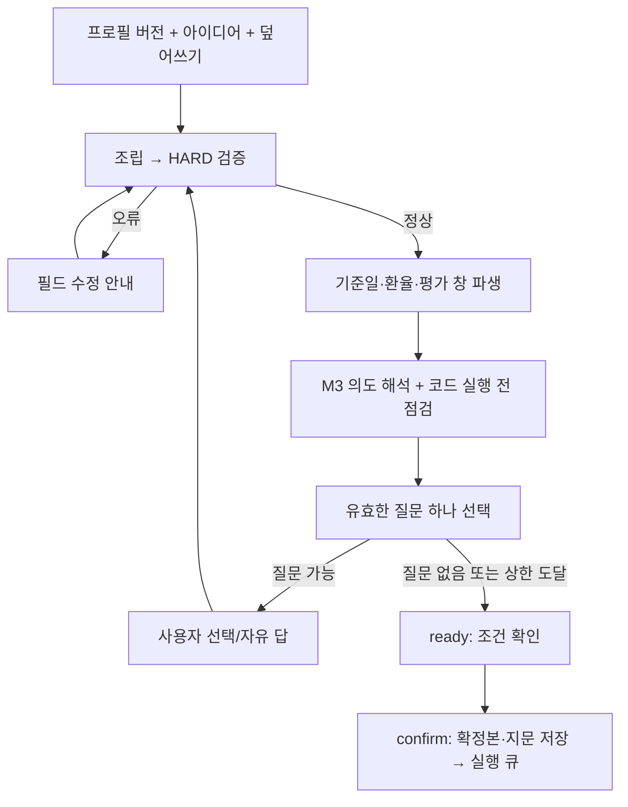

# m1_request 구현보고서

[전체 안내](README.md)

> 작성 기준: 2026-10-25 작업 공간의 실제 소스. 기존 설계 문서는 배경 참고용이며 아래 동작 설명은 구현을 기준으로 합니다.

대상: Python 파일 9개 · 클래스 1개 · 함수/메서드 48개(중첩 함수와 비공개 보조 함수 포함).

[역할](#role) · [파일 구성](#files) · [처리 흐름](#flow) · [클래스](#classes) · [함수](#functions) · [모듈 연계](#interactions) · [오류·검증](#verification)

<a id="role"></a>
## 1. 모듈의 역할과 용어

`m1_request`는 저장된 프로필과 이번 투자 아이디어를 실행 가능한 확정 요청으로 만듭니다. 프로필 버전은 과거 요청의 기본 조건을 보존하고, overrides는 이번 요청에서만 다른 값으로 적용할 필드 경로 사전입니다. 자유 답변은 아이디어 보충 문장으로 저장합니다.

HARD 검증은 숫자 범위·포함/제외 충돌 등 코드가 반드시 확인하는 조건입니다. 해석이 필요한 충돌·부족 정보는 질문 후보가 되고 코드가 한 번에 하나를 골라 사용자에게 묻습니다. 현재 구현은 기본 5회 질문 후 남은 항목을 현재 기본값으로 유지하여 확정을 허용합니다.

중심 클래스는 `DialogService`입니다. 값 조립·검증·기간/환율 파생·의도 해석·점검·질문 선택을 조율하며 실제 분석은 `confirm()`으로 큐에 넣은 뒤 워커가 수행합니다.

<a id="files"></a>
## 2. 파일 구성과 책임

| 파일 | 책임 | 문서 내 해설 |
| --- | --- | --- |
| [m1_request/__init__.py](../../backend/analysis/m1_request/__init__.py) | 패키지 목적 설명; 독립 함수·클래스 정의 없음 | 정의 없음 |
| [m1_request/assemble.py](../../backend/analysis/m1_request/assemble.py) | 프로필·아이디어·덮어쓰기 조립과 경로 비교 | [클래스 0 · 함수 4](#file-m1_request-assemble-py) |
| [m1_request/conditions.py](../../backend/analysis/m1_request/conditions.py) | 화면용 조건 표·출처·환산값 표시 | [클래스 0 · 함수 2](#file-m1_request-conditions-py) |
| [m1_request/derive.py](../../backend/analysis/m1_request/derive.py) | 기준일·환율·백테스트 창·리밸런싱 파생 | [클래스 0 · 함수 2](#file-m1_request-derive-py) |
| [m1_request/dialog.py](../../backend/analysis/m1_request/dialog.py) | 대화 상태 전이·질문 선택·답 적용·실행 확정 | [클래스 1 · 함수 26](#file-m1_request-dialog-py) |
| [m1_request/history.py](../../backend/analysis/m1_request/history.py) | 이전 실행의 요약과 LLM 맥락 | [클래스 0 · 함수 2](#file-m1_request-history-py) |
| [m1_request/precheck.py](../../backend/analysis/m1_request/precheck.py) | 분류 전 후보·지표 수와 과거 시작일 가능성 점검 | [클래스 0 · 함수 3](#file-m1_request-precheck-py) |
| [m1_request/revision.py](../../backend/analysis/m1_request/revision.py) | 수정 제안·고정 조건·허용 변경·HARD 검증 | [클래스 0 · 함수 6](#file-m1_request-revision-py) |
| [m1_request/validate.py](../../backend/analysis/m1_request/validate.py) | 요청 검증 오류의 한국어 필드 메시지 | [클래스 0 · 함수 3](#file-m1_request-validate-py) |

<a id="flow"></a>
## 3. 처리 흐름과 예시



예를 들어 프로필은 목표 10종목인데 반도체 테마에서 지표를 계산할 수 있는 후보가 7개라면, 실행 전 점검이 종목 수 축소·상한 상향, 테마 확장, 현금을 남기고 진행을 질문할 수 있습니다. 선택지가 patch를 가지면 코드가 여러 필드를 함께 바꾸고, 테마 확장 문장은 아이디어 보충으로 다음 해석에 전달합니다. 점검 수는 LLM 분류 전 후보 수이므로 최종 선정 수를 보장하지 않습니다.

선택 답은 검증된 필드 값으로 반영하고 자유 답은 텍스트로 붙입니다. 수치 필드가 바뀌어야 한다면 다음 질문 또는 직접 조건 수정 API로 확정합니다. 이미 이번 요청에서 명시한 값은 프로필 기본값과 구분해 프롬프트에 HARD로 표시합니다.

기간에는 세 날짜가 있습니다. `horizon.start_date`는 이름과 달리 분석 끝 기준일, `derived.backtest_start`는 파생 평가 시작일, 최종 `BacktestSpec.period.as_of`는 실제 첫 구성 거래일입니다. 공통 휴장일·재무 자료 시작일·추정 이력 때문에 서로 조정될 수 있습니다.

수정 요청은 원안 프로필 버전과 FROZEN 평가 조건을 고정하고 REVISABLE의 지원 변경만 다음 대화에 반영합니다. 예를 들어 종목 제외·비중 상한·선정 기준은 수정할 수 있지만 자본·기간·적립·비교지수·리밸런싱·유니버스 변경은 이 경로에서 거부됩니다. 다른 평가 조건이 필요하면 새 분석 흐름을 사용합니다.

### 연관 리소스

| 파일 | 계약·용도 |
| --- | --- |
| [examples/request_kr_us_semis.json](../../backend/analysis/examples/request_kr_us_semis.json) | UserRequest 입력 예시; 아이디어: 미국과 한국의 반도체·메모리 기업에 나눠서 투자하고 싶습니다. 삼성전자, SK하이닉스 같은 한국 대형 반도체와 미국 반도체 장비·메모리 회사를 함께 담아 3년 정도 들고 가려고 합니다. 한 종목 비중은 15%를 넘지 않게 해 주세요. |
| [examples/request_us_ai_semis.json](../../backend/analysis/examples/request_us_ai_semis.json) | UserRequest 입력 예시; 아이디어: AI 반도체와 클라우드 인프라 관련 기업 중 최근 1년간 주가 흐름이 강한 종목 위주로 3년 정도 들고 가고 싶어요. 변동성은 어느 정도 감수할 수 있지만 한 종목에 몰빵하는 건 피하고 싶습니다. |
| [examples/request_us_lowper_2005.json](../../backend/analysis/examples/request_us_lowper_2005.json) | UserRequest 입력 예시; 아이디어: 시가총액이 어느 정도 큰 기업 중에서 저PER 위주로 투자하고 싶어요. 백테스트 기간은 2005년부터 약 12년간으로요. |
| [prompts/15_revision/system_prompt.md](../../backend/analysis/prompts/15_revision/system_prompt.md) | 고정 시스템 지침(로더는 치환하지 않음); 자리표시자 없음 |
| [prompts/15_revision/user_prompt.md](../../backend/analysis/prompts/15_revision/user_prompt.md) | 사용자 입력 템플릿; 자리표시자: `base_request`, `holdings`, `text`, `themes` |

<a id="classes"></a>
## 4. 클래스 상세

필드 표는 해당 클래스에서 직접 선언한 필드입니다. 상속 필드는 부모 클래스 설명을 함께 읽습니다. `Field(...)`의 범위는 선언된 검증이며, 서비스에서 추가하는 조건은 함수 설명에 구분합니다.

<a id="m1_request-dialog-py-DialogService-81"></a>
### `DialogService`

<!-- source-symbol: m1_request/dialog.py:81:DialogService -->
[dialog.py](../../backend/analysis/m1_request/dialog.py#L81)

프로필과 투자 아이디어를 확정 요청으로 바꾸는 대화 서비스입니다. 프로필·요청·큐 저장소와 시장 자료·LLM·설정을 조합해 한 턴의 검증→해석→질문을 제어합니다. 매번 저장된 요청을 읽어 상태를 이어갑니다.

기반: `명시적 부모 없음`.

메서드·속성: [__init__](#m1_request-dialog-py-DialogService-__init__-82), [start](#m1_request-dialog-py-DialogService-start-89), [start_revision](#m1_request-dialog-py-DialogService-start_revision-107), [_base](#m1_request-dialog-py-DialogService-_base-124), [get](#m1_request-dialog-py-DialogService-get-135), [answer](#m1_request-dialog-py-DialogService-answer-138), [update_overrides](#m1_request-dialog-py-DialogService-update_overrides-176), [message](#m1_request-dialog-py-DialogService-message-202), [_settle_pending](#m1_request-dialog-py-DialogService-_settle_pending-219), [skip](#m1_request-dialog-py-DialogService-skip-225), [cancel](#m1_request-dialog-py-DialogService-cancel-239), [confirm](#m1_request-dialog-py-DialogService-confirm-247), [_turn](#m1_request-dialog-py-DialogService-_turn-275), [_fix_num_holdings](#m1_request-dialog-py-DialogService-_fix_num_holdings-330), [_feasibility_proposals](#m1_request-dialog-py-DialogService-_feasibility_proposals-358), [_code_proposals](#m1_request-dialog-py-DialogService-_code_proposals-413), [_conflict_proposals](#m1_request-dialog-py-DialogService-_conflict_proposals-445), [_period_proposal](#m1_request-dialog-py-DialogService-_period_proposal-477), [_pick_question](#m1_request-dialog-py-DialogService-_pick_question-498), [_history_text](#m1_request-dialog-py-DialogService-_history_text-533), [_answer_message](#m1_request-dialog-py-DialogService-_answer_message-538), [_unresolved](#m1_request-dialog-py-DialogService-_unresolved-545), [state](#m1_request-dialog-py-DialogService-state-552).


<a id="functions"></a>
## 5. 함수·메서드 상세

시그니처에 입력 자료형·기본값·반환 자료형을 그대로 기재했습니다. `self`는 소속 클래스의 인스턴스, `cls`는 클래스입니다. 반환 주석이 없는 함수는 본문 해설의 반환 내용을 따릅니다. 속성(`property`)은 호출 괄호 없이 읽고, 중첩 함수는 바깥 함수의 지역 상태를 공유합니다. 연결 목록은 정적으로 확인되는 패키지 내부 직접 호출이며, 주입된 서비스·콜백·Repository 호출은 처리 흐름과 해설에서 설명합니다.


<a id="file-m1_request-assemble-py"></a>
### m1_request/assemble.py


<a id="m1_request-assemble-py-get_path-11"></a>
#### `get_path`

<!-- source-symbol: m1_request/assemble.py:11:get_path -->
[assemble.py](../../backend/analysis/m1_request/assemble.py#L11)

```python
def get_path(obj: dict[str, Any], path: str) -> Any: ...
```

점으로 구분된 경로를 따라 중첩 사전의 값을 읽습니다. 도중에 사전이 아니거나 키가 없으면 None을 반환하므로 기존 값·수정안 비교에서 누락을 동일하게 처리할 수 있습니다.

<details>
<summary>호출하는 코드</summary>

[fmt](#m1_request-conditions-py-fmt-33), [condition_rows](#m1_request-conditions-py-condition_rows-65), [DialogService._conflict_proposals](#m1_request-dialog-py-DialogService-_conflict_proposals-445), [frozen_overrides](#m1_request-revision-py-frozen_overrides-43), [propose](#m1_request-revision-py-propose-80), [compare](m5_backtest_report_구현보고서.md#m5_backtest_report-compare-py-compare-88).

</details>


<a id="m1_request-assemble-py-set_path-20"></a>
#### `set_path`

<!-- source-symbol: m1_request/assemble.py:20:set_path -->
[assemble.py](../../backend/analysis/m1_request/assemble.py#L20)

```python
def set_path(obj: dict[str, Any], path: str, value: Any) -> None: ...
```

필드 경로의 중간 사전을 만들며 값을 제자리 갱신합니다. 마지막 위치의 기존 값과 새 값이 모두 사전이면 한 단계 병합하고, 그 외는 교체합니다. 재귀적 전체 깊이 병합은 아닙니다.

호출하는 코드: [build](#m1_request-assemble-py-build-33), [DialogService._pick_question](#m1_request-dialog-py-DialogService-_pick_question-498), [propose](#m1_request-revision-py-propose-80).


<a id="m1_request-assemble-py-build-33"></a>
#### `build`

<!-- source-symbol: m1_request/assemble.py:33:build -->
[assemble.py](../../backend/analysis/m1_request/assemble.py#L33)

```python
def build(profile_version: dict[str, Any], idea: str, *, overrides: dict[str, Any] | None=None, clarifications: list[str] | None=None, request_id: str, created_at: str, language: str='ko') -> dict[str, Any]: ...
```

고정한 프로필 버전의 여섯 조건 블록을 깊은 복사하고 아이디어·자유 보충 답을 합친 뒤 이번 요청의 overrides를 적용합니다. 내부용 '_' 경로와 natural_language.idea 덮어쓰기는 무시합니다. 검증 전 요청 사전을 반환하므로 이후 hard_errors와 derive가 필요합니다.

직접 연결: [set_path](#m1_request-assemble-py-set_path-20).

호출하는 코드: [put_profile](api_구현보고서.md#api-routers-profile-py-put_profile-47), [DialogService._turn](#m1_request-dialog-py-DialogService-_turn-275), [DialogService._answer_message](#m1_request-dialog-py-DialogService-_answer_message-538), [DialogService.state](#m1_request-dialog-py-DialogService-state-552).


<a id="m1_request-assemble-py-diff_fields-53"></a>
#### `diff_fields`

<!-- source-symbol: m1_request/assemble.py:53:diff_fields -->
[assemble.py](../../backend/analysis/m1_request/assemble.py#L53)

```python
def diff_fields(base: dict[str, Any], new: dict[str, Any], prefix: str='') -> list[str]: ...
```

두 사전을 재귀 비교해 다른 말단 필드의 점 경로 목록을 정렬된 순서로 반환합니다. 수정안 조건 표와 변경 요약에 사용합니다.

직접 연결: [diff_fields](#m1_request-assemble-py-diff_fields-53).

호출하는 코드: [diff_fields](#m1_request-assemble-py-diff_fields-53), [compare](m5_backtest_report_구현보고서.md#m5_backtest_report-compare-py-compare-88).


<a id="file-m1_request-conditions-py"></a>
### m1_request/conditions.py


<a id="m1_request-conditions-py-fmt-33"></a>
#### `fmt`

<!-- source-symbol: m1_request/conditions.py:33:fmt -->
[conditions.py](../../backend/analysis/m1_request/conditions.py#L33)

```python
def fmt(field: str, v: Any, req: dict[str, Any]) -> str: ...
```

필드 의미에 따라 금액·통화·연수·비율·종목 수·리밸런싱·목록을 한국어 표시 문자열로 변환합니다. None은 대시, 0 적립은 없음처럼 처리하며 계산 원본을 바꾸지는 않습니다.

직접 연결: [get_path](#m1_request-assemble-py-get_path-11).

호출하는 코드: [condition_rows](#m1_request-conditions-py-condition_rows-65), [DialogService._conflict_proposals](#m1_request-dialog-py-DialogService-_conflict_proposals-445).


<a id="m1_request-conditions-py-condition_rows-65"></a>
#### `condition_rows`

<!-- source-symbol: m1_request/conditions.py:65:condition_rows -->
[conditions.py](../../backend/analysis/m1_request/conditions.py#L65)

```python
def condition_rows(req: dict[str, Any], profile_req: dict[str, Any], *, answered_fields: dict[str, int] | None=None, derived: dict[str, Any] | None=None) -> list[ConditionRow]: ...
```

이번 요청과 프로필 기본 요청을 비교해 그룹별 ConditionRow를 만듭니다. 답변 출처·변경 여부와 ETF 미지원 안내, 보정한 낙폭 맞춤 목표, 기준일·환율·백테스트 창을 추가합니다. 시작일 환율과 기준일 환율이 다르면 두 USD 투자금을 함께 표시합니다.

직접 연결: [get_path](#m1_request-assemble-py-get_path-11), [ConditionRow](schemas_구현보고서.md#schemas-dialog-py-ConditionRow-55), [fmt](#m1_request-conditions-py-fmt-33), [effective_max_drawdown](m3_selection_구현보고서.md#m3_selection-intent-py-effective_max_drawdown-82).

호출하는 코드: [DialogService.state](#m1_request-dialog-py-DialogService-state-552).


<a id="file-m1_request-derive-py"></a>
### m1_request/derive.py


<a id="m1_request-derive-py-rebalance_rule-23"></a>
#### `rebalance_rule`

<!-- source-symbol: m1_request/derive.py:23:rebalance_rule -->
[derive.py](../../backend/analysis/m1_request/derive.py#L23)

```python
def rebalance_rule(rb: dict[str, Any], settings: AnalysisSettings) -> RebalanceRule: ...
```

count와 unit을 실행 가능한 RebalanceRule로 변환합니다. count=0은 최초 매수 후 보유, 2w는 설정 거래일 수×count, 월·분기·반기·년은 달력 기준 규칙과 한국어 설명을 만듭니다.

직접 연결: [RebalanceRule](schemas_구현보고서.md#schemas-request-py-RebalanceRule-144).

호출하는 코드: [derive](#m1_request-derive-py-derive-35).


<a id="m1_request-derive-py-derive-35"></a>
#### `derive`

<!-- source-symbol: m1_request/derive.py:35:derive -->
[derive.py](../../backend/analysis/m1_request/derive.py#L35)

```python
def derive(req: UserRequest | dict[str, Any], md: MarketData, settings: AnalysisSettings, *, as_of: dt.date | None=None) -> NormalizedRequest: ...
```

UserRequest를 검증하고 요청 시장별 최신 자료 상한을 구한 뒤 기준일을 공통 거래일로 보정합니다. 기준일 환율로 현재 자본을 USD 환산하고 가격 추정 이력·재무 지표 시작일에 맞춰 백테스트 창을 조정합니다. 시작일 환율의 잠정 환산값도 포함한 NormalizedRequest를 반환합니다. 미래 기준일·재무 자료 시작 전 기준일·유효한 평가 창 부재는 오류입니다. 실제 백테스트 첫 거래일 환산은 Module4에서 다시 확정합니다.

직접 연결: [RequestInvalid](common_구현보고서.md#errors-py-RequestInvalid-11), [DataMissing](common_구현보고서.md#errors-py-DataMissing-38), [Derived](schemas_구현보고서.md#schemas-request-py-Derived-153), [rebalance_rule](#m1_request-derive-py-rebalance_rule-23).

호출하는 코드: [st_request](executor_구현보고서.md#executor-stages-py-st_request-46), [DialogService._turn](#m1_request-dialog-py-DialogService-_turn-275).

명시적으로 발생시키는 예외: `RequestInvalid`, `DataMissing`. 발생 조건은 위 해설과 소스의 분기를 함께 확인합니다.


<a id="file-m1_request-dialog-py"></a>
### m1_request/dialog.py


<a id="m1_request-dialog-py-_dicts-38"></a>
#### `_dicts`

<!-- source-symbol: m1_request/dialog.py:38:_dicts -->
[dialog.py](../../backend/analysis/m1_request/dialog.py#L38)

```python
def _dicts(messages: list[Any]) -> list[dict[str, str]]: ...
```

저장된 DialogMessage와 신규 사전을 모두 role/content 사전 목록으로 맞춥니다. LLM에 누적 대화를 전달하기 위한 형식 변환입니다.

호출하는 코드: [DialogService._turn](#m1_request-dialog-py-DialogService-_turn-275).


<a id="m1_request-dialog-py-parse_period-46"></a>
#### `parse_period`

<!-- source-symbol: m1_request/dialog.py:46:parse_period -->
[dialog.py](../../backend/analysis/m1_request/dialog.py#L46)

```python
def parse_period(text: str, *, today: dt.date, max_years: float=20.0) -> dict[str, Any] | None: ...
```

아이디어에서 시작·끝 연도 또는 'N년간'을 읽어 기간 정보를 반환합니다. 양끝 연도 포함으로 길이를 계산하고 현재 연도 이후 끝은 현재까지로 취급하며 max_years로 제한합니다. 끝 연도만 있거나 해석 가능한 기간이 없으면 None입니다.

호출하는 코드: [DialogService._period_proposal](#m1_request-dialog-py-DialogService-_period_proposal-477).


<a id="m1_request-dialog-py-DialogService-__init__-82"></a>
#### `DialogService.__init__`

<!-- source-symbol: m1_request/dialog.py:82:DialogService.__init__ -->
[dialog.py](../../backend/analysis/m1_request/dialog.py#L82)

```python
def __init__(self, store: JsonStore, repo: Any, md: MarketData, llm: LlmClient, settings: AnalysisSettings) -> None: ...
```

저장소·Repository·MarketData·LLM·설정과 프로필·요청·큐 래퍼를 보관합니다. 대화의 영속 상태는 요청 파일에 있습니다.

직접 연결: [RequestStore](common_구현보고서.md#common-store-py-RequestStore-154), [ProfileStore](common_구현보고서.md#common-store-py-ProfileStore-114), [Queue](executor_구현보고서.md#executor-queue-py-Queue-21).


<a id="m1_request-dialog-py-DialogService-start-89"></a>
#### `DialogService.start`

<!-- source-symbol: m1_request/dialog.py:89:DialogService.start -->
[dialog.py](../../backend/analysis/m1_request/dialog.py#L89)

```python
def start(self, idea: str, *, overrides: dict[str, Any] | None=None, mode: str='new', base_report_id: str | None=None, language: str='ko', profile_version: int | None=None, clarifications: list[str] | None=None, revision: RevisionDraft | None=None) -> DialogState: ...
```

등록 프로필과 5자 이상 아이디어를 확인하고 프로필 버전·요청 모드·덮어쓰기·질문 상한을 담은 새 요청을 만듭니다. 요청별 잠금 안에서 첫 턴을 실행·저장하고 화면용 DialogState를 반환합니다.

직접 연결: [RequestInvalid](common_구현보고서.md#errors-py-RequestInvalid-11), [AnalysisRequestDoc](schemas_구현보고서.md#schemas-dialog-py-AnalysisRequestDoc-98), [new_request_id](common_구현보고서.md#common-store-py-new_request_id-98), [now_iso](common_구현보고서.md#common-jsonio-py-now_iso-56), [DialogService._turn](#m1_request-dialog-py-DialogService-_turn-275), [DialogService.state](#m1_request-dialog-py-DialogService-state-552).

호출하는 코드: [DialogService.start_revision](#m1_request-dialog-py-DialogService-start_revision-107).

명시적으로 발생시키는 예외: `RequestInvalid`. 발생 조건은 위 해설과 소스의 분기를 함께 확인합니다.


<a id="m1_request-dialog-py-DialogService-start_revision-107"></a>
#### `DialogService.start_revision`

<!-- source-symbol: m1_request/dialog.py:107:DialogService.start_revision -->
[dialog.py](../../backend/analysis/m1_request/dialog.py#L107)

```python
def start_revision(self, base_report_id: str, text: str) -> DialogState: ...
```

기준 리포트의 확정 요청과 결과를 읽고 revision.propose로 수정 초안을 만듭니다. 원안 프로필 버전과 평가 조건을 유지하고 수정 문장을 보충에 추가한 revision 모드 대화를 시작합니다.

직접 연결: [RequestInvalid](common_구현보고서.md#errors-py-RequestInvalid-11), [DialogService._base](#m1_request-dialog-py-DialogService-_base-124), [propose](#m1_request-revision-py-propose-80), [overrides_from](#m1_request-revision-py-overrides_from-142), [DialogService.start](#m1_request-dialog-py-DialogService-start-89).

명시적으로 발생시키는 예외: `RequestInvalid`. 발생 조건은 위 해설과 소스의 분기를 함께 확인합니다.


<a id="m1_request-dialog-py-DialogService-_base-124"></a>
#### `DialogService._base`

<!-- source-symbol: m1_request/dialog.py:124:DialogService._base -->
[dialog.py](../../backend/analysis/m1_request/dialog.py#L124)

```python
def _base(self, base_report_id: str) -> tuple[AnalysisRequestDoc, dict[str, Any]]: ...
```

리포트 ID에 대응하는 실행 색인·요청·run_artifact를 찾아 확정 요청 문서와 결과 사전을 반환합니다. 확정 요청이나 결과가 없으면 오류입니다. 현 구현은 report_id와 run_id가 같은 저장 규칙을 이용합니다.

직접 연결: [RequestInvalid](common_구현보고서.md#errors-py-RequestInvalid-11), [NotFound](common_구현보고서.md#errors-py-NotFound-73).

호출하는 코드: [DialogService.start_revision](#m1_request-dialog-py-DialogService-start_revision-107), [DialogService.state](#m1_request-dialog-py-DialogService-state-552).

명시적으로 발생시키는 예외: `RequestInvalid`, `NotFound`. 발생 조건은 위 해설과 소스의 분기를 함께 확인합니다.


<a id="m1_request-dialog-py-DialogService-get-135"></a>
#### `DialogService.get`

<!-- source-symbol: m1_request/dialog.py:135:DialogService.get -->
[dialog.py](../../backend/analysis/m1_request/dialog.py#L135)

```python
def get(self, request_id: str) -> DialogState: ...
```

저장된 요청을 state로 변환한 현재 대화 응답을 반환합니다.

직접 연결: [DialogService.state](#m1_request-dialog-py-DialogService-state-552).


<a id="m1_request-dialog-py-DialogService-answer-138"></a>
#### `DialogService.answer`

<!-- source-symbol: m1_request/dialog.py:138:DialogService.answer -->
[dialog.py](../../backend/analysis/m1_request/dialog.py#L138)

```python
def answer(self, request_id: str, seq: int, *, option_value: Any=None, free_text: str | None=None) -> DialogState: ...
```

요청별 잠금 안에서 draft 여부·질문 존재·중복 답·빈 답을 검사합니다. 선택지 patch는 여러 필드, clarification은 아이디어 보충에 반영하며 일반 선택 값은 해당 경로에 씁니다. 자유 입력은 필드를 직접 바꾸지 않고 보충 문장으로 남깁니다. 답변 이력을 추가하고 다음 턴을 저장합니다. 목록 밖 option_value도 일반 값 경로로 들어갈 수 있으나 다음 HARD 검증을 거칩니다.

직접 연결: [Conflict](common_구현보고서.md#errors-py-Conflict-78), [NotFound](common_구현보고서.md#errors-py-NotFound-73), [RequestInvalid](common_구현보고서.md#errors-py-RequestInvalid-11), [now_iso](common_구현보고서.md#common-jsonio-py-now_iso-56), [label](#m1_request-validate-py-label-87), [DialogMessage](schemas_구현보고서.md#schemas-dialog-py-DialogMessage-69), [DialogService._answer_message](#m1_request-dialog-py-DialogService-_answer_message-538), [DialogService._turn](#m1_request-dialog-py-DialogService-_turn-275), [DialogService.state](#m1_request-dialog-py-DialogService-state-552).

명시적으로 발생시키는 예외: `Conflict`, `NotFound`, `RequestInvalid`. 발생 조건은 위 해설과 소스의 분기를 함께 확인합니다.


<a id="m1_request-dialog-py-DialogService-update_overrides-176"></a>
#### `DialogService.update_overrides`

<!-- source-symbol: m1_request/dialog.py:176:DialogService.update_overrides -->
[dialog.py](../../backend/analysis/m1_request/dialog.py#L176)

```python
def update_overrides(self, request_id: str, overrides: dict[str, Any]) -> DialogState: ...
```

직접 수정한 필드를 overrides에 반영하고 None 값은 제거합니다. 내부 키와 아이디어 직접 교체는 무시합니다. 기존 미응답 질문을 닫고 변경 메시지와 함께 다음 턴을 실행·저장합니다.

직접 연결: [Conflict](common_구현보고서.md#errors-py-Conflict-78), [label](#m1_request-validate-py-label-87), [DialogService.state](#m1_request-dialog-py-DialogService-state-552), [DialogService._settle_pending](#m1_request-dialog-py-DialogService-_settle_pending-219), [DialogMessage](schemas_구현보고서.md#schemas-dialog-py-DialogMessage-69), [DialogService._turn](#m1_request-dialog-py-DialogService-_turn-275).

명시적으로 발생시키는 예외: `Conflict`. 발생 조건은 위 해설과 소스의 분기를 함께 확인합니다.


<a id="m1_request-dialog-py-DialogService-message-202"></a>
#### `DialogService.message`

<!-- source-symbol: m1_request/dialog.py:202:DialogService.message -->
[dialog.py](../../backend/analysis/m1_request/dialog.py#L202)

```python
def message(self, request_id: str, text: str) -> DialogState: ...
```

비어 있지 않은 자유 문장을 아이디어 보충으로 추가합니다. draft 요청에서만 가능하며 대기 질문을 건너뛴 뒤 새 의도 해석 턴을 수행합니다.

직접 연결: [RequestInvalid](common_구현보고서.md#errors-py-RequestInvalid-11), [Conflict](common_구현보고서.md#errors-py-Conflict-78), [DialogService._settle_pending](#m1_request-dialog-py-DialogService-_settle_pending-219), [DialogMessage](schemas_구현보고서.md#schemas-dialog-py-DialogMessage-69), [DialogService._turn](#m1_request-dialog-py-DialogService-_turn-275), [DialogService.state](#m1_request-dialog-py-DialogService-state-552).

명시적으로 발생시키는 예외: `RequestInvalid`, `Conflict`. 발생 조건은 위 해설과 소스의 분기를 함께 확인합니다.


<a id="m1_request-dialog-py-DialogService-_settle_pending-219"></a>
#### `DialogService._settle_pending`

<!-- source-symbol: m1_request/dialog.py:219:DialogService._settle_pending -->
[dialog.py](../../backend/analysis/m1_request/dialog.py#L219)

```python
def _settle_pending(doc: AnalysisRequestDoc, note: str) -> None: ...
```

아직 답하지 않은 질문에 skipped·안내 답·응답 시각을 제자리 기록합니다. 직접 조건 수정이나 자유 메시지로 이전 질문을 닫을 때 사용합니다.

선언·진입 조건: `staticmethod`.

직접 연결: [now_iso](common_구현보고서.md#common-jsonio-py-now_iso-56).

호출하는 코드: [DialogService.update_overrides](#m1_request-dialog-py-DialogService-update_overrides-176), [DialogService.message](#m1_request-dialog-py-DialogService-message-202).


<a id="m1_request-dialog-py-DialogService-skip-225"></a>
#### `DialogService.skip`

<!-- source-symbol: m1_request/dialog.py:225:DialogService.skip -->
[dialog.py](../../backend/analysis/m1_request/dialog.py#L225)

```python
def skip(self, request_id: str, seq: int) -> DialogState: ...
```

지정 질문을 기본값 유지로 건너뛰고 LLM에 같은 필드를 다시 묻지 말라는 메시지를 추가해 다음 턴을 저장합니다. 질문 존재·중복 응답은 검사하지만 answer와 달리 별도 draft 상태 검사는 없습니다.

직접 연결: [NotFound](common_구현보고서.md#errors-py-NotFound-73), [Conflict](common_구현보고서.md#errors-py-Conflict-78), [now_iso](common_구현보고서.md#common-jsonio-py-now_iso-56), [DialogMessage](schemas_구현보고서.md#schemas-dialog-py-DialogMessage-69), [DialogService._turn](#m1_request-dialog-py-DialogService-_turn-275), [DialogService.state](#m1_request-dialog-py-DialogService-state-552).

명시적으로 발생시키는 예외: `NotFound`, `Conflict`. 발생 조건은 위 해설과 소스의 분기를 함께 확인합니다.


<a id="m1_request-dialog-py-DialogService-cancel-239"></a>
#### `DialogService.cancel`

<!-- source-symbol: m1_request/dialog.py:239:DialogService.cancel -->
[dialog.py](../../backend/analysis/m1_request/dialog.py#L239)

```python
def cancel(self, request_id: str) -> DialogState: ...
```

draft 요청만 status와 dialog_state를 cancelled로 저장합니다. 이미 확정·취소 상태면 그대로 반환합니다.

직접 연결: [DialogService.state](#m1_request-dialog-py-DialogService-state-552).


<a id="m1_request-dialog-py-DialogService-confirm-247"></a>
#### `DialogService.confirm`

<!-- source-symbol: m1_request/dialog.py:247:DialogService.confirm -->
[dialog.py](../../backend/analysis/m1_request/dialog.py#L247)

```python
def confirm(self, request_id: str) -> tuple[str, int | None]: ...
```

요청별 잠금 안에서 ready·HARD 오류 부재를 확인합니다. 확정 조건과 테마 ID로 지문을 만들고 effective_request·확정 시각·새 run_id를 저장한 뒤 FIFO 큐에 넣습니다. 이미 확정된 요청은 기존 run_id를 반환합니다. 요청 저장과 큐 등록은 별도 파일 연산이므로 한 트랜잭션은 아닙니다.

직접 연결: [Conflict](common_구현보고서.md#errors-py-Conflict-78), [DialogBlocked](common_구현보고서.md#errors-py-DialogBlocked-18), [DialogService._unresolved](#m1_request-dialog-py-DialogService-_unresolved-545), [DialogNotReady](common_구현보고서.md#errors-py-DialogNotReady-25), [sha256_hex](common_구현보고서.md#common-jsonio-py-sha256_hex-51), [canonical_json](common_구현보고서.md#common-jsonio-py-canonical_json-46), [now_iso](common_구현보고서.md#common-jsonio-py-now_iso-56), [new_run_id](common_구현보고서.md#common-store-py-new_run_id-103).

명시적으로 발생시키는 예외: `Conflict`, `DialogBlocked`, `DialogNotReady`. 발생 조건은 위 해설과 소스의 분기를 함께 확인합니다.


<a id="m1_request-dialog-py-DialogService-_turn-275"></a>
#### `DialogService._turn`

<!-- source-symbol: m1_request/dialog.py:275:DialogService._turn -->
[dialog.py](../../backend/analysis/m1_request/dialog.py#L275)

```python
def _turn(self, doc: AnalysisRequestDoc) -> AnalysisRequestDoc: ...
```

프로필과 덮어쓰기를 조립해 HARD 검증하고 파생값·사전·의도 명세를 만듭니다. 실행 전 점검과 코드 규칙 질문을 LLM 제안 앞에 합친 뒤 유효한 질문 하나를 고릅니다. 오류면 수정 대기, 질문이 없으면 ready, 질문 상한 도달 시에도 남은 조건을 기본값으로 두고 ready가 됩니다. 첫 프롬프트는 처음 한 번 구성하고 이후 누적 대화를 재사용합니다.

직접 연결: [DialogService._fix_num_holdings](#m1_request-dialog-py-DialogService-_fix_num_holdings-330), [build](#m1_request-assemble-py-build-33), [hard_errors](#m1_request-validate-py-hard_errors-69), [derive](#m1_request-derive-py-derive-35), [load_for](m2_data_구현보고서.md#m2_data-descriptor-py-load_for-24), [DialogMessage](schemas_구현보고서.md#schemas-dialog-py-DialogMessage-69), [build_messages](m3_selection_구현보고서.md#m3_selection-intent-py-build_messages-66), [context_package](#m1_request-history-py-context_package-41), [DialogService._history_text](#m1_request-dialog-py-DialogService-_history_text-533), [interpret](m3_selection_구현보고서.md#m3_selection-intent-py-interpret-104), [_dicts](#m1_request-dialog-py-_dicts-38), [precheck](#m1_request-precheck-py-precheck-54), [DialogService._code_proposals](#m1_request-dialog-py-DialogService-_code_proposals-413), [DialogService._pick_question](#m1_request-dialog-py-DialogService-_pick_question-498), [label](#m1_request-validate-py-label-87), [Question](schemas_구현보고서.md#schemas-dialog-py-Question-37), [now_iso](common_구현보고서.md#common-jsonio-py-now_iso-56).

호출하는 코드: [DialogService.start](#m1_request-dialog-py-DialogService-start-89), [DialogService.answer](#m1_request-dialog-py-DialogService-answer-138), [DialogService.update_overrides](#m1_request-dialog-py-DialogService-update_overrides-176), [DialogService.message](#m1_request-dialog-py-DialogService-message-202), [DialogService.skip](#m1_request-dialog-py-DialogService-skip-225).


<a id="m1_request-dialog-py-DialogService-_fix_num_holdings-330"></a>
#### `DialogService._fix_num_holdings`

<!-- source-symbol: m1_request/dialog.py:330:DialogService._fix_num_holdings -->
[dialog.py](../../backend/analysis/m1_request/dialog.py#L330)

```python
def _fix_num_holdings(doc: AnalysisRequestDoc, prof: dict[str, Any]) -> None: ...
```

목표 종목 수만 직접 변경되어 기존 최소·최대를 벗어나면 그 범위를 함께 보정합니다. 최소가 줄어 전액 배분 조건을 어기면 필요한 종목·섹터 상한도 올려 불필요한 HARD 오류를 줄입니다. 요청 overrides를 제자리 변경합니다.

선언·진입 조건: `staticmethod`.

호출하는 코드: [DialogService._turn](#m1_request-dialog-py-DialogService-_turn-275).


<a id="m1_request-dialog-py-DialogService-_feasibility_proposals-358"></a>
#### `DialogService._feasibility_proposals`

<!-- source-symbol: m1_request/dialog.py:358:DialogService._feasibility_proposals -->
[dialog.py](../../backend/analysis/m1_request/dialog.py#L358)

```python
def _feasibility_proposals(self, req: dict[str, Any], precheck: dict[str, Any] | None, overrides: dict[str, Any]) -> list[QuestionProposal]: ...
```

점검 결과로 현재 후보 부족 또는 과거 시작일 후보 부족 질문을 만듭니다. 종목 수·상한을 함께 조정하는 patch, 테마 확장 clarification, 부족 인지 후 진행 선택지를 제공합니다. 현재 부족 질문을 우선하며 숨은 확인 플래그가 있으면 재제안하지 않습니다.

직접 연결: [DialogService._feasibility_proposals.shrink_patch](#m1_request-dialog-py-DialogService-_feasibility_proposals-shrink_patch-368), [QuestionProposal](schemas_구현보고서.md#schemas-dialog-py-QuestionProposal-25).

호출하는 코드: [DialogService._code_proposals](#m1_request-dialog-py-DialogService-_code_proposals-413).


<a id="m1_request-dialog-py-DialogService-_feasibility_proposals-shrink_patch-368"></a>
#### `DialogService._feasibility_proposals.shrink_patch`

<!-- source-symbol: m1_request/dialog.py:368:DialogService._feasibility_proposals.shrink_patch -->
[dialog.py](../../backend/analysis/m1_request/dialog.py#L368)

```python
def shrink_patch(n: int) -> dict[str, Any]: ...
```

선정 가능한 n개로 최소·목표·최대를 맞추고 현금 비율을 제외한 자금을 담을 수 있도록 필요한 종목 상한을 올립니다. 섹터 상한도 종목 상한 이상인 여러 필드 patch를 반환합니다.

호출하는 코드: [DialogService._feasibility_proposals](#m1_request-dialog-py-DialogService-_feasibility_proposals-358).


<a id="m1_request-dialog-py-DialogService-_code_proposals-413"></a>
#### `DialogService._code_proposals`

<!-- source-symbol: m1_request/dialog.py:413:DialogService._code_proposals -->
[dialog.py](../../backend/analysis/m1_request/dialog.py#L413)

```python
def _code_proposals(self, req: dict[str, Any], intent: dict[str, Any], desc: Any, *, overrides: dict[str, Any] | None=None, precheck: dict[str, Any] | None=None) -> list[QuestionProposal]: ...
```

후보·기간 점검, 아이디어와 프로필 충돌, 단일 섹터 테마의 상한 때문에 남는 현금에 대한 질문을 합칩니다. 섹터 충돌 질문은 설정이 켜져 있고 한 섹터의 상한이 목표 투자 비율보다 작을 때만 추가합니다.

직접 연결: [DialogService._feasibility_proposals](#m1_request-dialog-py-DialogService-_feasibility_proposals-358), [DialogService._period_proposal](#m1_request-dialog-py-DialogService-_period_proposal-477), [DialogService._conflict_proposals](#m1_request-dialog-py-DialogService-_conflict_proposals-445), [sector_name_to_code](m2_data_구현보고서.md#m2_data-descriptor-py-sector_name_to_code-108), [QuestionProposal](schemas_구현보고서.md#schemas-dialog-py-QuestionProposal-25).

호출하는 코드: [DialogService._turn](#m1_request-dialog-py-DialogService-_turn-275).


<a id="m1_request-dialog-py-DialogService-_conflict_proposals-445"></a>
#### `DialogService._conflict_proposals`

<!-- source-symbol: m1_request/dialog.py:445:DialogService._conflict_proposals -->
[dialog.py](../../backend/analysis/m1_request/dialog.py#L445)

```python
def _conflict_proposals(self, req: dict[str, Any], intent: dict[str, Any], overrides: dict[str, Any]) -> list[QuestionProposal]: ...
```

LLM conflicts에서 idea_value가 있고 질문 가능한 필드를 골라 '아이디어대로/프로필대로' 선택지를 만듭니다. 이번 요청에서 이미 명시한 경로와 겹치는 필드, 같은 값, 중복 필드는 제외합니다.

직접 연결: [get_path](#m1_request-assemble-py-get_path-11), [label](#m1_request-validate-py-label-87), [QuestionProposal](schemas_구현보고서.md#schemas-dialog-py-QuestionProposal-25), [fmt](#m1_request-conditions-py-fmt-33).

호출하는 코드: [DialogService._code_proposals](#m1_request-dialog-py-DialogService-_code_proposals-413).


<a id="m1_request-dialog-py-DialogService-_period_proposal-477"></a>
#### `DialogService._period_proposal`

<!-- source-symbol: m1_request/dialog.py:477:DialogService._period_proposal -->
[dialog.py](../../backend/analysis/m1_request/dialog.py#L477)

```python
def _period_proposal(self, req: dict[str, Any]) -> list[QuestionProposal]: ...
```

자연어 기간과 현재 backtest_years·끝 기준일이 다르면 horizon 전체를 부분 갱신하는 두 선택지를 만듭니다. 실제 재무 자료 가용 시작일은 derive의 설정값이 결정하며 이 함수의 설명 문구에는 과거 날짜가 남아 있습니다.

직접 연결: [parse_period](#m1_request-dialog-py-parse_period-46), [QuestionProposal](schemas_구현보고서.md#schemas-dialog-py-QuestionProposal-25).

호출하는 코드: [DialogService._code_proposals](#m1_request-dialog-py-DialogService-_code_proposals-413).


<a id="m1_request-dialog-py-DialogService-_pick_question-498"></a>
#### `DialogService._pick_question`

<!-- source-symbol: m1_request/dialog.py:498:DialogService._pick_question -->
[dialog.py](../../backend/analysis/m1_request/dialog.py#L498)

```python
def _pick_question(self, doc: AnalysisRequestDoc, proposals: list[QuestionProposal], req: dict[str, Any]) -> QuestionProposal | None: ...
```

허용 필드와 아직 묻지 않은 경로만 남기고 선택지 patch를 시험 요청에 적용해 HARD 검증합니다. 자유 입력이 불가한 질문에 유효한 보기가 2개 미만이면 버립니다. priority와 종류 순으로 정렬해 하나 또는 None을 반환합니다.

직접 연결: [set_path](#m1_request-assemble-py-set_path-20), [hard_errors](#m1_request-validate-py-hard_errors-69).

호출하는 코드: [DialogService._turn](#m1_request-dialog-py-DialogService-_turn-275).


<a id="m1_request-dialog-py-DialogService-_history_text-533"></a>
#### `DialogService._history_text`

<!-- source-symbol: m1_request/dialog.py:533:DialogService._history_text -->
[dialog.py](../../backend/analysis/m1_request/dialog.py#L533)

```python
def _history_text(doc: AnalysisRequestDoc) -> str: ...
```

질문 순번·종류·필드·질문·답변을 LLM용 문자열로 묶습니다. 질문이 없으면 '(없음)'입니다.

선언·진입 조건: `staticmethod`.

호출하는 코드: [DialogService._turn](#m1_request-dialog-py-DialogService-_turn-275).


<a id="m1_request-dialog-py-DialogService-_answer_message-538"></a>
#### `DialogService._answer_message`

<!-- source-symbol: m1_request/dialog.py:538:DialogService._answer_message -->
[dialog.py](../../backend/analysis/m1_request/dialog.py#L538)

```python
def _answer_message(self, doc: AnalysisRequestDoc, q: Question) -> str: ...
```

답을 적용한 최신 요청을 다시 조립해 JSON과 질문 답을 포함하는 사용자 메시지를 반환합니다. 다음 LLM 턴이 코드가 실제 반영한 조건을 보도록 합니다.

직접 연결: [build](#m1_request-assemble-py-build-33).

호출하는 코드: [DialogService.answer](#m1_request-dialog-py-DialogService-answer-138).


<a id="m1_request-dialog-py-DialogService-_unresolved-545"></a>
#### `DialogService._unresolved`

<!-- source-symbol: m1_request/dialog.py:545:DialogService._unresolved -->
[dialog.py](../../backend/analysis/m1_request/dialog.py#L545)

```python
def _unresolved(self, doc: AnalysisRequestDoc) -> list[dict[str, Any]]: ...
```

미응답 또는 건너뛴 질문을 필드·라벨·힌트·예시 목록으로 반환합니다. 원본 질문을 바꾸지는 않습니다.

직접 연결: [label](#m1_request-validate-py-label-87).

호출하는 코드: [DialogService.confirm](#m1_request-dialog-py-DialogService-confirm-247), [DialogService.state](#m1_request-dialog-py-DialogService-state-552).


<a id="m1_request-dialog-py-DialogService-state-552"></a>
#### `DialogService.state`

<!-- source-symbol: m1_request/dialog.py:552:DialogService.state -->
[dialog.py](../../backend/analysis/m1_request/dialog.py#L552)

```python
def state(self, doc: AnalysisRequestDoc) -> DialogState: ...
```

저장 요청에서 현재 질문·확정 조건 표·의도 요약·오류·공지·수정 초안·점검 결과를 조립한 DialogState를 반환합니다. '_' 내부 overrides는 숨깁니다. ready 상태에서도 상한 안내 blocked_reason_ko가 있으면 미해결 안내를 함께 제공할 수 있습니다.

직접 연결: [build](#m1_request-assemble-py-build-33), [DialogService._base](#m1_request-dialog-py-DialogService-_base-124), [condition_rows](#m1_request-conditions-py-condition_rows-65), [DialogSummary](schemas_구현보고서.md#schemas-dialog-py-DialogSummary-134), [DialogState](schemas_구현보고서.md#schemas-dialog-py-DialogState-141), [DialogService._unresolved](#m1_request-dialog-py-DialogService-_unresolved-545).

호출하는 코드: [DialogService.start](#m1_request-dialog-py-DialogService-start-89), [DialogService.get](#m1_request-dialog-py-DialogService-get-135), [DialogService.answer](#m1_request-dialog-py-DialogService-answer-138), [DialogService.update_overrides](#m1_request-dialog-py-DialogService-update_overrides-176), [DialogService.message](#m1_request-dialog-py-DialogService-message-202), [DialogService.skip](#m1_request-dialog-py-DialogService-skip-225), [DialogService.cancel](#m1_request-dialog-py-DialogService-cancel-239).


<a id="file-m1_request-history-py"></a>
### m1_request/history.py


<a id="m1_request-history-py-recent_runs-10"></a>
#### `recent_runs`

<!-- source-symbol: m1_request/history.py:10:recent_runs -->
[history.py](../../backend/analysis/m1_request/history.py#L10)

```python
def recent_runs(store: JsonStore, repo: Any, *, limit: int=3) -> list[dict[str, Any]]: ...
```

성공/부분 성공 실행을 최신순으로 훑어 요청 아이디어와 가능한 경우 선택안·성과·종목 요약을 limit건 반환합니다. 읽을 수 없는 요청은 건너뛰고 결과 DB 조회 실패는 성과 없는 요약으로 처리합니다.

직접 연결: [RunIndex](common_구현보고서.md#common-store-py-RunIndex-186), [RequestStore](common_구현보고서.md#common-store-py-RequestStore-154).

호출하는 코드: [context_package](#m1_request-history-py-context_package-41).


<a id="m1_request-history-py-context_package-41"></a>
#### `context_package`

<!-- source-symbol: m1_request/history.py:41:context_package -->
[history.py](../../backend/analysis/m1_request/history.py#L41)

```python
def context_package(store: JsonStore, repo: Any, *, limit: int=3) -> str: ...
```

최근 실행 요약을 LLM 입력용 짧은 한국어 목록으로 렌더링합니다. 이력이 없으면 '(이전 실행 없음)'이며 과거 리포트 전문은 포함하지 않습니다.

직접 연결: [recent_runs](#m1_request-history-py-recent_runs-10).

호출하는 코드: [DialogService._turn](#m1_request-dialog-py-DialogService-_turn-275).


<a id="file-m1_request-precheck-py"></a>
### m1_request/precheck.py


<a id="m1_request-precheck-py-signature-28"></a>
#### `signature`

<!-- source-symbol: m1_request/precheck.py:28:signature -->
[precheck.py](../../backend/analysis/m1_request/precheck.py#L28)

```python
def signature(normalized: dict[str, Any], intent: dict[str, Any]) -> str: ...
```

기준일·백테스트 시작일·선정 지표·테마 검색 조건·제외 규칙·제약을 정규화한 해시를 반환합니다. 결과에 영향 주는 입력이 같으면 이전 실행 전 점검을 재사용하기 위한 키입니다.

직접 연결: [sha256_hex](common_구현보고서.md#common-jsonio-py-sha256_hex-51), [canonical_json](common_구현보고서.md#common-jsonio-py-canonical_json-46).

호출하는 코드: [precheck](#m1_request-precheck-py-precheck-54).


<a id="m1_request-precheck-py-_count_at-39"></a>
#### `_count_at`

<!-- source-symbol: m1_request/precheck.py:39:_count_at -->
[precheck.py](../../backend/analysis/m1_request/precheck.py#L39)

```python
def _count_at(day: dt.date, normalized: dict[str, Any], intent: dict[str, Any], desc: Descriptor, md: MarketData) -> dict[str, Any]: ...
```

지정 날짜 view에서 상한 없는 후보 검색과 지표 계산을 수행해 후보 수·지표 보유 수를 반환합니다. LLM 테마 분류를 거치지 않으므로 실제 최종 선정 가능 수의 상한으로 해석합니다.

직접 연결: [retrieve](m3_selection_구현보고서.md#m3_selection-retrieve-py-retrieve-70).

호출하는 코드: [precheck](#m1_request-precheck-py-precheck-54).


<a id="m1_request-precheck-py-precheck-54"></a>
#### `precheck`

<!-- source-symbol: m1_request/precheck.py:54:precheck -->
[precheck.py](../../backend/analysis/m1_request/precheck.py#L54)

```python
def precheck(normalized: dict[str, Any], intent: dict[str, Any], desc: Descriptor, md: MarketData, settings: AnalysisSettings, *, previous: dict[str, Any] | None=None) -> dict[str, Any]: ...
```

서명이 같으면 previous를 반환하고, 다르면 가격을 미리 적재해 현재일·시작일의 후보·지표 수를 셉니다. 현재는 충분하지만 과거에 부족하면 30일씩 최대 24회 이동하며 최소 1년 평가 창을 남기는 시작일을 탐색합니다. 점검 결과와 부족 플래그를 반환하며 실제 실행의 시작일 확정은 하지 않습니다.

직접 연결: [signature](#m1_request-precheck-py-signature-28), [tickers](m2_data_구현보고서.md#m2_data-descriptor-py-tickers-128), [_count_at](#m1_request-precheck-py-_count_at-39).

호출하는 코드: [DialogService._turn](#m1_request-dialog-py-DialogService-_turn-275).


<a id="file-m1_request-revision-py"></a>
### m1_request/revision.py


<a id="m1_request-revision-py-_check-36"></a>
#### `_check`

<!-- source-symbol: m1_request/revision.py:36:_check -->
[revision.py](../../backend/analysis/m1_request/revision.py#L36)

```python
def _check(ans: dict[str, Any]) -> None: ...
```

LLM 수정 응답의 changes와 unsupported_ko가 목록인지 검사합니다. 각 변경의 허용 여부와 값 검증은 propose에서 추가로 수행합니다.

명시적으로 발생시키는 예외: `ValueError`. 발생 조건은 위 해설과 소스의 분기를 함께 확인합니다.


<a id="m1_request-revision-py-frozen_overrides-43"></a>
#### `frozen_overrides`

<!-- source-symbol: m1_request/revision.py:43:frozen_overrides -->
[revision.py](../../backend/analysis/m1_request/revision.py#L43)

```python
def frozen_overrides(base_request: dict[str, Any]) -> dict[str, Any]: ...
```

원안의 자본·기간·비교지수·리밸런싱·종목 범위 등 FROZEN 값을 깊은 복사해 덮어쓰기 사전으로 반환합니다. 분석 기준일은 원안 derived.as_of를 우선하여 고정합니다.

직접 연결: [get_path](#m1_request-assemble-py-get_path-11).

호출하는 코드: [overrides_from](#m1_request-revision-py-overrides_from-142).


<a id="m1_request-revision-py-_coerce-56"></a>
#### `_coerce`

<!-- source-symbol: m1_request/revision.py:56:_coerce -->
[revision.py](../../backend/analysis/m1_request/revision.py#L56)

```python
def _coerce(field: str, value: Any) -> Any: ...
```

REVISABLE 필드의 값을 코드 계약에 맞춰 목록·문자열·불리언·종목 수 사전·실수로 변환합니다. 티커는 대문자화하고 비율형 숫자가 1보다 크면 퍼센트로 보아 100으로 나눕니다. 변환 불가능한 입력은 오류입니다.

호출하는 코드: [propose](#m1_request-revision-py-propose-80).

명시적으로 발생시키는 예외: `ValueError`. 발생 조건은 위 해설과 소스의 분기를 함께 확인합니다.


<a id="m1_request-revision-py-propose-80"></a>
#### `propose`

<!-- source-symbol: m1_request/revision.py:80:propose -->
[revision.py](../../backend/analysis/m1_request/revision.py#L80)

```python
def propose(base_request: dict[str, Any], base_intent: dict[str, Any], holdings: list[tuple[str, str]], text: str, llm: LlmClient) -> RevisionDraft: ...
```

원안 조건·테마·보유 종목과 수정 문장을 15_revision 프롬프트로 보내 변경 초안을 받습니다. FROZEN·미지원 필드·같은 값·형 변환 실패·HARD 오류 변경은 supported=False로 남깁니다. 유효한 변경만 누적한 시험 요청에 순서대로 적용하고 RevisionDraft를 반환하므로 앞 변경의 유효성에 뒤 변경이 의존할 수 있습니다.

직접 연결: [load_prompts](common_구현보고서.md#common-prompts-py-load_prompts-17), [RevisionDraft](schemas_구현보고서.md#schemas-dialog-py-RevisionDraft-86), [RevisionChange](schemas_구현보고서.md#schemas-dialog-py-RevisionChange-74), [get_path](#m1_request-assemble-py-get_path-11), [label](#m1_request-validate-py-label-87), [_coerce](#m1_request-revision-py-_coerce-56), [_rescale_holdings](#m1_request-revision-py-_rescale_holdings-127), [set_path](#m1_request-assemble-py-set_path-20), [hard_errors](#m1_request-validate-py-hard_errors-69).

호출하는 코드: [DialogService.start_revision](#m1_request-dialog-py-DialogService-start_revision-107).


<a id="m1_request-revision-py-_rescale_holdings-127"></a>
#### `_rescale_holdings`

<!-- source-symbol: m1_request/revision.py:127:_rescale_holdings -->
[revision.py](../../backend/analysis/m1_request/revision.py#L127)

```python
def _rescale_holdings(value: dict[str, Any], base: dict[str, Any]) -> dict[str, Any]: ...
```

목표 종목 수만 바뀌거나 최소=목표=최대로 굳은 경우 원안의 최소/목표·최대/목표 비율로 범위를 다시 벌립니다. 보정식은 최소 2, 최대 50을 사용하며 최종 요청 범위 검증은 별도로 수행합니다.

호출하는 코드: [propose](#m1_request-revision-py-propose-80).


<a id="m1_request-revision-py-overrides_from-142"></a>
#### `overrides_from`

<!-- source-symbol: m1_request/revision.py:142:overrides_from -->
[revision.py](../../backend/analysis/m1_request/revision.py#L142)

```python
def overrides_from(draft: RevisionDraft, base_request: dict[str, Any]) -> dict[str, Any]: ...
```

원안의 고정 평가 조건 위에 supported=True인 수정 변경을 덧붙여 revision 대화용 overrides를 반환합니다.

직접 연결: [frozen_overrides](#m1_request-revision-py-frozen_overrides-43).

호출하는 코드: [DialogService.start_revision](#m1_request-dialog-py-DialogService-start_revision-107).


<a id="file-m1_request-validate-py"></a>
### m1_request/validate.py


<a id="m1_request-validate-py-_ko-50"></a>
#### `_ko`

<!-- source-symbol: m1_request/validate.py:50:_ko -->
[validate.py](../../backend/analysis/m1_request/validate.py#L50)

```python
def _ko(msg: str, field: str='') -> str: ...
```

Pydantic 오류 문구를 필드 단위 한국어 메시지로 바꿉니다. 비율은 퍼센트, 연수는 년 단위를 붙이고 교차 검증 문구는 별도 번역 목록으로 처리합니다. 모르는 문구는 원문을 반환합니다.

호출하는 코드: [install._val](api_구현보고서.md#api-errors-py-install-_val-58), [hard_errors](#m1_request-validate-py-hard_errors-69).


<a id="m1_request-validate-py-hard_errors-69"></a>
#### `hard_errors`

<!-- source-symbol: m1_request/validate.py:69:hard_errors -->
[validate.py](../../backend/analysis/m1_request/validate.py#L69)

```python
def hard_errors(req: dict[str, Any]) -> list[FieldError]: ...
```

요청을 UserRequest로 검증해 성공 시 빈 목록, 실패 시 중복을 제거한 FieldError 목록을 반환합니다. 예외를 바로 전파하기보다 대화·프로필 화면에 수정 가능한 필드 오류를 제공하는 경계입니다.

직접 연결: [_ko](#m1_request-validate-py-_ko-50), [FieldError](schemas_구현보고서.md#schemas-dialog-py-FieldError-50).

호출하는 코드: [put_profile](api_구현보고서.md#api-routers-profile-py-put_profile-47), [DialogService._turn](#m1_request-dialog-py-DialogService-_turn-275), [DialogService._pick_question](#m1_request-dialog-py-DialogService-_pick_question-498), [propose](#m1_request-revision-py-propose-80).


<a id="m1_request-validate-py-label-87"></a>
#### `label`

<!-- source-symbol: m1_request/validate.py:87:label -->
[validate.py](../../backend/analysis/m1_request/validate.py#L87)

```python
def label(field: str) -> str: ...
```

필드 경로의 한국어 라벨을 반환하고 사전에 없으면 원래 경로를 반환합니다.

<details>
<summary>호출하는 코드</summary>

[DialogService.answer](#m1_request-dialog-py-DialogService-answer-138), [DialogService.update_overrides](#m1_request-dialog-py-DialogService-update_overrides-176), [DialogService._turn](#m1_request-dialog-py-DialogService-_turn-275), [DialogService._conflict_proposals](#m1_request-dialog-py-DialogService-_conflict_proposals-445), [DialogService._unresolved](#m1_request-dialog-py-DialogService-_unresolved-545), [propose](#m1_request-revision-py-propose-80), [compare](m5_backtest_report_구현보고서.md#m5_backtest_report-compare-py-compare-88).

</details>


<a id="interactions"></a>
## 6. 다른 모듈과의 상호작용

| 연결 | 데이터 흐름 |
| --- | --- |
| [공통 저장소](common_구현보고서.md) | 프로필 버전 읽기 → requests/<ID>.json에 대화·확정본 쓰기 |
| [M2](m2_data_구현보고서.md) | 기준일·자료 범위·환율·사전·후보 점검용 view |
| [M3](m3_selection_구현보고서.md) | interpret로 의도·질문 제안, precheck에서 retrieve와 METRICS 재사용 |
| [실행기](executor_구현보고서.md) | confirm에서 새 실행 등록, 워커가 확정 의도 재사용 |
| [M5](m5_backtest_report_구현보고서.md) | 이력·수정의 원안 13_results 조회, 완료 후 비교 |
| [API](api_구현보고서.md) | 입력·질문·직접 수정·확정과 DialogState 반환 |

프로필을 나중에 바꿔도 이미 저장된 요청은 자기 profile_version을 읽습니다. 수정안은 원안과 기간·자본 등을 고정하고 같은 사용자 프로필의 최신 버전으로 임의 교체하지 않습니다.

<a id="verification"></a>
## 7. 오류·제약과 검증 근거

현재 질문 상한은 차단이 아니라 기본값 유지 후 ready입니다. DialogBlocked 예외·blocked 상태는 호환 경로로 남아 있으며 주석과 과거 테스트 이름만으로 현재 정책을 판단하지 않습니다. HARD 오류가 있으면 ready로 갈 수 없습니다.

시작 전 후보 점검은 LLM 분류 전 상한 추정이고 실제 시작일 이동 정책(최대 36회·평가 창 절반 유지)과 점검 탐색(최대 24회·최소 1년)이 완전히 같지는 않습니다. 점검 실패는 경고와 함께 생략합니다. 요청 확정 파일 저장과 큐 등록도 단일 트랜잭션이 아니며 요청 지문은 시간·ID·derived를 제외해 모든 실행 수치의 완전한 지문은 아닙니다.

### 관련 테스트

아래는 테스트 소스에서 확인한 검증 시나리오입니다. 이번 문서 작성에서는 금융 DB·유료 LLM·시나리오 워커를 실행하지 않았으며, 테스트 통과를 새로 보증하는 기록으로 사용하지 않습니다.

- [test_dialog.py](../../backend/tests/analysis/test_dialog.py): 질문/직접 수정/자유 답·기간·프로필 충돌·확정 멱등성·지문.
- [test_round5_dialog.py](../../backend/tests/analysis/test_round5_dialog.py): 후보 부족 질문·다중 필드 patch·보기 1개 폐기·종목 수 보정.
- [test_revision.py](../../backend/tests/analysis/test_revision.py): 고정/미지원/잘못된 수정 필터와 수정안 실행·비교.

### 문서 검증

구문 분석 정의 목록과 대조하여 이 보고서의 클래스 1개와 함수/메서드 48개를 모두 설명했습니다. 상대경로 링크와 내부 앵커를 별도로 확인합니다.
