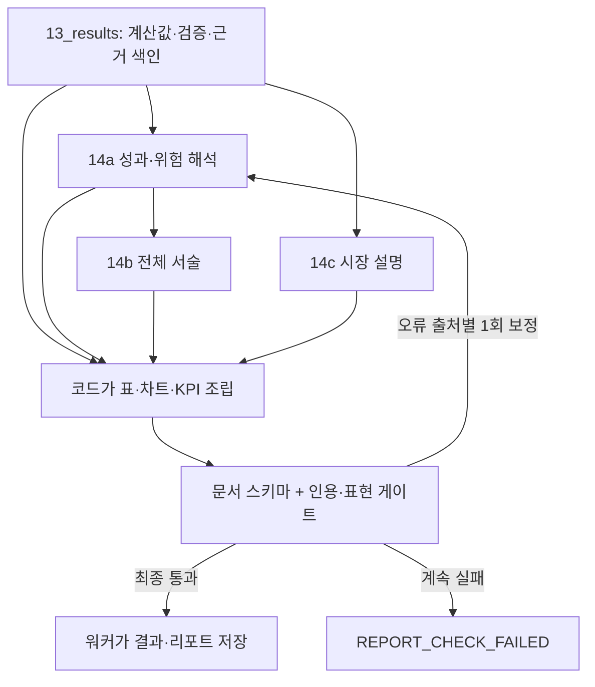

# m5_backtest_report 구현보고서

[전체 안내](README.md)

> 작성 기준: 2026-10-25 작업 공간의 실제 소스. 기존 설계 문서는 배경 참고용이며 아래 동작 설명은 구현을 기준으로 합니다.

대상: Python 파일 12개 · 클래스 2개 · 함수/메서드 169개(중첩 함수와 비공개 보조 함수 포함).

[역할](#role) · [파일 구성](#files) · [처리 흐름](#flow) · [클래스](#classes) · [함수](#functions) · [모듈 연계](#interactions) · [오류·검증](#verification)

<a id="role"></a>
## 1. 모듈의 역할과 용어

`m5_backtest_report`는 목표 비중을 과거 시장에서 평가하고 그 결과를 사용자 조건과 비교한 뒤 읽을 수 있는 리포트로 만듭니다. 백테스트는 실제 과거 가격에 매매 규칙을 적용한 시뮬레이션이고, walk-forward는 리밸런싱일마다 당시 이전 자료로 비중을 다시 계산한 경로입니다. 종목은 시작 선정 이후 유지합니다.

지수(index)는 납입금 영향을 분리한 성과 경로, 평가액(value_usd)은 적립을 포함한 자금 규모, XIRR은 납입 시점을 반영한 수익률입니다. CAGR은 복리 연수익, MDD는 고점에서 가장 크게 하락한 비율입니다. 이 구현에서 낙폭은 음수로 저장하고 검증 시 절댓값으로 비교합니다.

중심 흐름은 `run_backtest()` → `validate()` → `build_results()` → `generate_report()`이며 저장은 워커가 `persist`를 호출합니다. 현재 추천은 조건별 순위의 1위 한 개이고, 리포트 공개 차단은 별도의 구조·인용·금지 표현 게이트가 담당합니다.

<a id="files"></a>
## 2. 파일 구성과 책임

| 파일 | 책임 | 문서 내 해설 |
| --- | --- | --- |
| [m5_backtest_report/__init__.py](../../backend/analysis/m5_backtest_report/__init__.py) | 패키지 목적 설명; 독립 함수·클래스 정의 없음 | 정의 없음 |
| [m5_backtest_report/backtest.py](../../backend/analysis/m5_backtest_report/backtest.py) | 평가 준비·후보 실행·체크포인트·정식 맞춤 후보·결과 | [클래스 0 · 함수 15](#file-m5_backtest_report-backtest-py) |
| [m5_backtest_report/backtest_engine.py](../../backend/analysis/m5_backtest_report/backtest_engine.py) | bt 실행·일정·적립 Algo·원시 결과·XIRR | [클래스 1 · 함수 12](#file-m5_backtest_report-backtest_engine-py) |
| [m5_backtest_report/backtest_metrics.py](../../backend/analysis/m5_backtest_report/backtest_metrics.py) | 수익·위험·상대성과·금액·구성·거래·의견 진단 | [클래스 0 · 함수 23](#file-m5_backtest_report-backtest_metrics-py) |
| [m5_backtest_report/collect.py](../../backend/analysis/m5_backtest_report/collect.py) | 통합 결과·현재/과거 선정·근거 색인·원화 표시 | [클래스 0 · 함수 2](#file-m5_backtest_report-collect-py) |
| [m5_backtest_report/compare.py](../../backend/analysis/m5_backtest_report/compare.py) | 같은 평가 조건 확인·원안/수정안 차이·성과 비교 | [클래스 0 · 함수 9](#file-m5_backtest_report-compare-py) |
| [m5_backtest_report/matched.py](../../backend/analysis/m5_backtest_report/matched.py) | 실제 일정 재실행으로 낙폭 맞춤 현금 비율 탐색 | [클래스 0 · 함수 6](#file-m5_backtest_report-matched-py) |
| [m5_backtest_report/persist.py](../../backend/analysis/m5_backtest_report/persist.py) | DB 단계/결과/문서 저장 위임과 API 상태 변환 | [클래스 0 · 함수 7](#file-m5_backtest_report-persist-py) |
| [m5_backtest_report/report.py](../../backend/analysis/m5_backtest_report/report.py) | 세 LLM 문단·문서 조립·구형 표시·원인별 재시도 | [클래스 0 · 함수 22](#file-m5_backtest_report-report-py) |
| [m5_backtest_report/report_blocks.py](../../backend/analysis/m5_backtest_report/report_blocks.py) | 코드 기반 표·차트·KPI·기업·비중·타임라인·요약 | [클래스 0 · 함수 55](#file-m5_backtest_report-report_blocks-py) |
| [m5_backtest_report/report_check.py](../../backend/analysis/m5_backtest_report/report_check.py) | 일곱 섹션·인용·표현·숫자 게이트 | [클래스 1 · 함수 9](#file-m5_backtest_report-report_check-py) |
| [m5_backtest_report/validate.py](../../backend/analysis/m5_backtest_report/validate.py) | 사용자 표시/권장·내부 무결성·추천 순위와 라벨 | [클래스 0 · 함수 9](#file-m5_backtest_report-validate-py) |

<a id="flow"></a>
## 3. 처리 흐름과 예시

### 백테스트와 지표

같은 USD 가격 패널에 같은 초기자본·월 적립·거래비용을 적용해 정적 템플릿·시작일 BL·날짜별 경로·비교지수를 평가합니다. 기본 비용은 거래대금의 5bp(0.05%), 연간 거래일 252, 무위험수익률 4%, 소수 주식 허용입니다. 세금·환전 비용·슬리피지는 계산하지 않습니다.

누적 지수 수익과 납입 포함 평가액을 나눕니다. 예를 들어 자본 1,000 USD에 적립 100 USD가 들어오면 평가액 증가 전체가 투자수익은 아닙니다. 지수는 외부 유입의 효과를 분리하고 money 지표는 총납입·손익·XIRR을 따로 보여 줍니다.

핵심 식은 CAGR=`(끝 지수/시작 지수)^(252/관측 간격)-1`, MDD=`min(지수/누적 최고-1)`, Sharpe=`(CAGR-rf)/연변동성`입니다. 구성 단계의 로그수익 공분산과 성과 단계의 단순 일수익률 변동성을 구분합니다. 기본 378거래일 미만 평가 창은 기간 수익률을 대표 KPI로 사용하고 R2/R7을 참고로 낮춥니다.

### 낙폭 맞춤안과 추천

낙폭 맞춤안은 기준 템플릿·날짜별 뉴스 BL의 주식 비중을 (1-c)배로 줄여 현금을 추가한 `dd_match_<base_id>` 후보입니다. 일별 혼합 근사로 씨앗을 잡고 실제 리밸런싱·적립 일정의 백테스트를 반복해 목표를 만족하는지 확인합니다. 현금 수익은 0으로 가정합니다. 같은 과거 창에서 비율을 맞춘 사후 후보이므로 별도 미래 검증 결과로 설명하지 않습니다.

| 검사 | 의미 | 현재 처리 |
| --- | --- | --- |
| R1 | 사용자 허용 최대낙폭 | 초과는 flag와 순위 감점 |
| R2 | 투자기간 구간 목표수익 | 기본 절반 이상 구간 달성, 창 부족 시 전체 CAGR; 권장 |
| R3 | 비교지수 초과 CAGR | 권장 |
| R7 | 비교지수 대비 변동성 | 성향별 배수 또는 적극 성향 참고 |
| R1b/R4b/R5b/R9 | 시장 낙폭·드리프트·투자 비율 | 정보 |
| R4/R5/R8 | 조정 시 종목/섹터 상한·길이/횟수 | 내부 무결성 hard |

현재 R6 종목 수 검사를 별도로 생성하지 않습니다. 추천 순위는 **무결성 실패 → 목표수익 미달 → 비교지수 열위 → 허용 낙폭 초과 5%p 구간 → 보수 성향이면 맞춤안 우선 → 높은 Sharpe → 작은 낙폭**입니다. 후보가 있으면 1위 하나를 항상 고르며, 기준안 투자 비율이 기본 50% 미만이면 '구성 불충분' 라벨을 붙입니다.

### 통합·문서·저장



14a와 14c는 병렬, 14b는 14a 결과를 사용합니다. 재시도는 원인별이며 14a 수정 시 14b도 다시 씁니다. 이 문서 보정 1회와 LLM 호출기 자체의 형식/전송 재시도는 다른 층입니다.

새 문서는 요약 대시보드와 `verdict, market, companies, construction, performance, assumptions, references` 일곱 섹션입니다. 표·숫자·차트는 코드가, 문단은 LLM이 만듭니다. 실제 인용 근거만 문서에 포함하고 전체 색인은 API로 조회합니다. 긴 시계열은 기본 600점 부근으로 줄이되 끝점·낙폭 고점/저점을 보존합니다.

워커는 정상/부분 성공에만 run_artifact를 저장하고 이어 report를 저장합니다. 리포트 저장 오류면 실행 실패가 되지만 이전 artifact 쓰기까지 자동으로 되돌리는 하나의 트랜잭션은 아닙니다. 수정안 비교 파일 생성 실패도 별도로 로그 처리됩니다.

### 연관 리소스

| 파일 | 계약·용도 |
| --- | --- |
| [prompts/14a_interpret/system_prompt.md](../../backend/analysis/prompts/14a_interpret/system_prompt.md) | 고정 시스템 지침(로더는 치환하지 않음); 자리표시자 없음 |
| [prompts/14a_interpret/user_prompt.md](../../backend/analysis/prompts/14a_interpret/user_prompt.md) | 사용자 입력 템플릿; 자리표시자: `facts_json` |
| [prompts/14b_narrate/system_prompt.md](../../backend/analysis/prompts/14b_narrate/system_prompt.md) | 고정 시스템 지침(로더는 치환하지 않음); 자리표시자 없음 |
| [prompts/14b_narrate/user_prompt.md](../../backend/analysis/prompts/14b_narrate/user_prompt.md) | 사용자 입력 템플릿; 자리표시자: `facts_json`, `interpretation_json` |
| [prompts/14c_market/system_prompt.md](../../backend/analysis/prompts/14c_market/system_prompt.md) | 고정 시스템 지침(로더는 치환하지 않음); 자리표시자 없음 |
| [prompts/14c_market/user_prompt.md](../../backend/analysis/prompts/14c_market/user_prompt.md) | 사용자 입력 템플릿; 자리표시자: `facts_json` |

<a id="classes"></a>
## 4. 클래스 상세

필드 표는 해당 클래스에서 직접 선언한 필드입니다. 상속 필드는 부모 클래스 설명을 함께 읽습니다. `Field(...)`의 범위는 선언된 검증이며, 서비스에서 추가하는 조건은 함수 설명에 구분합니다.

<a id="m5_backtest_report-backtest_engine-py-ContributeOnDates-53"></a>
### `ContributeOnDates`

<!-- source-symbol: m5_backtest_report/backtest_engine.py:53:ContributeOnDates -->
[backtest_engine.py](../../backend/analysis/m5_backtest_report/backtest_engine.py#L53)

bt.Algo를 상속한 적립 처리기입니다. 현금 유입을 투자 수익과 분리하고 적립금의 목표 배분을 수행합니다.

기반: `bt.Algo`.

메서드·속성: [__init__](#m5_backtest_report-backtest_engine-py-ContributeOnDates-__init__-56), [__call__](#m5_backtest_report-backtest_engine-py-ContributeOnDates-__call__-60).


<a id="m5_backtest_report-report_check-py-CheckResult-21"></a>
### `CheckResult`

<!-- source-symbol: m5_backtest_report/report_check.py:21:CheckResult -->
[report_check.py](../../backend/analysis/m5_backtest_report/report_check.py#L21)

최종 리포트 게이트의 errors·warnings·errors_by_src를 담습니다. 실패 출처로 어떤 LLM 호출을 다시 보정할지 정합니다.

기반: `명시적 부모 없음` · 선언: `dataclass`.

| 필드 | 자료형 | 기본값 또는 생성 방식 | 선언된 제약·설명 |
| --- | --- | --- | --- |
| `errors` | `list[str]` | `생성 함수: list` | 문서 제공을 차단하는 오류 |
| `warnings` | `list[str]` | `생성 함수: list` | 문맥별 전체 경고 또는 문장 검사 메모 |
| `errors_by_src` | `dict[str, list[str]]` | `생성 함수: dict` | 생성 호출별 문서 오류 |

메서드·속성: [ok](#m5_backtest_report-report_check-py-CheckResult-ok-27), [err](#m5_backtest_report-report_check-py-CheckResult-err-30), [sources_to_retry](#m5_backtest_report-report_check-py-CheckResult-sources_to_retry-34).


<a id="functions"></a>
## 5. 함수·메서드 상세

시그니처에 입력 자료형·기본값·반환 자료형을 그대로 기재했습니다. `self`는 소속 클래스의 인스턴스, `cls`는 클래스입니다. 반환 주석이 없는 함수는 본문 해설의 반환 내용을 따릅니다. 속성(`property`)은 호출 괄호 없이 읽고, 중첩 함수는 바깥 함수의 지역 상태를 공유합니다. 연결 목록은 정적으로 확인되는 패키지 내부 직접 호출이며, 주입된 서비스·콜백·Repository 호출은 처리 흐름과 해설에서 설명합니다.


<a id="file-m5_backtest_report-backtest-py"></a>
### m5_backtest_report/backtest.py


<a id="m5_backtest_report-backtest-py-_f-35"></a>
#### `_f`

<!-- source-symbol: m5_backtest_report/backtest.py:35:_f -->
[backtest.py](../../backend/analysis/m5_backtest_report/backtest.py#L35)

```python
def _f(x, n=6): ...
```

backtest_metrics._r에 숫자 정규화·반올림을 위임합니다.

직접 연결: [_r](#m5_backtest_report-backtest_metrics-py-_r-11).

<details>
<summary>호출하는 코드</summary>

[build_checkpoints](#m5_backtest_report-backtest-py-build_checkpoints-55), [evaluate](#m5_backtest_report-backtest-py-evaluate-217).

</details>


<a id="m5_backtest_report-backtest-py-slice_raw-39"></a>
#### `slice_raw`

<!-- source-symbol: m5_backtest_report/backtest.py:39:slice_raw -->
[backtest.py](../../backend/analysis/m5_backtest_report/backtest.py#L39)

```python
def slice_raw(raw, d): ...
```

지정 날짜까지 원시 지수·평가액·유입·비중·보유·회전율·거래를 자른 사전을 반환합니다. 현재 주요 체크포인트 경로는 compute_to_date를 직접 사용하므로 실제 호출 여부와 별도로 남아 있는 보조 함수입니다.


<a id="m5_backtest_report-backtest-py-flat_to_date-45"></a>
#### `flat_to_date`

<!-- source-symbol: m5_backtest_report/backtest.py:45:flat_to_date -->
[backtest.py](../../backend/analysis/m5_backtest_report/backtest.py#L45)

```python
def flat_to_date(res, n_days, td): ...
```

compute_all 결과에서 체크포인트 요약 필드를 펼치고 관측 수가 연간 거래일 이상인지 reliable로 붙입니다. 새 compute_to_date와 값 비교 테스트가 이 변환을 참조합니다.


<a id="m5_backtest_report-backtest-py-build_checkpoints-55"></a>
#### `build_checkpoints`

<!-- source-symbol: m5_backtest_report/backtest.py:55:build_checkpoints -->
[backtest.py](../../backend/analysis/m5_backtest_report/backtest.py#L55)

```python
def build_checkpoints(raw, bench_raw, panel, targets, sectors, cp_dates, rb_set, last, cfg, views, implied, as_of, end, settings, targets_by_date=None): ...
```

리밸런싱·선택 월말·종료 시점별 목표/전후 비중, 보유 수량, 거래, 수수료, 구간 성과·기여·드리프트와 누적 금액을 기록합니다. 누적 관측 5일 이상이면 compute_to_date를 호출하고 설정 시 의견 진단도 추가합니다. 날짜별 목표가 있으면 그날 이전 최신 목표를 적용한 체크포인트 목록을 반환합니다.

직접 연결: [_f](#m5_backtest_report-backtest-py-_f-35), [daily_returns](#m5_backtest_report-backtest_metrics-py-daily_returns-16), [drawdown_series](#m5_backtest_report-backtest_metrics-py-drawdown_series-60), [ann_vol](#m5_backtest_report-backtest_metrics-py-ann_vol-51), [compute_to_date](#m5_backtest_report-backtest_metrics-py-compute_to_date-295), [view_diagnostics](#m5_backtest_report-backtest_metrics-py-view_diagnostics-194).

호출하는 코드: [evaluate](#m5_backtest_report-backtest-py-evaluate-217).


<a id="m5_backtest_report-backtest-py-build_events-131"></a>
#### `build_events`

<!-- source-symbol: m5_backtest_report/backtest.py:131:build_events -->
[backtest.py](../../backend/analysis/m5_backtest_report/backtest.py#L131)

```python
def build_events(raw, rb_dates, contrib_dates, checkpoints, settings): ...
```

낙폭 임계치 최초 하향 돌파·신고점 회복·적립·리밸런싱·상한 이탈을 날짜순 사건 목록으로 만듭니다. 낙폭이 회복되면 임계치 도달 이력을 초기화해 다음 하락 사건을 기록할 수 있습니다.

직접 연결: [drawdown_series](#m5_backtest_report-backtest_metrics-py-drawdown_series-60).

호출하는 코드: [evaluate](#m5_backtest_report-backtest-py-evaluate-217).


<a id="m5_backtest_report-backtest-py-prepare-155"></a>
#### `prepare`

<!-- source-symbol: m5_backtest_report/backtest.py:155:prepare -->
[backtest.py](../../backend/analysis/m5_backtest_report/backtest.py#L155)

```python
def prepare(md: MarketData, spec: dict[str, Any], req: dict[str, Any], intent: dict[str, Any], mm: dict[str, Any], desc: Descriptor, settings: AnalysisSettings, baseline_id: str) -> dict[str, Any]: ...
```

선정 종목과 비교지수의 품질 통과 USD 패널을 만들고 실제 거래일·리밸런싱일·적립일·섹터·자본·검증 조건을 실행 컨텍스트 사전에 모읍니다. 품질로 빠진 일반 종목과 필수 비교지수 실패를 구분하며 후속 정적·동적 실행에서 같은 조건을 사용합니다.

직접 연결: [rebalance_dates](#m5_backtest_report-backtest_engine-py-rebalance_dates-23), [contribution_dates](#m5_backtest_report-backtest_engine-py-contribution_dates-42), [gics_model](m2_data_구현보고서.md#m2_data-descriptor-py-gics_model-64), [report_summary](m2_data_구현보고서.md#m2_data-quality-py-report_summary-33).

호출하는 코드: [run_backtest](#m5_backtest_report-backtest-py-run_backtest-311).


<a id="m5_backtest_report-backtest-py-_usable_weights-184"></a>
#### `_usable_weights`

<!-- source-symbol: m5_backtest_report/backtest.py:184:_usable_weights -->
[backtest.py](../../backend/analysis/m5_backtest_report/backtest.py#L184)

```python
def _usable_weights(ctx, weights: dict[str, float]) -> dict[str, float]: ...
```

패널에 없는 종목을 빼고 남은 비중의 합계를 원래 주식 투자 총합으로 재조정합니다. 항상 100% 투자로 만드는 것이 아니므로 원래 현금 비율은 유지합니다. 남은 합계가 0이면 빈/0 비중을 그대로 반환합니다.

호출하는 코드: [run_raw](#m5_backtest_report-backtest-py-run_raw-192), [run_raw_dynamic](#m5_backtest_report-backtest-py-run_raw_dynamic-198), [evaluate](#m5_backtest_report-backtest-py-evaluate-217).


<a id="m5_backtest_report-backtest-py-run_raw-192"></a>
#### `run_raw`

<!-- source-symbol: m5_backtest_report/backtest.py:192:run_raw -->
[backtest.py](../../backend/analysis/m5_backtest_report/backtest.py#L192)

```python
def run_raw(ctx, pid, weights): ...
```

정적 비중을 사용 가능 종목에 맞추고 동일 자본·적립·리밸런싱 조건으로 실행한 원시 결과를 반환합니다.

직접 연결: [_usable_weights](#m5_backtest_report-backtest-py-_usable_weights-184), [run_static_portfolio](#m5_backtest_report-backtest_engine-py-run_static_portfolio-76), [extract_raw](#m5_backtest_report-backtest_engine-py-extract_raw-103).

호출하는 코드: [build_matched_blocks.run_fn](#m5_backtest_report-backtest-py-build_matched_blocks-run_fn-285), [run_backtest](#m5_backtest_report-backtest-py-run_backtest-311).


<a id="m5_backtest_report-backtest-py-run_raw_dynamic-198"></a>
#### `run_raw_dynamic`

<!-- source-symbol: m5_backtest_report/backtest.py:198:run_raw_dynamic -->
[backtest.py](../../backend/analysis/m5_backtest_report/backtest.py#L198)

```python
def run_raw_dynamic(ctx, pid, weights_by_date): ...
```

각 날짜 목표 비중을 정제한 뒤 날짜별 비중 bt 실행의 원시 결과를 반환합니다.

직접 연결: [_usable_weights](#m5_backtest_report-backtest-py-_usable_weights-184), [run_dynamic_portfolio](#m5_backtest_report-backtest_engine-py-run_dynamic_portfolio-85), [extract_raw](#m5_backtest_report-backtest_engine-py-extract_raw-103).

호출하는 코드: [build_matched_blocks.run_fn](#m5_backtest_report-backtest-py-build_matched_blocks-run_fn-288), [run_backtest](#m5_backtest_report-backtest-py-run_backtest-311).


<a id="m5_backtest_report-backtest-py-walkforward_view_diagnostics-204"></a>
#### `walkforward_view_diagnostics`

<!-- source-symbol: m5_backtest_report/backtest.py:204:walkforward_view_diagnostics -->
[backtest.py](../../backend/analysis/m5_backtest_report/backtest.py#L204)

```python
def walkforward_view_diagnostics(views_by_date, panel, end, implied_by_date, implied_start, horizon_days): ...
```

날짜별 의견을 각각 그 구성일 기준으로 진단하고 해당 날짜의 내재수익을 기준으로 사용합니다. 날짜별 모형이 없으면 시작 모형으로 대체하며 진단 행에 as_of를 붙입니다.

직접 연결: [view_diagnostics](#m5_backtest_report-backtest_metrics-py-view_diagnostics-194).

호출하는 코드: [evaluate](#m5_backtest_report-backtest-py-evaluate-217).


<a id="m5_backtest_report-backtest-py-evaluate-217"></a>
#### `evaluate`

<!-- source-symbol: m5_backtest_report/backtest.py:217:evaluate -->
[backtest.py](../../backend/analysis/m5_backtest_report/backtest.py#L217)

```python
def evaluate(ctx, p, raw, kind, bench_raw, baseline_idx, *, implied_by_date=None): ...
```

포트폴리오 원시 결과를 전체 지표·금액·체크포인트·적립 원장·사건·지수/평가액/낙폭 배열로 변환합니다. BL이면 365일 진단과 다음 리밸런싱까지 진단을 계산하고 헤드라인에 적중률을 붙입니다. 목표 비중 사전과 평가 엔진의 실제 보유 비중은 구분해 저장합니다.

직접 연결: [_usable_weights](#m5_backtest_report-backtest-py-_usable_weights-184), [walkforward_view_diagnostics](#m5_backtest_report-backtest-py-walkforward_view_diagnostics-204), [compute_all](#m5_backtest_report-backtest_metrics-py-compute_all-261), [view_diagnostics_next_window](#m5_backtest_report-backtest_metrics-py-view_diagnostics_next_window-222), [build_checkpoints](#m5_backtest_report-backtest-py-build_checkpoints-55), [_f](#m5_backtest_report-backtest-py-_f-35), [drawdown_series](#m5_backtest_report-backtest_metrics-py-drawdown_series-60), [build_events](#m5_backtest_report-backtest-py-build_events-131).

호출하는 코드: [build_matched_blocks](#m5_backtest_report-backtest-py-build_matched_blocks-259), [run_backtest](#m5_backtest_report-backtest-py-run_backtest-311).


<a id="m5_backtest_report-backtest-py-build_matched_blocks-259"></a>
#### `build_matched_blocks`

<!-- source-symbol: m5_backtest_report/backtest.py:259:build_matched_blocks -->
[backtest.py](../../backend/analysis/m5_backtest_report/backtest.py#L259)

```python
def build_matched_blocks(ctx, targets, wf, runs, blocks, primary_raw, baseline_idx, intent, implied_by_date): ...
```

사용자 기준 템플릿 정적안과 wf_bl_news를 기반으로 실제 일정의 낙폭이 목표 안에 들어오는 현금 축소 후보를 만듭니다. 원안이 이미 목표 안이면 생략하고 solve_cash_ratio가 찾은 비율로 정적 또는 날짜별 비중을 축소합니다. 정식 matched 결과·원시 실행·경고를 반환합니다. 현금 비율을 같은 과거 평가 창의 낙폭으로 맞춘 사후 비교 후보라는 한계가 있습니다.

직접 연결: [drawdown_series](#m5_backtest_report-backtest_metrics-py-drawdown_series-60), [seed_cash_ratio](#m5_backtest_report-matched-py-seed_cash_ratio-22), [solve_cash_ratio](#m5_backtest_report-matched-py-solve_cash_ratio-46), [scale_weights](#m5_backtest_report-matched-py-scale_weights-87), [matched_name](#m5_backtest_report-matched-py-matched_name-91), [evaluate](#m5_backtest_report-backtest-py-evaluate-217).

호출하는 코드: [run_backtest](#m5_backtest_report-backtest-py-run_backtest-311).


<a id="m5_backtest_report-backtest-py-build_matched_blocks-run_fn-285"></a>
#### `build_matched_blocks.run_fn`

<!-- source-symbol: m5_backtest_report/backtest.py:285:build_matched_blocks.run_fn -->
[backtest.py](../../backend/analysis/m5_backtest_report/backtest.py#L285)

```python
def run_fn(c, _w=base['weights'], _pid=pid): ...
```

정적 분기에서는 기준 weights에 (1-c)를 곱해 run_raw를, 동적 분기에서는 모든 날짜 비중을 축소해 run_raw_dynamic을 호출합니다. 같은 이름의 두 조건부 정의이며 각 정의의 소스 위치를 별도로 문서화합니다. 현금 탐색기가 실제 일정의 결과를 평가하도록 연결합니다.

직접 연결: [run_raw](#m5_backtest_report-backtest-py-run_raw-192), [scale_weights](#m5_backtest_report-matched-py-scale_weights-87).


<a id="m5_backtest_report-backtest-py-build_matched_blocks-run_fn-288"></a>
#### `build_matched_blocks.run_fn`

<!-- source-symbol: m5_backtest_report/backtest.py:288:build_matched_blocks.run_fn -->
[backtest.py](../../backend/analysis/m5_backtest_report/backtest.py#L288)

```python
def run_fn(c, _wbd=base['weights_by_date'], _pid=pid): ...
```

정적 분기에서는 기준 weights에 (1-c)를 곱해 run_raw를, 동적 분기에서는 모든 날짜 비중을 축소해 run_raw_dynamic을 호출합니다. 같은 이름의 두 조건부 정의이며 각 정의의 소스 위치를 별도로 문서화합니다. 현금 탐색기가 실제 일정의 결과를 평가하도록 연결합니다.

직접 연결: [run_raw_dynamic](#m5_backtest_report-backtest-py-run_raw_dynamic-198), [scale_weights](#m5_backtest_report-matched-py-scale_weights-87).


<a id="m5_backtest_report-backtest-py-run_backtest-311"></a>
#### `run_backtest`

<!-- source-symbol: m5_backtest_report/backtest.py:311:run_backtest -->
[backtest.py](../../backend/analysis/m5_backtest_report/backtest.py#L311)

```python
def run_backtest(md: MarketData, targets: dict[str, Any], req: dict[str, Any], intent: dict[str, Any], mm: dict[str, Any], desc: Descriptor, settings: AnalysisSettings, walkforward: dict[str, Any] | None=None) -> tuple[dict[str, Any], dict[str, Any], pd.DataFrame]: ...
```

정적 BL·네 템플릿·선택 날짜별 경로와 비교지수를 같은 패널·자본·적립으로 실행합니다. 낙폭 맞춤 후보를 추가하고 결과를 BacktestResults로 검증하며 재현 설정·타겟 해시·엔진 버전을 남깁니다. 결과 사전·내부 컨텍스트·전체 일별 패널을 반환합니다. 날짜별 입력 포트폴리오에는 마지막 목표 비중과 의견 목록을 제자리 보완합니다.

직접 연결: [prepare](#m5_backtest_report-backtest-py-prepare-155), [run_raw](#m5_backtest_report-backtest-py-run_raw-192), [run_raw_dynamic](#m5_backtest_report-backtest-py-run_raw_dynamic-198), [evaluate](#m5_backtest_report-backtest-py-evaluate-217), [build_matched_blocks](#m5_backtest_report-backtest-py-build_matched_blocks-259), [BacktestResults](schemas_구현보고서.md#schemas-backtest-py-BacktestResults-178), [drawdown_series](#m5_backtest_report-backtest_metrics-py-drawdown_series-60).

호출하는 코드: [st_backtest](executor_구현보고서.md#executor-stages-py-st_backtest-259).


<a id="file-m5_backtest_report-backtest_engine-py"></a>
### m5_backtest_report/backtest_engine.py


<a id="m5_backtest_report-backtest_engine-py-_period_key-19"></a>
#### `_period_key`

<!-- source-symbol: m5_backtest_report/backtest_engine.py:19:_period_key -->
[backtest_engine.py](../../backend/analysis/m5_backtest_report/backtest_engine.py#L19)

```python
def _period_key(ts: pd.Timestamp, unit: str): ...
```

날짜를 월·분기·반기·년의 그룹 키로 변환합니다. 기간의 첫 실제 거래일을 골라내는 보조 함수입니다.

호출하는 코드: [rebalance_dates](#m5_backtest_report-backtest_engine-py-rebalance_dates-23).


<a id="m5_backtest_report-backtest_engine-py-rebalance_dates-23"></a>
#### `rebalance_dates`

<!-- source-symbol: m5_backtest_report/backtest_engine.py:23:rebalance_dates -->
[backtest_engine.py](../../backend/analysis/m5_backtest_report/backtest_engine.py#L23)

```python
def rebalance_dates(rule: dict, calendar: pd.DatetimeIndex, as_of, settings: BacktestSettings) -> list: ...
```

실제 달력에서 시작일 매수와 주기별 리밸런싱 날짜를 고릅니다. count=0은 시작 한 번, 2w는 10거래일×count, 달력 단위는 기간 첫 거래일마다 count 간격입니다. 마지막 날이 반복 리밸런싱에 해당하면 제외해 종료 평가만 남깁니다.

직접 연결: [_period_key](#m5_backtest_report-backtest_engine-py-_period_key-19).

호출하는 코드: [st_walkforward](executor_구현보고서.md#executor-stages-py-st_walkforward-174), [prepare](#m5_backtest_report-backtest-py-prepare-155).


<a id="m5_backtest_report-backtest_engine-py-contribution_dates-42"></a>
#### `contribution_dates`

<!-- source-symbol: m5_backtest_report/backtest_engine.py:42:contribution_dates -->
[backtest_engine.py](../../backend/analysis/m5_backtest_report/backtest_engine.py#L42)

```python
def contribution_dates(calendar: pd.DatetimeIndex, as_of, end, day: int) -> list: ...
```

시작 다음 달부터 매월 지정 적립일 이후 첫 실제 거래일을 선택합니다. 달 마지막 날짜를 넘지 않게 보정하며 전체 평가 끝을 넘어선 적립은 만들지 않습니다.

호출하는 코드: [prepare](#m5_backtest_report-backtest-py-prepare-155), [PaperService._advance](m6_tracking_구현보고서.md#m6_tracking-paper-py-PaperService-_advance-380).


<a id="m5_backtest_report-backtest_engine-py-ContributeOnDates-__init__-56"></a>
#### `ContributeOnDates.__init__`

<!-- source-symbol: m5_backtest_report/backtest_engine.py:56:ContributeOnDates.__init__ -->
[backtest_engine.py](../../backend/analysis/m5_backtest_report/backtest_engine.py#L56)

```python
def __init__(self, dates, amount, weights): ...
```

적립 날짜 집합·금액·고정 비중 또는 날짜별 비중 콜백을 보관합니다.


<a id="m5_backtest_report-backtest_engine-py-ContributeOnDates-__call__-60"></a>
#### `ContributeOnDates.__call__`

<!-- source-symbol: m5_backtest_report/backtest_engine.py:60:ContributeOnDates.__call__ -->
[backtest_engine.py](../../backend/analysis/m5_backtest_report/backtest_engine.py#L60)

```python
def __call__(self, target): ...
```

적립일에 bt 전략에 외부 현금 유입을 넣고 당일 목표 비중대로 적립금만 자산에 배분합니다. 기존 보유 전체를 이 단계에서 리밸런싱하지는 않습니다. bt Algo 연결을 계속하도록 True를 반환합니다.


<a id="m5_backtest_report-backtest_engine-py-_commission-71"></a>
#### `_commission`

<!-- source-symbol: m5_backtest_report/backtest_engine.py:71:_commission -->
[backtest_engine.py](../../backend/analysis/m5_backtest_report/backtest_engine.py#L71)

```python
def _commission(settings: BacktestSettings): ...
```

매매 수량 절댓값×가격×commission_bps/10,000을 계산하는 수수료 콜백을 반환합니다.

호출하는 코드: [run_static_portfolio](#m5_backtest_report-backtest_engine-py-run_static_portfolio-76), [run_dynamic_portfolio](#m5_backtest_report-backtest_engine-py-run_dynamic_portfolio-85).


<a id="m5_backtest_report-backtest_engine-py-run_static_portfolio-76"></a>
#### `run_static_portfolio`

<!-- source-symbol: m5_backtest_report/backtest_engine.py:76:run_static_portfolio -->
[backtest_engine.py](../../backend/analysis/m5_backtest_report/backtest_engine.py#L76)

```python
def run_static_portfolio(pid, weights: dict, data: pd.DataFrame, initial_capital, rebal_dates, contrib_dates, contrib_amount, settings: BacktestSettings): ...
```

적립·정해진 날짜 실행·전체 선택·고정 비중·리밸런싱 Algo를 조립해 bt를 실행합니다. 가격은 전달받은 패널만 사용하고 Backtest와 실행 결과를 반환합니다.

직접 연결: [ContributeOnDates](#m5_backtest_report-backtest_engine-py-ContributeOnDates-53), [_commission](#m5_backtest_report-backtest_engine-py-_commission-71).

호출하는 코드: [run_raw](#m5_backtest_report-backtest-py-run_raw-192).


<a id="m5_backtest_report-backtest_engine-py-run_dynamic_portfolio-85"></a>
#### `run_dynamic_portfolio`

<!-- source-symbol: m5_backtest_report/backtest_engine.py:85:run_dynamic_portfolio -->
[backtest_engine.py](../../backend/analysis/m5_backtest_report/backtest_engine.py#L85)

```python
def run_dynamic_portfolio(pid, weights_by_date: dict, data: pd.DataFrame, initial_capital, contrib_dates, contrib_amount, settings: BacktestSettings): ...
```

날짜별 목표 비중을 표로 만들고 적립 때 최신 목표를 쓰도록 구성합니다. WeighTarget으로 지정 날짜에 비중을 바꾸는 bt를 실행해 Backtest와 결과를 반환합니다.

직접 연결: [ContributeOnDates](#m5_backtest_report-backtest_engine-py-ContributeOnDates-53), [_commission](#m5_backtest_report-backtest_engine-py-_commission-71).

호출하는 코드: [run_raw_dynamic](#m5_backtest_report-backtest-py-run_raw_dynamic-198).


<a id="m5_backtest_report-backtest_engine-py-run_dynamic_portfolio-latest-91"></a>
#### `run_dynamic_portfolio.latest`

<!-- source-symbol: m5_backtest_report/backtest_engine.py:91:run_dynamic_portfolio.latest -->
[backtest_engine.py](../../backend/analysis/m5_backtest_report/backtest_engine.py#L91)

```python
def latest(now): ...
```

현재 날짜 이하의 가장 최근 비중 행을 사전으로 반환합니다. 앞선 행이 없으면 첫 행을 사용하므로 정상 입력은 시작일 비중을 포함해야 합니다.


<a id="m5_backtest_report-backtest_engine-py-extract_raw-103"></a>
#### `extract_raw`

<!-- source-symbol: m5_backtest_report/backtest_engine.py:103:extract_raw -->
[backtest_engine.py](../../backend/analysis/m5_backtest_report/backtest_engine.py#L103)

```python
def extract_raw(b, res, first_date) -> dict: ...
```

bt가 덧붙인 시작 전 현금 행을 제거하고 초기 유입을 첫 거래일로 옮깁니다. 지수를 첫날 100으로 정규화하고 평가액·유입·비중·보유 수량·회전율·거래 표를 반환합니다. 첫날 체결 수수료는 평가액에 존재해도 지수 정규화의 기준에 흡수될 수 있습니다.

직접 연결: [extract_raw.cut](#m5_backtest_report-backtest_engine-py-extract_raw-cut-107).

호출하는 코드: [run_raw](#m5_backtest_report-backtest-py-run_raw-192), [run_raw_dynamic](#m5_backtest_report-backtest-py-run_raw_dynamic-198).


<a id="m5_backtest_report-backtest_engine-py-extract_raw-cut-107"></a>
#### `extract_raw.cut`

<!-- source-symbol: m5_backtest_report/backtest_engine.py:107:extract_raw.cut -->
[backtest_engine.py](../../backend/analysis/m5_backtest_report/backtest_engine.py#L107)

```python
def cut(x): ...
```

시계열에서 실제 첫 거래일 이상 행만 반환합니다. 바깥 함수의 first를 캡처합니다.

호출하는 코드: [extract_raw](#m5_backtest_report-backtest_engine-py-extract_raw-103).


<a id="m5_backtest_report-backtest_engine-py-xirr-123"></a>
#### `xirr`

<!-- source-symbol: m5_backtest_report/backtest_engine.py:123:xirr -->
[backtest_engine.py](../../backend/analysis/m5_backtest_report/backtest_engine.py#L123)

```python
def xirr(dates, amounts) -> float: ...
```

투입은 음수, 최종 회수는 양수인 날짜별 현금흐름의 현재가치 합계가 0이 되는 연수익률을 Brent 방법으로 찾습니다. 탐색 구간 -0.9999~10에서 근을 찾지 못하면 NaN입니다.


<a id="file-m5_backtest_report-backtest_metrics-py"></a>
### m5_backtest_report/backtest_metrics.py


<a id="m5_backtest_report-backtest_metrics-py-_r-11"></a>
#### `_r`

<!-- source-symbol: m5_backtest_report/backtest_metrics.py:11:_r -->
[backtest_metrics.py](../../backend/analysis/m5_backtest_report/backtest_metrics.py#L11)

```python
def _r(x, n=6): ...
```

None 또는 비유한 Python float는 None, 그 외 숫자는 지정 자릿수로 반올림합니다. 결과 JSON의 표시·전달용 보조 함수입니다.

<details>
<summary>호출하는 코드</summary>

[_f](#m5_backtest_report-backtest-py-_f-35), [yearly_returns](#m5_backtest_report-backtest_metrics-py-yearly_returns-36), [rolling_12m](#m5_backtest_report-backtest_metrics-py-rolling_12m-43), [drawdown_episodes](#m5_backtest_report-backtest_metrics-py-drawdown_episodes-77), [var_cvar](#m5_backtest_report-backtest_metrics-py-var_cvar-98), [relative_to](#m5_backtest_report-backtest_metrics-py-relative_to-106), [money_metrics](#m5_backtest_report-backtest_metrics-py-money_metrics-136), [composition_metrics](#m5_backtest_report-backtest_metrics-py-composition_metrics-152), [trading_metrics](#m5_backtest_report-backtest_metrics-py-trading_metrics-175), [rolling_metrics](#m5_backtest_report-backtest_metrics-py-rolling_metrics-183), [view_diagnostics](#m5_backtest_report-backtest_metrics-py-view_diagnostics-194), [view_diagnostics_next_window](#m5_backtest_report-backtest_metrics-py-view_diagnostics_next_window-222), [compute_all](#m5_backtest_report-backtest_metrics-py-compute_all-261), [compute_to_date](#m5_backtest_report-backtest_metrics-py-compute_to_date-295).

</details>


<a id="m5_backtest_report-backtest_metrics-py-daily_returns-16"></a>
#### `daily_returns`

<!-- source-symbol: m5_backtest_report/backtest_metrics.py:16:daily_returns -->
[backtest_metrics.py](../../backend/analysis/m5_backtest_report/backtest_metrics.py#L16)

```python
def daily_returns(idx: pd.Series) -> pd.Series: ...
```

지수 시계열의 전일 대비 단순 수익률을 계산하고 결측 첫 행을 제거합니다.

호출하는 코드: [build_checkpoints](#m5_backtest_report-backtest-py-build_checkpoints-55), [relative_to](#m5_backtest_report-backtest_metrics-py-relative_to-106), [rolling_metrics](#m5_backtest_report-backtest_metrics-py-rolling_metrics-183), [compute_all](#m5_backtest_report-backtest_metrics-py-compute_all-261), [compute_to_date](#m5_backtest_report-backtest_metrics-py-compute_to_date-295).


<a id="m5_backtest_report-backtest_metrics-py-total_return-20"></a>
#### `total_return`

<!-- source-symbol: m5_backtest_report/backtest_metrics.py:20:total_return -->
[backtest_metrics.py](../../backend/analysis/m5_backtest_report/backtest_metrics.py#L20)

```python
def total_return(idx): ...
```

마지막 지수/첫 지수-1로 기간 수익률을 계산합니다. 적립금이 포함된 평가액 증가율과 구별합니다.

호출하는 코드: [compute_all](#m5_backtest_report-backtest_metrics-py-compute_all-261), [compute_to_date](#m5_backtest_report-backtest_metrics-py-compute_to_date-295).


<a id="m5_backtest_report-backtest_metrics-py-cagr-24"></a>
#### `cagr`

<!-- source-symbol: m5_backtest_report/backtest_metrics.py:24:cagr -->
[backtest_metrics.py](../../backend/analysis/m5_backtest_report/backtest_metrics.py#L24)

```python
def cagr(idx, td: int): ...
```

관측 간격 수 len(index)-1과 연간 거래일 수 td로 복리 연환산 수익률을 계산합니다. 유효 간격이 없으면 NaN이며 짧은 창의 표시 제한은 상위 계층이 담당합니다.

호출하는 코드: [relative_to](#m5_backtest_report-backtest_metrics-py-relative_to-106), [compute_all](#m5_backtest_report-backtest_metrics-py-compute_all-261), [compute_to_date](#m5_backtest_report-backtest_metrics-py-compute_to_date-295).


<a id="m5_backtest_report-backtest_metrics-py-monthly_returns-29"></a>
#### `monthly_returns`

<!-- source-symbol: m5_backtest_report/backtest_metrics.py:29:monthly_returns -->
[backtest_metrics.py](../../backend/analysis/m5_backtest_report/backtest_metrics.py#L29)

```python
def monthly_returns(idx: pd.Series) -> pd.Series: ...
```

월말 지수의 전월 대비 수익률을 계산합니다. 첫 달은 분석 첫 지수와 첫 월말을 비교해 부분월 수익률로 보완합니다.

호출하는 코드: [relative_to](#m5_backtest_report-backtest_metrics-py-relative_to-106), [compute_all](#m5_backtest_report-backtest_metrics-py-compute_all-261), [compute_to_date](#m5_backtest_report-backtest_metrics-py-compute_to_date-295).


<a id="m5_backtest_report-backtest_metrics-py-yearly_returns-36"></a>
#### `yearly_returns`

<!-- source-symbol: m5_backtest_report/backtest_metrics.py:36:yearly_returns -->
[backtest_metrics.py](../../backend/analysis/m5_backtest_report/backtest_metrics.py#L36)

```python
def yearly_returns(idx: pd.Series) -> dict: ...
```

연말 지수로 연도별 수익률 사전을 만듭니다. 첫 해는 분석 시작부터의 부분기간 수익률입니다.

직접 연결: [_r](#m5_backtest_report-backtest_metrics-py-_r-11).

호출하는 코드: [compute_all](#m5_backtest_report-backtest_metrics-py-compute_all-261).


<a id="m5_backtest_report-backtest_metrics-py-rolling_12m-43"></a>
#### `rolling_12m`

<!-- source-symbol: m5_backtest_report/backtest_metrics.py:43:rolling_12m -->
[backtest_metrics.py](../../backend/analysis/m5_backtest_report/backtest_metrics.py#L43)

```python
def rolling_12m(idx, target, td: int): ...
```

td거래일 간격 수익률의 최저·중앙·최고와 목표 초과 비율을 반환합니다. 1년 관측이 없으면 각 값이 None인 요약입니다.

직접 연결: [_r](#m5_backtest_report-backtest_metrics-py-_r-11).

호출하는 코드: [compute_all](#m5_backtest_report-backtest_metrics-py-compute_all-261).


<a id="m5_backtest_report-backtest_metrics-py-ann_vol-51"></a>
#### `ann_vol`

<!-- source-symbol: m5_backtest_report/backtest_metrics.py:51:ann_vol -->
[backtest_metrics.py](../../backend/analysis/m5_backtest_report/backtest_metrics.py#L51)

```python
def ann_vol(r, td: int): ...
```

일별 단순 수익률의 표본 표준편차에 √td를 곱해 연환산 변동성을 계산합니다. 관측 2개 미만이면 NaN입니다.

호출하는 코드: [build_checkpoints](#m5_backtest_report-backtest-py-build_checkpoints-55), [compute_all](#m5_backtest_report-backtest_metrics-py-compute_all-261), [compute_to_date](#m5_backtest_report-backtest_metrics-py-compute_to_date-295).


<a id="m5_backtest_report-backtest_metrics-py-downside_deviation-55"></a>
#### `downside_deviation`

<!-- source-symbol: m5_backtest_report/backtest_metrics.py:55:downside_deviation -->
[backtest_metrics.py](../../backend/analysis/m5_backtest_report/backtest_metrics.py#L55)

```python
def downside_deviation(r, rf, td: int): ...
```

일별 수익률에서 rf/td를 뺀 음수 부분의 제곱평균 제곱근을 연율화합니다. 음수인 날만을 분모로 삼는 방식이 아니라 전체 관측 평균입니다.

호출하는 코드: [compute_all](#m5_backtest_report-backtest_metrics-py-compute_all-261), [compute_to_date](#m5_backtest_report-backtest_metrics-py-compute_to_date-295).


<a id="m5_backtest_report-backtest_metrics-py-drawdown_series-60"></a>
#### `drawdown_series`

<!-- source-symbol: m5_backtest_report/backtest_metrics.py:60:drawdown_series -->
[backtest_metrics.py](../../backend/analysis/m5_backtest_report/backtest_metrics.py#L60)

```python
def drawdown_series(idx): ...
```

현재 지수/과거 누적 최고 지수-1을 반환합니다. 낙폭은 0 이하로 표현됩니다.

<details>
<summary>호출하는 코드</summary>

[build_checkpoints](#m5_backtest_report-backtest-py-build_checkpoints-55), [build_events](#m5_backtest_report-backtest-py-build_events-131), [evaluate](#m5_backtest_report-backtest-py-evaluate-217), [build_matched_blocks](#m5_backtest_report-backtest-py-build_matched_blocks-259), [run_backtest](#m5_backtest_report-backtest-py-run_backtest-311), [mdd_info](#m5_backtest_report-backtest_metrics-py-mdd_info-64), [drawdown_episodes](#m5_backtest_report-backtest_metrics-py-drawdown_episodes-77), [compute_all](#m5_backtest_report-backtest_metrics-py-compute_all-261), [compute_to_date](#m5_backtest_report-backtest_metrics-py-compute_to_date-295), [seed_cash_ratio.mdd](#m5_backtest_report-matched-py-seed_cash_ratio-mdd-27), [_mdd](#m5_backtest_report-matched-py-_mdd-42).

</details>


<a id="m5_backtest_report-backtest_metrics-py-mdd_info-64"></a>
#### `mdd_info`

<!-- source-symbol: m5_backtest_report/backtest_metrics.py:64:mdd_info -->
[backtest_metrics.py](../../backend/analysis/m5_backtest_report/backtest_metrics.py#L64)

```python
def mdd_info(idx): ...
```

최대낙폭 저점·선행 고점·회복일과 달력일 기준 하락·수중 기간을 계산합니다. 낙폭이 한 번도 없으면 날짜는 None, 기간은 0입니다.

직접 연결: [drawdown_series](#m5_backtest_report-backtest_metrics-py-drawdown_series-60).

호출하는 코드: [compute_all](#m5_backtest_report-backtest_metrics-py-compute_all-261).


<a id="m5_backtest_report-backtest_metrics-py-drawdown_episodes-77"></a>
#### `drawdown_episodes`

<!-- source-symbol: m5_backtest_report/backtest_metrics.py:77:drawdown_episodes -->
[backtest_metrics.py](../../backend/analysis/m5_backtest_report/backtest_metrics.py#L77)

```python
def drawdown_episodes(idx, min_depth=-0.05, top=3): ...
```

고점에서 이탈해 회복하는 구간과 아직 회복하지 않은 구간을 찾아 깊이 기준으로 정렬합니다. 기본 -5% 이하 상위 3개 사건의 고점·저점·회복일을 반환합니다.

직접 연결: [drawdown_series](#m5_backtest_report-backtest_metrics-py-drawdown_series-60), [_r](#m5_backtest_report-backtest_metrics-py-_r-11).

호출하는 코드: [compute_all](#m5_backtest_report-backtest_metrics-py-compute_all-261).


<a id="m5_backtest_report-backtest_metrics-py-var_cvar-98"></a>
#### `var_cvar`

<!-- source-symbol: m5_backtest_report/backtest_metrics.py:98:var_cvar -->
[backtest_metrics.py](../../backend/analysis/m5_backtest_report/backtest_metrics.py#L98)

```python
def var_cvar(mr, q=0.05): ...
```

월 수익률의 하위 q 분위수와 그 이하 평균을 VaR·CVaR 쌍으로 반환합니다. 월 관측이 3개 미만이면 둘 다 None입니다. 손실 절댓값으로 바꾸지 않은 수익률 부호를 유지합니다.

직접 연결: [_r](#m5_backtest_report-backtest_metrics-py-_r-11).

호출하는 코드: [compute_all](#m5_backtest_report-backtest_metrics-py-compute_all-261).


<a id="m5_backtest_report-backtest_metrics-py-relative_to-106"></a>
#### `relative_to`

<!-- source-symbol: m5_backtest_report/backtest_metrics.py:106:relative_to -->
[backtest_metrics.py](../../backend/analysis/m5_backtest_report/backtest_metrics.py#L106)

```python
def relative_to(idx, bench_idx, rf, td: int): ...
```

전략·비교지수의 공통 날짜 일수익률을 정렬해 초과 CAGR·베타·알파·상관·추적오차·정보비율·상승/하락 포착률·월별 우위 비율을 계산합니다. 공통 관측이 5개 미만이면 빈 값 사전입니다. 상수 비교지수로 인한 분산 0은 별도로 예외 처리하지 않습니다.

직접 연결: [daily_returns](#m5_backtest_report-backtest_metrics-py-daily_returns-16), [cagr](#m5_backtest_report-backtest_metrics-py-cagr-24), [monthly_returns](#m5_backtest_report-backtest_metrics-py-monthly_returns-29), [_r](#m5_backtest_report-backtest_metrics-py-_r-11).

호출하는 코드: [compute_all](#m5_backtest_report-backtest_metrics-py-compute_all-261), [compute_to_date](#m5_backtest_report-backtest_metrics-py-compute_to_date-295).


<a id="m5_backtest_report-backtest_metrics-py-irr_annual-127"></a>
#### `irr_annual`

<!-- source-symbol: m5_backtest_report/backtest_metrics.py:127:irr_annual -->
[backtest_metrics.py](../../backend/analysis/m5_backtest_report/backtest_metrics.py#L127)

```python
def irr_annual(values: pd.Series, flows: pd.Series, xirr_fn): ...
```

유입 원장의 각 납입을 음수, 마지막 평가액을 양수로 xirr_fn에 전달합니다. 자금 투입 시점을 반영한 금액가중수익률이며 지수 CAGR과 구별합니다.

호출하는 코드: [money_metrics](#m5_backtest_report-backtest_metrics-py-money_metrics-136), [compute_to_date](#m5_backtest_report-backtest_metrics-py-compute_to_date-295).


<a id="m5_backtest_report-backtest_metrics-py-money_metrics-136"></a>
#### `money_metrics`

<!-- source-symbol: m5_backtest_report/backtest_metrics.py:136:money_metrics -->
[backtest_metrics.py](../../backend/analysis/m5_backtest_report/backtest_metrics.py#L136)

```python
def money_metrics(values: pd.Series, flows: pd.Series, xirr_fn, td: int): ...
```

초기자본·적립 합계·누적 납입·최종 평가액·이익·XIRR·납입 대비 최대 금액 손실·최악 12개월 금액 손실을 계산합니다. 가격 지수 수익과 자금 규모의 효과를 분리한 결과입니다.

직접 연결: [irr_annual](#m5_backtest_report-backtest_metrics-py-irr_annual-127), [_r](#m5_backtest_report-backtest_metrics-py-_r-11).

호출하는 코드: [compute_all](#m5_backtest_report-backtest_metrics-py-compute_all-261).


<a id="m5_backtest_report-backtest_metrics-py-composition_metrics-152"></a>
#### `composition_metrics`

<!-- source-symbol: m5_backtest_report/backtest_metrics.py:152:composition_metrics -->
[backtest_metrics.py](../../backend/analysis/m5_backtest_report/backtest_metrics.py#L152)

```python
def composition_metrics(sec_w: pd.DataFrame, asset_px: pd.DataFrame, targets: dict, sectors: dict, max_stock, max_sector, drift_tol: float): ...
```

일별 실제 비중·가격으로 종목 수익 기여, 평균 섹터 비중, 집중도 HHI·유효 종목 수, 최대 비중 드리프트와 상한 이탈을 계산합니다. 목표 대비 드리프트 기준은 전달 targets이며 동적 경로의 모든 날짜별 목표와 각각 비교하는 함수는 아닙니다.

직접 연결: [_r](#m5_backtest_report-backtest_metrics-py-_r-11).

호출하는 코드: [compute_all](#m5_backtest_report-backtest_metrics-py-compute_all-261).


<a id="m5_backtest_report-backtest_metrics-py-trading_metrics-175"></a>
#### `trading_metrics`

<!-- source-symbol: m5_backtest_report/backtest_metrics.py:175:trading_metrics -->
[backtest_metrics.py](../../backend/analysis/m5_backtest_report/backtest_metrics.py#L175)

```python
def trading_metrics(tx: pd.DataFrame, turnover: pd.Series, rebal_dates, values: pd.Series, commission_bps: float): ...
```

실제 거래량·가격에서 수수료 합계와 평균 평가액 대비 연환산 비용을 계산하고 일정상 리밸런싱 수·해당 날짜 평균 회전율을 반환합니다.

직접 연결: [_r](#m5_backtest_report-backtest_metrics-py-_r-11).

호출하는 코드: [compute_all](#m5_backtest_report-backtest_metrics-py-compute_all-261).


<a id="m5_backtest_report-backtest_metrics-py-rolling_metrics-183"></a>
#### `rolling_metrics`

<!-- source-symbol: m5_backtest_report/backtest_metrics.py:183:rolling_metrics -->
[backtest_metrics.py](../../backend/analysis/m5_backtest_report/backtest_metrics.py#L183)

```python
def rolling_metrics(idx, rf, td: int): ...
```

1년 이동 변동성과 (1년 누적 수익률-rf)/변동성 형태의 이동 Sharpe 요약을 계산합니다. 관측이 td+5보다 적으면 None 값 요약입니다.

직접 연결: [daily_returns](#m5_backtest_report-backtest_metrics-py-daily_returns-16), [_r](#m5_backtest_report-backtest_metrics-py-_r-11).

호출하는 코드: [compute_all](#m5_backtest_report-backtest_metrics-py-compute_all-261).


<a id="m5_backtest_report-backtest_metrics-py-view_diagnostics-194"></a>
#### `view_diagnostics`

<!-- source-symbol: m5_backtest_report/backtest_metrics.py:194:view_diagnostics -->
[backtest_metrics.py](../../backend/analysis/m5_backtest_report/backtest_metrics.py#L194)

```python
def view_diagnostics(views, asset_px: pd.DataFrame, as_of, end, implied: dict, horizon_days: int): ...
```

의견 구성일에서 기본 365달력일 또는 평가 끝까지 실현수익을 구해 의견 방향을 진단합니다. 절대 의견은 연간 내재수익 대비 양쪽 차이의 부호, 상대 의견은 long 평균-short 평균 양수 여부로 적중을 판단합니다. 이 경로는 기간별 연율 지평을 엄밀히 맞추는 방식이 아닙니다.

직접 연결: [_r](#m5_backtest_report-backtest_metrics-py-_r-11).

호출하는 코드: [build_checkpoints](#m5_backtest_report-backtest-py-build_checkpoints-55), [walkforward_view_diagnostics](#m5_backtest_report-backtest-py-walkforward_view_diagnostics-204), [compute_all](#m5_backtest_report-backtest_metrics-py-compute_all-261).


<a id="m5_backtest_report-backtest_metrics-py-view_diagnostics_next_window-222"></a>
#### `view_diagnostics_next_window`

<!-- source-symbol: m5_backtest_report/backtest_metrics.py:222:view_diagnostics_next_window -->
[backtest_metrics.py](../../backend/analysis/m5_backtest_report/backtest_metrics.py#L222)

```python
def view_diagnostics_next_window(views_by_date, asset_px: pd.DataFrame, rb_dates, end, implied_by_date, implied_start): ...
```

의견 구성일부터 다음 리밸런싱일 또는 종료일까지의 실현수익을 진단합니다. 절대 의견의 내재수익 기준은 달력일 비례로 줄이고 상대 의견은 long-short 양수로 판단합니다. 창이 너무 짧거나 관련 가격이 없으면 해당 의견을 생략합니다.

직접 연결: [_r](#m5_backtest_report-backtest_metrics-py-_r-11).

호출하는 코드: [evaluate](#m5_backtest_report-backtest-py-evaluate-217).


<a id="m5_backtest_report-backtest_metrics-py-compute_all-261"></a>
#### `compute_all`

<!-- source-symbol: m5_backtest_report/backtest_metrics.py:261:compute_all -->
[backtest_metrics.py](../../backend/analysis/m5_backtest_report/backtest_metrics.py#L261)

```python
def compute_all(raw, bench_idx, asset_px, targets, sectors, rebal_dates, rf, target_return, max_stock, max_sector, xirr_fn, settings: BacktestSettings, baseline_idx=None, views=None, implied=None, as_of=None, end=None): ...
```

성과·위험·위험조정·비교지수/기준안 대비·구성·거래·안정성·금액 지표와 월/연 수익·의견 진단을 통합합니다. Sharpe=(CAGR-rf)/연변동성, Sortino=(CAGR-rf)/하방편차로 계산하므로 다른 라이브러리의 평균 일수익률 기반 정의와 구분합니다.

직접 연결: [daily_returns](#m5_backtest_report-backtest_metrics-py-daily_returns-16), [monthly_returns](#m5_backtest_report-backtest_metrics-py-monthly_returns-29), [cagr](#m5_backtest_report-backtest_metrics-py-cagr-24), [ann_vol](#m5_backtest_report-backtest_metrics-py-ann_vol-51), [drawdown_series](#m5_backtest_report-backtest_metrics-py-drawdown_series-60), [downside_deviation](#m5_backtest_report-backtest_metrics-py-downside_deviation-55), [var_cvar](#m5_backtest_report-backtest_metrics-py-var_cvar-98), [composition_metrics](#m5_backtest_report-backtest_metrics-py-composition_metrics-152), [_r](#m5_backtest_report-backtest_metrics-py-_r-11), [total_return](#m5_backtest_report-backtest_metrics-py-total_return-20), [rolling_12m](#m5_backtest_report-backtest_metrics-py-rolling_12m-43), [mdd_info](#m5_backtest_report-backtest_metrics-py-mdd_info-64), [drawdown_episodes](#m5_backtest_report-backtest_metrics-py-drawdown_episodes-77), [relative_to](#m5_backtest_report-backtest_metrics-py-relative_to-106), [trading_metrics](#m5_backtest_report-backtest_metrics-py-trading_metrics-175), [rolling_metrics](#m5_backtest_report-backtest_metrics-py-rolling_metrics-183), [money_metrics](#m5_backtest_report-backtest_metrics-py-money_metrics-136), [view_diagnostics](#m5_backtest_report-backtest_metrics-py-view_diagnostics-194), [yearly_returns](#m5_backtest_report-backtest_metrics-py-yearly_returns-36).

호출하는 코드: [evaluate](#m5_backtest_report-backtest-py-evaluate-217).


<a id="m5_backtest_report-backtest_metrics-py-compute_to_date-295"></a>
#### `compute_to_date`

<!-- source-symbol: m5_backtest_report/backtest_metrics.py:295:compute_to_date -->
[backtest_metrics.py](../../backend/analysis/m5_backtest_report/backtest_metrics.py#L295)

```python
def compute_to_date(idx: pd.Series, values: pd.Series, flows: pd.Series, bench_idx: pd.Series, rf, xirr_fn, settings: BacktestSettings, baseline_idx=None): ...
```

체크포인트까지 필요한 수익률·위험·상대성과·XIRR 등 요약 13개 값을 compute_all과 같은 식으로 계산합니다. 전체 구성·거래 지표를 매번 다시 만들지 않아 반복 비용을 줄입니다.

직접 연결: [daily_returns](#m5_backtest_report-backtest_metrics-py-daily_returns-16), [monthly_returns](#m5_backtest_report-backtest_metrics-py-monthly_returns-29), [cagr](#m5_backtest_report-backtest_metrics-py-cagr-24), [ann_vol](#m5_backtest_report-backtest_metrics-py-ann_vol-51), [drawdown_series](#m5_backtest_report-backtest_metrics-py-drawdown_series-60), [downside_deviation](#m5_backtest_report-backtest_metrics-py-downside_deviation-55), [relative_to](#m5_backtest_report-backtest_metrics-py-relative_to-106), [_r](#m5_backtest_report-backtest_metrics-py-_r-11), [total_return](#m5_backtest_report-backtest_metrics-py-total_return-20), [irr_annual](#m5_backtest_report-backtest_metrics-py-irr_annual-127).

호출하는 코드: [build_checkpoints](#m5_backtest_report-backtest-py-build_checkpoints-55).


<a id="file-m5_backtest_report-collect-py"></a>
### m5_backtest_report/collect.py


<a id="m5_backtest_report-collect-py-_calc_facts-28"></a>
#### `_calc_facts`

<!-- source-symbol: m5_backtest_report/collect.py:28:_calc_facts -->
[collect.py](../../backend/analysis/m5_backtest_report/collect.py#L28)

```python
def _calc_facts(bt: dict[str, Any], val: dict[str, Any]) -> dict[str, dict[str, Any]]: ...
```

모든 전략·비교지수·호환 대안의 계산 지표를 calc:<metric>:<portfolio_id> 근거 사전으로 만듭니다. 사용 가능한 헤드라인 값과 ann_vol에 계산 출처·끝 날짜·단위를 붙입니다.

호출하는 코드: [build_results](#m5_backtest_report-collect-py-build_results-42).


<a id="m5_backtest_report-collect-py-build_results-42"></a>
#### `build_results`

<!-- source-symbol: m5_backtest_report/collect.py:42:build_results -->
[collect.py](../../backend/analysis/m5_backtest_report/collect.py#L42)

```python
def build_results(*, run_id: str, req: dict[str, Any], intent: dict[str, Any], cand: dict[str, Any], tag: dict[str, Any], sel: dict[str, Any], expl: dict[str, Any] | None, spec: dict[str, Any], mm: dict[str, Any], base: dict[str, Any], views: dict[str, Any], targets: dict[str, Any], bt: dict[str, Any], val: dict[str, Any], desc: Descriptor, descriptor_info: dict[str, Any], settings: AnalysisSettings, facts: list[dict[str, Any]], news_windows: list[dict[str, Any]], walkforward: dict[str, Any] | None=None, forward: dict[str, Any] | None=None, llm_usage: dict[str, Any] | None=None, extra_warnings: list[Any] | None=None) -> dict[str, Any]: ...
```

단계별 결과를 재계산하지 않고 ResultsBundle로 통합합니다. 현재/과거 선정 합집합 표·퍼널·설명·과거/현재/날짜별 구성·원화 표시금액·출처·설정·사용량을 묶습니다. 뉴스·공시·금융 Fact·계산값의 evidence_index를 만들고 구조화 경고를 병합해 전체 warnings와 사용자 notices를 분리합니다. 사전 키가 같은 근거는 후속 창의 메타로 덮어씁니다.

직접 연결: [Warning](common_구현보고서.md#common-warnings-py-Warning-19), [merge](common_구현보고서.md#common-warnings-py-merge-167), [render](common_구현보고서.md#common-warnings-py-render-183), [gics_model](m2_data_구현보고서.md#m2_data-descriptor-py-gics_model-64), [tickers](m2_data_구현보고서.md#m2_data-descriptor-py-tickers-128), [_calc_facts](#m5_backtest_report-collect-py-_calc_facts-28), [ResultsBundle](schemas_구현보고서.md#schemas-results-py-ResultsBundle-45), [now_iso](common_구현보고서.md#common-jsonio-py-now_iso-56).

호출하는 코드: [st_results](executor_구현보고서.md#executor-stages-py-st_results-286).


<a id="file-m5_backtest_report-compare-py"></a>
### m5_backtest_report/compare.py


<a id="m5_backtest_report-compare-py-_revision_text_from-25"></a>
#### `_revision_text_from`

<!-- source-symbol: m5_backtest_report/compare.py:25:_revision_text_from -->
[compare.py](../../backend/analysis/m5_backtest_report/compare.py#L25)

```python
def _revision_text_from(revised: dict[str, Any]) -> str: ...
```

수정안 요청 natural_language.clarifications에서 '[수정 요청]' 접두 문장을 찾고 없으면 빈 문자열을 반환합니다. 일반 요청 조립은 보충을 idea 본문에 붙이므로 실제 워커는 revision_text를 명시 전달합니다.

호출하는 코드: [compare](#m5_backtest_report-compare-py-compare-88).


<a id="m5_backtest_report-compare-py-_chosen-34"></a>
#### `_chosen`

<!-- source-symbol: m5_backtest_report/compare.py:34:_chosen -->
[compare.py](../../backend/analysis/m5_backtest_report/compare.py#L34)

```python
def _chosen(results: dict[str, Any]) -> tuple[str | None, dict[str, Any] | None]: ...
```

validation의 선택/추천 ID를 결과 포트폴리오에서 찾아 ID·결과 쌍을 반환합니다. 구형 cash_blend ID는 alternatives에서도 찾습니다.

호출하는 코드: [compare](#m5_backtest_report-compare-py-compare-88).


<a id="m5_backtest_report-compare-py-_perf-44"></a>
#### `_perf`

<!-- source-symbol: m5_backtest_report/compare.py:44:_perf -->
[compare.py](../../backend/analysis/m5_backtest_report/compare.py#L44)

```python
def _perf(port: dict[str, Any] | None) -> dict[str, Any]: ...
```

선택 포트폴리오의 비교용 성과·위험·금액을 헤드라인과 metrics·money에서 추출합니다. 입력이 없으면 빈 사전입니다.

호출하는 코드: [compare](#m5_backtest_report-compare-py-compare-88).


<a id="m5_backtest_report-compare-py-_weights-55"></a>
#### `_weights`

<!-- source-symbol: m5_backtest_report/compare.py:55:_weights -->
[compare.py](../../backend/analysis/m5_backtest_report/compare.py#L55)

```python
def _weights(port: dict[str, Any] | None) -> dict[str, float]: ...
```

목표 비중이 있으면 사용하고 없으면 날짜별 마지막 비중을 선택한 실수 사전을 반환합니다.

호출하는 코드: [compare](#m5_backtest_report-compare-py-compare-88).


<a id="m5_backtest_report-compare-py-_tickers-66"></a>
#### `_tickers`

<!-- source-symbol: m5_backtest_report/compare.py:66:_tickers -->
[compare.py](../../backend/analysis/m5_backtest_report/compare.py#L66)

```python
def _tickers(results: dict[str, Any]) -> list[str]: ...
```

통합 결과 selection.as_of_now.selected에서 현재 선정 티커를 반환합니다.

호출하는 코드: [compare](#m5_backtest_report-compare-py-compare-88).


<a id="m5_backtest_report-compare-py-_rules-72"></a>
#### `_rules`

<!-- source-symbol: m5_backtest_report/compare.py:72:_rules -->
[compare.py](../../backend/analysis/m5_backtest_report/compare.py#L72)

```python
def _rules(results: dict[str, Any], cid: str | None) -> dict[str, str]: ...
```

선택 ID의 사용자 검사 목록을 rule→status 사전으로 반환합니다. 내부 integrity 목록은 포함하지 않습니다.

호출하는 코드: [compare](#m5_backtest_report-compare-py-compare-88).


<a id="m5_backtest_report-compare-py-_f-78"></a>
#### `_f`

<!-- source-symbol: m5_backtest_report/compare.py:78:_f -->
[compare.py](../../backend/analysis/m5_backtest_report/compare.py#L78)

```python
def _f(v: Any, kind: str) -> str: ...
```

비교 설명의 수치를 퍼센트·USD·일반 소수 형식으로 표시하고 None은 대시로 바꿉니다.

호출하는 코드: [compare._say](#m5_backtest_report-compare-py-compare-_say-121).


<a id="m5_backtest_report-compare-py-compare-88"></a>
#### `compare`

<!-- source-symbol: m5_backtest_report/compare.py:88:compare -->
[compare.py](../../backend/analysis/m5_backtest_report/compare.py#L88)

```python
def compare(base: dict[str, Any], revised: dict[str, Any], *, base_report_id: str, revised_report_id: str, comparison_id: str | None=None, now: dt.datetime | None=None, revision_text: str | None=None) -> dict[str, Any]: ...
```

두 결과의 조건·현재 종목·선택안 비중·사용자 규칙 변화를 비교합니다. EVAL_FIELDS가 같을 때만 저장 성과값으로 성과표와 장단점 문장을 만들고 다르면 same_window=False·경고를 남깁니다. 비교 JSON을 반환하고 저장은 워커가 수행합니다. 기간 비교는 요청 derived 창 기준이므로 실제 확정 spec의 모든 차이를 재검사하는 것은 아닙니다.

직접 연결: [diff_fields](m1_request_구현보고서.md#m1_request-assemble-py-diff_fields-53), [label](m1_request_구현보고서.md#m1_request-validate-py-label-87), [get_path](m1_request_구현보고서.md#m1_request-assemble-py-get_path-11), [_tickers](#m5_backtest_report-compare-py-_tickers-66), [_chosen](#m5_backtest_report-compare-py-_chosen-34), [_weights](#m5_backtest_report-compare-py-_weights-55), [_rules](#m5_backtest_report-compare-py-_rules-72), [_perf](#m5_backtest_report-compare-py-_perf-44), [compare._say](#m5_backtest_report-compare-py-compare-_say-121), [_revision_text_from](#m5_backtest_report-compare-py-_revision_text_from-25).

호출하는 코드: [execute_run](executor_구현보고서.md#executor-worker-py-execute_run-38).


<a id="m5_backtest_report-compare-py-compare-_say-121"></a>
#### `compare._say`

<!-- source-symbol: m5_backtest_report/compare.py:121:compare._say -->
[compare.py](../../backend/analysis/m5_backtest_report/compare.py#L121)

```python
def _say(key: str, lab: str, kind: str, higher_better: bool) -> None: ...
```

지표별 개선 방향과 차이 허용치를 사용해 장점 또는 불리한 점 문장을 추가합니다. 최대낙폭에는 음수 원값을 higher_better=False로 비교하므로 더 음수인 낙폭을 좋게 분류할 수 있는 구현상 한계가 있습니다.

직접 연결: [_f](#m5_backtest_report-compare-py-_f-78).

호출하는 코드: [compare](#m5_backtest_report-compare-py-compare-88).


<a id="file-m5_backtest_report-matched-py"></a>
### m5_backtest_report/matched.py


<a id="m5_backtest_report-matched-py-seed_cash_ratio-22"></a>
#### `seed_cash_ratio`

<!-- source-symbol: m5_backtest_report/matched.py:22:seed_cash_ratio -->
[matched.py](../../backend/analysis/m5_backtest_report/matched.py#L22)

```python
def seed_cash_ratio(index_values, target: float) -> float: ...
```

기준 지수의 일수익률에 (1-c)를 곱한 가상 혼합을 40회 이분 탐색해 현금 비율 씨앗을 구합니다. 이미 목표 안이면 0이며 실제 일정용 최종 해는 아닙니다.

직접 연결: [seed_cash_ratio.mdd](#m5_backtest_report-matched-py-seed_cash_ratio-mdd-27).

호출하는 코드: [build_matched_blocks](#m5_backtest_report-backtest-py-build_matched_blocks-259).


<a id="m5_backtest_report-matched-py-seed_cash_ratio-mdd-27"></a>
#### `seed_cash_ratio.mdd`

<!-- source-symbol: m5_backtest_report/matched.py:27:seed_cash_ratio.mdd -->
[matched.py](../../backend/analysis/m5_backtest_report/matched.py#L27)

```python
def mdd(c: float) -> float: ...
```

전달 c에서 일별 현금 혼합 누적지수를 만들고 최대낙폭을 계산합니다. 바깥 함수의 수익률 r을 사용합니다.

직접 연결: [drawdown_series](#m5_backtest_report-backtest_metrics-py-drawdown_series-60).

호출하는 코드: [seed_cash_ratio](#m5_backtest_report-matched-py-seed_cash_ratio-22).


<a id="m5_backtest_report-matched-py-_mdd-42"></a>
#### `_mdd`

<!-- source-symbol: m5_backtest_report/matched.py:42:_mdd -->
[matched.py](../../backend/analysis/m5_backtest_report/matched.py#L42)

```python
def _mdd(raw: dict[str, Any]) -> float: ...
```

원시 결과의 index에서 최대낙폭 최소값을 반환합니다.

직접 연결: [drawdown_series](#m5_backtest_report-backtest_metrics-py-drawdown_series-60).

호출하는 코드: [solve_cash_ratio](#m5_backtest_report-matched-py-solve_cash_ratio-46).


<a id="m5_backtest_report-matched-py-solve_cash_ratio-46"></a>
#### `solve_cash_ratio`

<!-- source-symbol: m5_backtest_report/matched.py:46:solve_cash_ratio -->
[matched.py](../../backend/analysis/m5_backtest_report/matched.py#L46)

```python
def solve_cash_ratio(run_fn: Callable[[float], dict[str, Any]], seed: float, target: float, *, iters: int=6, bump: float=0.01, max_bumps: int=3) -> tuple[float | None, dict[str, Any] | None, int]: ...
```

실제 백테스트 run_fn을 반복 호출해 목표 낙폭을 충족하는 현금 비율을 찾습니다. 씨앗 주변 탐색 상한을 확장하고 기본 6회 이분 탐색 후 0.5%p 단위로 올려 재검증합니다. 필요하면 1%p씩 기본 최대 3회 보완합니다. 95% 한도 내 충족하지 못하면 (None,None,호출수)입니다. 적립 때문에 완전 단조가 아닐 수 있어 전역 최소 해를 보장하지 않습니다.

직접 연결: [_mdd](#m5_backtest_report-matched-py-_mdd-42).

호출하는 코드: [build_matched_blocks](#m5_backtest_report-backtest-py-build_matched_blocks-259).


<a id="m5_backtest_report-matched-py-scale_weights-87"></a>
#### `scale_weights`

<!-- source-symbol: m5_backtest_report/matched.py:87:scale_weights -->
[matched.py](../../backend/analysis/m5_backtest_report/matched.py#L87)

```python
def scale_weights(w: dict[str, float], c: float) -> dict[str, float]: ...
```

모든 주식 비중에 (1-c)를 곱해 반올림한 새 사전을 반환합니다. 기준안이 이미 가진 현금도 남아 있어 c와 최종 총현금 비중은 다를 수 있습니다.

호출하는 코드: [build_matched_blocks](#m5_backtest_report-backtest-py-build_matched_blocks-259), [build_matched_blocks.run_fn](#m5_backtest_report-backtest-py-build_matched_blocks-run_fn-285), [build_matched_blocks.run_fn](#m5_backtest_report-backtest-py-build_matched_blocks-run_fn-288).


<a id="m5_backtest_report-matched-py-matched_name-91"></a>
#### `matched_name`

<!-- source-symbol: m5_backtest_report/matched.py:91:matched_name -->
[matched.py](../../backend/analysis/m5_backtest_report/matched.py#L91)

```python
def matched_name(base_label: str, invested: float) -> str: ...
```

최종 주식 투자 비율과 나머지 현금 비율, 기준 전략명을 합친 낙폭 맞춤안 이름을 반환합니다.

호출하는 코드: [build_matched_blocks](#m5_backtest_report-backtest-py-build_matched_blocks-259).


<a id="file-m5_backtest_report-persist-py"></a>
### m5_backtest_report/persist.py


<a id="m5_backtest_report-persist-py-_ts-20"></a>
#### `_ts`

<!-- source-symbol: m5_backtest_report/persist.py:20:_ts -->
[persist.py](../../backend/analysis/m5_backtest_report/persist.py#L20)

```python
def _ts(s: str | None) -> dt.datetime | None: ...
```

선택 ISO 시각 문자열을 datetime으로 변환하고 비어 있으면 None을 반환합니다.

호출하는 코드: [db_step_hook.hook](#m5_backtest_report-persist-py-db_step_hook-hook-30).


<a id="m5_backtest_report-persist-py-db_step_hook-24"></a>
#### `db_step_hook`

<!-- source-symbol: m5_backtest_report/persist.py:24:db_step_hook -->
[persist.py](../../backend/analysis/m5_backtest_report/persist.py#L24)

```python
def db_step_hook(repo: Any, run_id: str) -> Callable[[str, str, dict[str, Any]], None]: ...
```

repo와 run_id를 고정한 단계 기록 콜백을 반환합니다. 러너가 시작·종료·진행 상태를 바꿀 때 호출합니다.

호출하는 코드: [execute_run](executor_구현보고서.md#executor-worker-py-execute_run-38).


<a id="m5_backtest_report-persist-py-db_step_hook-hook-30"></a>
#### `db_step_hook.hook`

<!-- source-symbol: m5_backtest_report/persist.py:30:db_step_hook.hook -->
[persist.py](../../backend/analysis/m5_backtest_report/persist.py#L30)

```python
def hook(step: str, status: str, info: dict[str, Any]) -> None: ...
```

단계명·상태·시각·요약·오류를 StepRecord로 만들어 save_step합니다. DB 쓰기 예외는 로그만 남겨 계산을 계속하지만 StepRecord 구성 자체는 try 바깥입니다.

직접 연결: [_ts](#m5_backtest_report-persist-py-_ts-20).


<a id="m5_backtest_report-persist-py-save_results-42"></a>
#### `save_results`

<!-- source-symbol: m5_backtest_report/persist.py:42:save_results -->
[persist.py](../../backend/analysis/m5_backtest_report/persist.py#L42)

```python
def save_results(repo: Any, run_id: str, request_id: str, results: dict[str, Any], params: dict[str, Any], llm_usage: dict[str, Any] | None) -> None: ...
```

통합 결과·설정·LLM 사용량을 Repository.save_run_artifact로 저장합니다. 중복·트랜잭션 처리는 Repository 계약에 따릅니다.

호출하는 코드: [execute_run](executor_구현보고서.md#executor-worker-py-execute_run-38).


<a id="m5_backtest_report-persist-py-save_report-46"></a>
#### `save_report`

<!-- source-symbol: m5_backtest_report/persist.py:46:save_report -->
[persist.py](../../backend/analysis/m5_backtest_report/persist.py#L46)

```python
def save_report(repo: Any, run_id: str, doc: dict[str, Any], *, strategy_name: str | None, request_summary: str | None, as_of: dt.date) -> None: ...
```

검증된 문서와 전략명·요청 요약·기준일을 Repository.save_report로 전달합니다. 기존 report의 불변성 검사는 Repository에서 수행합니다.

호출하는 코드: [execute_run](executor_구현보고서.md#executor-worker-py-execute_run-38).


<a id="m5_backtest_report-persist-py-steps_for_api-50"></a>
#### `steps_for_api`

<!-- source-symbol: m5_backtest_report/persist.py:50:steps_for_api -->
[persist.py](../../backend/analysis/m5_backtest_report/persist.py#L50)

```python
def steps_for_api(repo: Any, run_id: str, labels: dict[str, tuple[str, str]]) -> list[dict[str, Any]]: ...
```

DB StepRecord를 레지스트리 라벨·화면 묶음을 가진 API 단계 사전으로 변환합니다. 미등록 단계는 원래 이름과 report 묶음을 사용합니다.

호출하는 코드: [run_status](api_구현보고서.md#api-routers-runs-py-run_status-19).


<a id="m5_backtest_report-persist-py-bucket_status-61"></a>
#### `bucket_status`

<!-- source-symbol: m5_backtest_report/persist.py:61:bucket_status -->
[persist.py](../../backend/analysis/m5_backtest_report/persist.py#L61)

```python
def bucket_status(steps: list[dict[str, Any]]) -> list[dict[str, Any]]: ...
```

다섯 화면 묶음별 단계 상태를 합칩니다. FAILED·STARTED가 우선하고 일부 취소는 CANCELLED, 전부 성공/부분 성공이면 해당 최종 상태, 그 외 QUEUED입니다. 단계가 전혀 없는 묶음은 생략하므로 API에서 보완합니다.

호출하는 코드: [run_status](api_구현보고서.md#api-routers-runs-py-run_status-19).


<a id="file-m5_backtest_report-report-py"></a>
### m5_backtest_report/report.py


<a id="m5_backtest_report-report-py-_need-26"></a>
#### `_need`

<!-- source-symbol: m5_backtest_report/report.py:26:_need -->
[report.py](../../backend/analysis/m5_backtest_report/report.py#L26)

```python
def _need(ans: dict[str, Any], key: str, min_n: int=1) -> None: ...
```

LLM 응답의 특정 키가 최소 min_n개 원소의 목록인지 검사합니다. 문단·용어집 기본 구조를 보장하고 부족하면 ValueError입니다.

호출하는 코드: [call_interpret._check](#m5_backtest_report-report-py-call_interpret-_check-149), [call_narrate._check](#m5_backtest_report-report-py-call_narrate-_check-171).

명시적으로 발생시키는 예외: `ValueError`. 발생 조건은 위 해설과 소스의 분기를 함께 확인합니다.


<a id="m5_backtest_report-report-py-facts_for_interpret-32"></a>
#### `facts_for_interpret`

<!-- source-symbol: m5_backtest_report/report.py:32:facts_for_interpret -->
[report.py](../../backend/analysis/m5_backtest_report/report.py#L32)

```python
def facts_for_interpret(R: dict[str, Any], chosen: str) -> dict[str, Any]: ...
```

선택안·기준안·비교지수 성과, 구간 성과·종목 기여·검증·낙폭 맞춤·뉴스 효과·평가 창·인용 ID를 14a 해석용 사실 묶음으로 반환합니다. 수치 재계산보다 저장값 선택·요약에 집중합니다.

직접 연결: [find](#m5_backtest_report-report_blocks-py-find-29), [pf_label](#m5_backtest_report-report_blocks-py-pf_label-17), [news_effect](#m5_backtest_report-report_blocks-py-news_effect-711), [period_note](#m5_backtest_report-report_blocks-py-period_note-732), [comparison_table](#m5_backtest_report-report_blocks-py-comparison_table-280).

호출하는 코드: [call_interpret](#m5_backtest_report-report-py-call_interpret-146), [generate_report._redo_interp](#m5_backtest_report-report-py-generate_report-_redo_interp-410).


<a id="m5_backtest_report-report-py-_chosen_note-76"></a>
#### `_chosen_note`

<!-- source-symbol: m5_backtest_report/report.py:76:_chosen_note -->
[report.py](../../backend/analysis/m5_backtest_report/report.py#L76)

```python
def _chosen_note(R: dict[str, Any], p: dict[str, Any], is_rec: bool) -> str: ...
```

추천 verdict가 있으면 구성 불충분·주의·추천 상태에 맞는 안내를 반환합니다. verdict가 없는 구형 결과는 현금 혼합안/기준안 대체 문구를 사용합니다.

호출하는 코드: [build_doc](#m5_backtest_report-report-py-build_doc-224).


<a id="m5_backtest_report-report-py-facts_for_market-91"></a>
#### `facts_for_market`

<!-- source-symbol: m5_backtest_report/report.py:91:facts_for_market -->
[report.py](../../backend/analysis/m5_backtest_report/report.py#L91)

```python
def facts_for_market(R: dict[str, Any]) -> dict[str, Any]: ...
```

뉴스 최신 최대 60건·공시 최신 최대 40건과 종목별 사건 종류 집계·테마·섹터 노출·현재 의견을 14c용 사전으로 만듭니다. event_summary_90d라는 이름과 달리 입력 색인에는 여러 날짜 창의 근거가 섞일 수 있으므로 엄밀한 단일 90일 전체 통계로 보아서는 안 됩니다.

직접 연결: [chosen_portfolio_id](#m5_backtest_report-report_blocks-py-chosen_portfolio_id-33), [find](#m5_backtest_report-report_blocks-py-find-29).

호출하는 코드: [call_market](#m5_backtest_report-report-py-call_market-161), [generate_report._redo_market](#m5_backtest_report-report-py-generate_report-_redo_market-417).


<a id="m5_backtest_report-report-py-facts_for_narrate-117"></a>
#### `facts_for_narrate`

<!-- source-symbol: m5_backtest_report/report.py:117:facts_for_narrate -->
[report.py](../../backend/analysis/m5_backtest_report/report.py#L117)

```python
def facts_for_narrate(R: dict[str, Any], chosen: str, interp: dict[str, Any]) -> dict[str, Any]: ...
```

요청·의도·현재/과거 선정 차이·기준/BL 구성·확정 해석·현재 구성·품질·한계를 14b 서술용 사전으로 만듭니다. 표의 수치와 인용 ID를 전달해 LLM이 계산을 다시 하지 않게 합니다.

직접 연결: [find](#m5_backtest_report-report_blocks-py-find-29), [request_table](#m5_backtest_report-report_blocks-py-request_table-84), [constraints_table](#m5_backtest_report-report_blocks-py-constraints_table-103), [templates_table](#m5_backtest_report-report_blocks-py-templates_table-202), [pf_label](#m5_backtest_report-report_blocks-py-pf_label-17), [allocation_table](#m5_backtest_report-report_blocks-py-allocation_table-233), [limitations](#m5_backtest_report-report_blocks-py-limitations-526), [parameters_table](#m5_backtest_report-report_blocks-py-parameters_table-474).

호출하는 코드: [call_narrate](#m5_backtest_report-report-py-call_narrate-167), [generate_report](#m5_backtest_report-report-py-generate_report-394).


<a id="m5_backtest_report-report-py-call_interpret-146"></a>
#### `call_interpret`

<!-- source-symbol: m5_backtest_report/report.py:146:call_interpret -->
[report.py](../../backend/analysis/m5_backtest_report/report.py#L146)

```python
def call_interpret(R, chosen, llm): ...
```

14a 프롬프트에 선택안 사실을 넣고 필수 해석 배열을 검증한 JSON을 반환합니다. 선택 필드인 제목·의견 검토·뉴스 설명·assessment는 기본값을 보완합니다.

직접 연결: [load_prompts](common_구현보고서.md#common-prompts-py-load_prompts-17), [facts_for_interpret](#m5_backtest_report-report-py-facts_for_interpret-32), [messages_from_prompts](common_구현보고서.md#common-llm-py-messages_from_prompts-54).


<a id="m5_backtest_report-report-py-call_interpret-_check-149"></a>
#### `call_interpret._check`

<!-- source-symbol: m5_backtest_report/report.py:149:call_interpret._check -->
[report.py](../../backend/analysis/m5_backtest_report/report.py#L149)

```python
def _check(a): ...
```

성과 설명 최소 2개, 위험 적합·검증 최소 1개, 다음 행동 최소 2개 배열을 요구합니다. 내용의 인용·금지 표현은 완성 문서의 검증 게이트가 확인합니다.

직접 연결: [_need](#m5_backtest_report-report-py-_need-26).


<a id="m5_backtest_report-report-py-call_market-161"></a>
#### `call_market`

<!-- source-symbol: m5_backtest_report/report.py:161:call_market -->
[report.py](../../backend/analysis/m5_backtest_report/report.py#L161)

```python
def call_market(R, llm): ...
```

14c_market 사실 프롬프트를 호출해 시장 설명 최소 한 문단을 검증한 응답을 반환합니다.

직접 연결: [load_prompts](common_구현보고서.md#common-prompts-py-load_prompts-17), [facts_for_market](#m5_backtest_report-report-py-facts_for_market-91), [messages_from_prompts](common_구현보고서.md#common-llm-py-messages_from_prompts-54).


<a id="m5_backtest_report-report-py-call_narrate-167"></a>
#### `call_narrate`

<!-- source-symbol: m5_backtest_report/report.py:167:call_narrate -->
[report.py](../../backend/analysis/m5_backtest_report/report.py#L167)

```python
def call_narrate(R, chosen, interp, llm): ...
```

14a 해석과 서술용 사실을 14b에 전달해 필수 설명 배열과 최소 5개 용어를 검증합니다. forward_ko가 없으면 빈 배열을 보완합니다.

직접 연결: [load_prompts](common_구현보고서.md#common-prompts-py-load_prompts-17), [facts_for_narrate](#m5_backtest_report-report-py-facts_for_narrate-117), [messages_from_prompts](common_구현보고서.md#common-llm-py-messages_from_prompts-54).

호출하는 코드: [generate_report](#m5_backtest_report-report-py-generate_report-394).


<a id="m5_backtest_report-report-py-call_narrate-_check-171"></a>
#### `call_narrate._check`

<!-- source-symbol: m5_backtest_report/report.py:171:call_narrate._check -->
[report.py](../../backend/analysis/m5_backtest_report/report.py#L171)

```python
def _check(a): ...
```

개요 최소 2개, 요청·선정·구성·전제·재검토 설명 각각 최소 1개와 용어집 최소 5개를 검사합니다.

직접 연결: [_need](#m5_backtest_report-report-py-_need-26).


<a id="m5_backtest_report-report-py-_group-180"></a>
#### `_group`

<!-- source-symbol: m5_backtest_report/report.py:180:_group -->
[report.py](../../backend/analysis/m5_backtest_report/report.py#L180)

```python
def _group(blocks: list[dict[str, Any] | None], group_ko: str, *, open_: bool=False) -> list[dict[str, Any]]: ...
```

비어 있지 않은 블록에 같은 group_ko와 선택 group_open=True를 붙여 연속 접힘 묶음으로 반환합니다.

호출하는 코드: [build_doc](#m5_backtest_report-report-py-build_doc-224).


<a id="m5_backtest_report-report-py-cited_ids-189"></a>
#### `cited_ids`

<!-- source-symbol: m5_backtest_report/report.py:189:cited_ids -->
[report.py](../../backend/analysis/m5_backtest_report/report.py#L189)

```python
def cited_ids(sections: list[dict[str, Any]], idx: dict[str, Any]) -> list[str]: ...
```

문단·카드·기업·근거 참조·타임라인·일부 표에서 실제 사용한 ID를 수집하고 원래 색인 순서로 반환합니다. ids=None인 전체 근거 참조가 모든 근거 원문을 문서에 복사하게 하지는 않습니다.

호출하는 코드: [build_doc](#m5_backtest_report-report-py-build_doc-224), [present_doc](#m5_backtest_report-report-py-present_doc-328).


<a id="m5_backtest_report-report-py-build_doc-224"></a>
#### `build_doc`

<!-- source-symbol: m5_backtest_report/report.py:224:build_doc -->
[report.py](../../backend/analysis/m5_backtest_report/report.py#L224)

```python
def build_doc(R: dict[str, Any], *, interp: dict[str, Any], narr: dict[str, Any], market: dict[str, Any], step_summaries: dict[str, str] | None, settings: AnalysisSettings) -> dict[str, Any]: ...
```

13_results의 저장 수치로 KPI·시계열·배분·타임라인·표를 만들고 LLM 문단을 일곱 섹션에 배치합니다. 인용한 근거만 본문 evidence에 넣고 전체 색인은 별도 조회로 둡니다. 긴 시계열을 표본화하고 요약 대시보드를 붙인 doc_version=2 ReportDoc을 검증해 반환합니다. 추후 게이트 통과 전 문서 초안 단계입니다.

직접 연결: [chosen_portfolio_id](#m5_backtest_report-report_blocks-py-chosen_portfolio_id-33), [find](#m5_backtest_report-report_blocks-py-find-29), [pf_label](#m5_backtest_report-report_blocks-py-pf_label-17), [all_blocks](#m5_backtest_report-report_blocks-py-all_blocks-25), [_chosen_note](#m5_backtest_report-report-py-_chosen_note-76), [kpis](#m5_backtest_report-report_blocks-py-kpis-47), [view_table](#m5_backtest_report-report_blocks-py-view_table-326), [validation_tables](#m5_backtest_report-report_blocks-py-validation_tables-335), [news_used_ids](#m5_backtest_report-report_blocks-py-news_used_ids-391), [infeasibility_callout](#m5_backtest_report-report_blocks-py-infeasibility_callout-178), [alternatives_cards](#m5_backtest_report-report_blocks-py-alternatives_cards-364), [conflicts_cards](#m5_backtest_report-report_blocks-py-conflicts_cards-124), [timeline](#m5_backtest_report-report_blocks-py-timeline-578), [walkforward_blocks](#m5_backtest_report-report_blocks-py-walkforward_blocks-410), [forward_blocks](#m5_backtest_report-report_blocks-py-forward_blocks-445), [build_doc.nz](#m5_backtest_report-report-py-build_doc-nz-266), [_group](#m5_backtest_report-report-py-_group-180), [themes_table](#m5_backtest_report-report_blocks-py-themes_table-98), [request_table](#m5_backtest_report-report_blocks-py-request_table-84), [constraints_table](#m5_backtest_report-report_blocks-py-constraints_table-103), [soft_table](#m5_backtest_report-report_blocks-py-soft_table-116), [sector_bar](#m5_backtest_report-report_blocks-py-sector_bar-253), [evidence_ref](#m5_backtest_report-report_blocks-py-evidence_ref-546), [funnel](#m5_backtest_report-report_blocks-py-funnel-132), [_metric_note](#m5_backtest_report-report-py-_metric_note-368), [companies](#m5_backtest_report-report_blocks-py-companies-619), [excluded_table](#m5_backtest_report-report_blocks-py-excluded_table-149), [diff_table](#m5_backtest_report-report_blocks-py-diff_table-158), [weights_compare](#m5_backtest_report-report_blocks-py-weights_compare-557), [scenario_cards](#m5_backtest_report-report_blocks-py-scenario_cards-216), [delta_bar](#m5_backtest_report-report_blocks-py-delta_bar-246), [allocation_table](#m5_backtest_report-report_blocks-py-allocation_table-233), [assumptions_callout](#m5_backtest_report-report_blocks-py-assumptions_callout-260), [comparison_table](#m5_backtest_report-report_blocks-py-comparison_table-280), [yearly_table](#m5_backtest_report-report_blocks-py-yearly_table-293), [monthly_table](#m5_backtest_report-report_blocks-py-monthly_table-300), [contribution_bar](#m5_backtest_report-report_blocks-py-contribution_bar-309), [data_quality_table](#m5_backtest_report-report_blocks-py-data_quality_table-507), [notices_table](#m5_backtest_report-report_blocks-py-notices_table-515), [limitations](#m5_backtest_report-report_blocks-py-limitations-526), [sources_table](#m5_backtest_report-report_blocks-py-sources_table-470), [parameters_table](#m5_backtest_report-report_blocks-py-parameters_table-474), [execution_table](#m5_backtest_report-report_blocks-py-execution_table-496), [cited_ids](#m5_backtest_report-report-py-cited_ids-189), [sample_series](#m5_backtest_report-report_blocks-py-sample_series-750), [build_summary](#m5_backtest_report-report_blocks-py-build_summary-650), [ReportDoc](schemas_구현보고서.md#schemas-report-py-ReportDoc-68), [now_iso](common_구현보고서.md#common-jsonio-py-now_iso-56).

호출하는 코드: [generate_report](#m5_backtest_report-report-py-generate_report-394).


<a id="m5_backtest_report-report-py-build_doc-nz-266"></a>
#### `build_doc.nz`

<!-- source-symbol: m5_backtest_report/report.py:266:build_doc.nz -->
[report.py](../../backend/analysis/m5_backtest_report/report.py#L266)

```python
def nz(*blocks): ...
```

None·빈 블록을 제거한 목록을 반환해 선택 기능이 없는 섹션에도 유효한 블록만 남깁니다.

호출하는 코드: [build_doc](#m5_backtest_report-report-py-build_doc-224).


<a id="m5_backtest_report-report-py-present_doc-328"></a>
#### `present_doc`

<!-- source-symbol: m5_backtest_report/report.py:328:present_doc -->
[report.py](../../backend/analysis/m5_backtest_report/report.py#L328)

```python
def present_doc(doc: dict[str, Any], R: dict[str, Any] | None=None) -> dict[str, Any]: ...
```

v2는 그대로 반환하고 v1은 깊은 복사하여 evidence 블록을 참조로 바꾸고 실제 인용 근거만 남깁니다. 결과 번들이 있으면 요약 대시보드를 보완합니다. 보완 실패는 summary=None으로 처리하며 저장 문서를 갱신하지 않습니다.

직접 연결: [cited_ids](#m5_backtest_report-report-py-cited_ids-189), [chosen_portfolio_id](#m5_backtest_report-report_blocks-py-chosen_portfolio_id-33), [build_summary](#m5_backtest_report-report_blocks-py-build_summary-650).

호출하는 코드: [get_report](api_구현보고서.md#api-routers-reports-py-get_report-40).


<a id="m5_backtest_report-report-py-_metric_note-368"></a>
#### `_metric_note`

<!-- source-symbol: m5_backtest_report/report.py:368:_metric_note -->
[report.py](../../backend/analysis/m5_backtest_report/report.py#L368)

```python
def _metric_note(metric: str) -> str: ...
```

모멘텀·변동성·PER·ROE·배당 선정 지표의 한국어 설명을 반환합니다. 실제 산식의 인덱스와 로그수익 정의는 Module2 지표 코드 설명을 기준으로 합니다.

호출하는 코드: [build_doc](#m5_backtest_report-report-py-build_doc-224).


<a id="m5_backtest_report-report-py-_retry_feedback-376"></a>
#### `_retry_feedback`

<!-- source-symbol: m5_backtest_report/report.py:376:_retry_feedback -->
[report.py](../../backend/analysis/m5_backtest_report/report.py#L376)

```python
def _retry_feedback(errors: list[str]) -> dict[str, str]: ...
```

검증 오류 앞 12개와 금지 표현·알 수 없는 인용 수정 지침을 포함한 user 메시지를 반환합니다.

호출하는 코드: [generate_report](#m5_backtest_report-report-py-generate_report-394), [generate_report._redo_interp](#m5_backtest_report-report-py-generate_report-_redo_interp-410), [generate_report._redo_market](#m5_backtest_report-report-py-generate_report-_redo_market-417).


<a id="m5_backtest_report-report-py-_both-383"></a>
#### `_both`

<!-- source-symbol: m5_backtest_report/report.py:383:_both -->
[report.py](../../backend/analysis/m5_backtest_report/report.py#L383)

```python
def _both(a, b, parallel: bool): ...
```

설정이 켜져 있으면 두 콜백을 스레드 2개로 동시에 실행하고 결과를 a,b 순서로 반환합니다. 꺼져 있으면 순차 호출하며 한 호출의 예외를 자동 복구하지 않습니다.

호출하는 코드: [generate_report](#m5_backtest_report-report-py-generate_report-394).


<a id="m5_backtest_report-report-py-generate_report-394"></a>
#### `generate_report`

<!-- source-symbol: m5_backtest_report/report.py:394:generate_report -->
[report.py](../../backend/analysis/m5_backtest_report/report.py#L394)

```python
def generate_report(R: dict[str, Any], llm: LlmClient, settings: AnalysisSettings, *, step_summaries: dict[str, str] | None=None) -> tuple[dict[str, Any], list[str]]: ...
```

14a 해석과 14c 시장 설명을 독립 병렬 호출하고 그 해석으로 14b 서술을 만듭니다. 문서를 조립·검증한 뒤 오류 출처별 호출을 피드백으로 한 차례 보정합니다. 14a가 바뀌면 그것을 읽는 14b도 다시 부릅니다. 재검증 실패는 ReportCheckError이며 성공하면 문서·전체 검사 경고를 반환합니다. 숫자 검사 경고는 문서에, 개발 용어 경고는 실행 기록에 남깁니다.

직접 연결: [chosen_portfolio_id](#m5_backtest_report-report_blocks-py-chosen_portfolio_id-33), [_both](#m5_backtest_report-report-py-_both-383), [call_narrate](#m5_backtest_report-report-py-call_narrate-167), [build_doc](#m5_backtest_report-report-py-build_doc-224), [check](#m5_backtest_report-report_check-py-check-107), [generate_report._redo_interp](#m5_backtest_report-report-py-generate_report-_redo_interp-410), [generate_report._redo_market](#m5_backtest_report-report-py-generate_report-_redo_market-417), [load_prompts](common_구현보고서.md#common-prompts-py-load_prompts-17), [facts_for_narrate](#m5_backtest_report-report-py-facts_for_narrate-117), [messages_from_prompts](common_구현보고서.md#common-llm-py-messages_from_prompts-54), [_retry_feedback](#m5_backtest_report-report-py-_retry_feedback-376), [generate_report._errs](#m5_backtest_report-report-py-generate_report-_errs-406), [ReportCheckError](common_구현보고서.md#errors-py-ReportCheckError-56).

호출하는 코드: [st_report](executor_구현보고서.md#executor-stages-py-st_report-298).

명시적으로 발생시키는 예외: `ReportCheckError`. 발생 조건은 위 해설과 소스의 분기를 함께 확인합니다.


<a id="m5_backtest_report-report-py-generate_report-_errs-406"></a>
#### `generate_report._errs`

<!-- source-symbol: m5_backtest_report/report.py:406:generate_report._errs -->
[report.py](../../backend/analysis/m5_backtest_report/report.py#L406)

```python
def _errs(*keys: str) -> list[str]: ...
```

재시도할 호출 출처들의 오류를 모아 반환하고 해당 출처 오류가 없으면 전체 오류를 사용합니다.

호출하는 코드: [generate_report](#m5_backtest_report-report-py-generate_report-394), [generate_report._redo_interp](#m5_backtest_report-report-py-generate_report-_redo_interp-410), [generate_report._redo_market](#m5_backtest_report-report-py-generate_report-_redo_market-417).


<a id="m5_backtest_report-report-py-generate_report-_redo_interp-410"></a>
#### `generate_report._redo_interp`

<!-- source-symbol: m5_backtest_report/report.py:410:generate_report._redo_interp -->
[report.py](../../backend/analysis/m5_backtest_report/report.py#L410)

```python
def _redo_interp(): ...
```

원래 해석·원인별 피드백을 추가한 14a 대화로 다시 응답을 받습니다. 선택 배열과 assessment를 보완하며 초기 call_interpret와 동일한 validator를 다시 전달하지는 않습니다.

직접 연결: [load_prompts](common_구현보고서.md#common-prompts-py-load_prompts-17), [facts_for_interpret](#m5_backtest_report-report-py-facts_for_interpret-32), [messages_from_prompts](common_구현보고서.md#common-llm-py-messages_from_prompts-54), [_retry_feedback](#m5_backtest_report-report-py-_retry_feedback-376), [generate_report._errs](#m5_backtest_report-report-py-generate_report-_errs-406).

호출하는 코드: [generate_report](#m5_backtest_report-report-py-generate_report-394).


<a id="m5_backtest_report-report-py-generate_report-_redo_market-417"></a>
#### `generate_report._redo_market`

<!-- source-symbol: m5_backtest_report/report.py:417:generate_report._redo_market -->
[report.py](../../backend/analysis/m5_backtest_report/report.py#L417)

```python
def _redo_market(): ...
```

기존 시장 설명·14c/doc 오류 피드백을 포함한 14c를 다시 호출하고 market_ko 최소 1개를 검사합니다.

직접 연결: [load_prompts](common_구현보고서.md#common-prompts-py-load_prompts-17), [facts_for_market](#m5_backtest_report-report-py-facts_for_market-91), [messages_from_prompts](common_구현보고서.md#common-llm-py-messages_from_prompts-54), [_retry_feedback](#m5_backtest_report-report-py-_retry_feedback-376), [generate_report._errs](#m5_backtest_report-report-py-generate_report-_errs-406).

호출하는 코드: [generate_report](#m5_backtest_report-report-py-generate_report-394).


<a id="file-m5_backtest_report-report_blocks-py"></a>
### m5_backtest_report/report_blocks.py


<a id="m5_backtest_report-report_blocks-py-pf_label-17"></a>
#### `pf_label`

<!-- source-symbol: m5_backtest_report/report_blocks.py:17:pf_label -->
[report_blocks.py](../../backend/analysis/m5_backtest_report/report_blocks.py#L17)

```python
def pf_label(p: dict[str, Any]) -> str: ...
```

포트폴리오 종류·뉴스 의견 제목·템플릿 이름을 이용해 화면 표시명을 반환합니다.

<details>
<summary>호출하는 코드</summary>

[get_checkpoint](api_구현보고서.md#api-routers-reports-py-get_checkpoint-131), [get_series](api_구현보고서.md#api-routers-reports-py-get_series-164), [facts_for_interpret](#m5_backtest_report-report-py-facts_for_interpret-32), [facts_for_narrate](#m5_backtest_report-report-py-facts_for_narrate-117), [build_doc](#m5_backtest_report-report-py-build_doc-224), [allocation_table](#m5_backtest_report-report_blocks-py-allocation_table-233), [sector_bar](#m5_backtest_report-report_blocks-py-sector_bar-253), [comparison_table](#m5_backtest_report-report_blocks-py-comparison_table-280), [yearly_table](#m5_backtest_report-report_blocks-py-yearly_table-293), [checkpoints_block](#m5_backtest_report-report_blocks-py-checkpoints_block-314), [validation_tables](#m5_backtest_report-report_blocks-py-validation_tables-335), [recommendation_card](#m5_backtest_report-report_blocks-py-recommendation_card-352), [timeline](#m5_backtest_report-report_blocks-py-timeline-578), [build_summary](#m5_backtest_report-report_blocks-py-build_summary-650), [news_effect](#m5_backtest_report-report_blocks-py-news_effect-711).

</details>


<a id="m5_backtest_report-report_blocks-py-all_blocks-25"></a>
#### `all_blocks`

<!-- source-symbol: m5_backtest_report/report_blocks.py:25:all_blocks -->
[report_blocks.py](../../backend/analysis/m5_backtest_report/report_blocks.py#L25)

```python
def all_blocks(R: dict[str, Any]) -> list[dict[str, Any]]: ...
```

전략 결과·비교지수·호환용 대안을 연결한 목록을 반환합니다. 여기서 block은 리포트 UI 블록이 아니라 포트폴리오 결과 묶음을 뜻합니다.

호출하는 코드: [get_series](api_구현보고서.md#api-routers-reports-py-get_series-164), [build_doc](#m5_backtest_report-report-py-build_doc-224), [find](#m5_backtest_report-report_blocks-py-find-29), [comparison_table](#m5_backtest_report-report_blocks-py-comparison_table-280).


<a id="m5_backtest_report-report_blocks-py-find-29"></a>
#### `find`

<!-- source-symbol: m5_backtest_report/report_blocks.py:29:find -->
[report_blocks.py](../../backend/analysis/m5_backtest_report/report_blocks.py#L29)

```python
def find(R: dict[str, Any], pid: str) -> dict[str, Any]: ...
```

전체 결과 목록에서 pid를 찾아 반환합니다. 없으면 StopIteration이므로 API는 필요한 지점에서 이를 NotFound로 바꿉니다.

직접 연결: [all_blocks](#m5_backtest_report-report_blocks-py-all_blocks-25).

<details>
<summary>호출하는 코드</summary>

[get_checkpoint](api_구현보고서.md#api-routers-reports-py-get_checkpoint-131), [get_series](api_구현보고서.md#api-routers-reports-py-get_series-164), [facts_for_interpret](#m5_backtest_report-report-py-facts_for_interpret-32), [facts_for_market](#m5_backtest_report-report-py-facts_for_market-91), [facts_for_narrate](#m5_backtest_report-report-py-facts_for_narrate-117), [build_doc](#m5_backtest_report-report-py-build_doc-224), [kpis](#m5_backtest_report-report_blocks-py-kpis-47), [allocation_table](#m5_backtest_report-report_blocks-py-allocation_table-233), [sector_bar](#m5_backtest_report-report_blocks-py-sector_bar-253), [yearly_table](#m5_backtest_report-report_blocks-py-yearly_table-293), [monthly_table](#m5_backtest_report-report_blocks-py-monthly_table-300), [contribution_bar](#m5_backtest_report-report_blocks-py-contribution_bar-309), [checkpoints_block](#m5_backtest_report-report_blocks-py-checkpoints_block-314), [view_table](#m5_backtest_report-report_blocks-py-view_table-326), [validation_tables](#m5_backtest_report-report_blocks-py-validation_tables-335), [recommendation_card](#m5_backtest_report-report_blocks-py-recommendation_card-352), [timeline](#m5_backtest_report-report_blocks-py-timeline-578), [companies](#m5_backtest_report-report_blocks-py-companies-619), [build_summary](#m5_backtest_report-report_blocks-py-build_summary-650).

</details>


<a id="m5_backtest_report-report_blocks-py-chosen_portfolio_id-33"></a>
#### `chosen_portfolio_id`

<!-- source-symbol: m5_backtest_report/report_blocks.py:33:chosen_portfolio_id -->
[report_blocks.py](../../backend/analysis/m5_backtest_report/report_blocks.py#L33)

```python
def chosen_portfolio_id(R: dict[str, Any]) -> tuple[str, bool]: ...
```

chosen_id, recommended.id, 기준 비중 ID 순으로 선택 ID를 고르고 추천 객체 존재 여부를 함께 반환합니다.

호출하는 코드: [get_checkpoint](api_구현보고서.md#api-routers-reports-py-get_checkpoint-131), [get_series](api_구현보고서.md#api-routers-reports-py-get_series-164), [facts_for_market](#m5_backtest_report-report-py-facts_for_market-91), [build_doc](#m5_backtest_report-report-py-build_doc-224), [present_doc](#m5_backtest_report-report-py-present_doc-328), [generate_report](#m5_backtest_report-report-py-generate_report-394).


<a id="m5_backtest_report-report_blocks-py-table-40"></a>
#### `table`

<!-- source-symbol: m5_backtest_report/report_blocks.py:40:table -->
[report_blocks.py](../../backend/analysis/m5_backtest_report/report_blocks.py#L40)

```python
def table(title, columns, rows, note=None): ...
```

표 제목·열 키/라벨/표시 형식·행·선택 주석을 공통 type=table 사전으로 만듭니다.

<details>
<summary>호출하는 코드</summary>

[request_table](#m5_backtest_report-report_blocks-py-request_table-84), [themes_table](#m5_backtest_report-report_blocks-py-themes_table-98), [constraints_table](#m5_backtest_report-report_blocks-py-constraints_table-103), [soft_table](#m5_backtest_report-report_blocks-py-soft_table-116), [selection_table](#m5_backtest_report-report_blocks-py-selection_table-136), [excluded_table](#m5_backtest_report-report_blocks-py-excluded_table-149), [diff_table](#m5_backtest_report-report_blocks-py-diff_table-158), [baseline_table](#m5_backtest_report-report_blocks-py-baseline_table-192), [templates_table](#m5_backtest_report-report_blocks-py-templates_table-202), [allocation_table](#m5_backtest_report-report_blocks-py-allocation_table-233), [comparison_table](#m5_backtest_report-report_blocks-py-comparison_table-280), [yearly_table](#m5_backtest_report-report_blocks-py-yearly_table-293), [monthly_table](#m5_backtest_report-report_blocks-py-monthly_table-300), [view_table](#m5_backtest_report-report_blocks-py-view_table-326), [validation_tables](#m5_backtest_report-report_blocks-py-validation_tables-335), [walkforward_blocks](#m5_backtest_report-report_blocks-py-walkforward_blocks-410), [forward_blocks](#m5_backtest_report-report_blocks-py-forward_blocks-445), [sources_table](#m5_backtest_report-report_blocks-py-sources_table-470), [parameters_table](#m5_backtest_report-report_blocks-py-parameters_table-474), [execution_table](#m5_backtest_report-report_blocks-py-execution_table-496), [data_quality_table](#m5_backtest_report-report_blocks-py-data_quality_table-507), [notices_table](#m5_backtest_report-report_blocks-py-notices_table-515).

</details>


<a id="m5_backtest_report-report_blocks-py-kpis-47"></a>
#### `kpis`

<!-- source-symbol: m5_backtest_report/report_blocks.py:47:kpis -->
[report_blocks.py](../../backend/analysis/m5_backtest_report/report_blocks.py#L47)

```python
def kpis(R: dict[str, Any], chosen: str) -> list[dict[str, Any]]: ...
```

선택안의 평가금액·수익·비교지수 대비·최대낙폭·Sharpe·의견 적중률 카드를 만듭니다. annualized_reliable=false면 수익과 초과성과를 기간 수익률로 표시하며 값의 계산은 기존 결과를 사용합니다.

직접 연결: [find](#m5_backtest_report-report_blocks-py-find-29), [_tolerance_note](#m5_backtest_report-report_blocks-py-_tolerance_note-69).

호출하는 코드: [build_doc](#m5_backtest_report-report-py-build_doc-224), [build_summary](#m5_backtest_report-report_blocks-py-build_summary-650).


<a id="m5_backtest_report-report_blocks-py-_tolerance_note-69"></a>
#### `_tolerance_note`

<!-- source-symbol: m5_backtest_report/report_blocks.py:69:_tolerance_note -->
[report_blocks.py](../../backend/analysis/m5_backtest_report/report_blocks.py#L69)

```python
def _tolerance_note(R) -> str: ...
```

입력 허용 낙폭과 성향 보정한 낙폭 맞춤 목표를 구분한 안내를 반환합니다. 보정이 다르면 매도 반응·경험 없음 배수를 명시합니다.

호출하는 코드: [kpis](#m5_backtest_report-report_blocks-py-kpis-47), [soft_table](#m5_backtest_report-report_blocks-py-soft_table-116), [build_summary](#m5_backtest_report-report_blocks-py-build_summary-650).


<a id="m5_backtest_report-report_blocks-py-request_table-84"></a>
#### `request_table`

<!-- source-symbol: m5_backtest_report/report_blocks.py:84:request_table -->
[report_blocks.py](../../backend/analysis/m5_backtest_report/report_blocks.py#L84)

```python
def request_table(R): ...
```

자본·적립·기간·성향·목표수익·유니버스·아이디어를 표로 만듭니다. 백테스트 시작일과 현재 기준일 환율의 투자금 차이를 설명합니다.

직접 연결: [table](#m5_backtest_report-report_blocks-py-table-40).

호출하는 코드: [facts_for_narrate](#m5_backtest_report-report-py-facts_for_narrate-117), [build_doc](#m5_backtest_report-report-py-build_doc-224).


<a id="m5_backtest_report-report_blocks-py-themes_table-98"></a>
#### `themes_table`

<!-- source-symbol: m5_backtest_report/report_blocks.py:98:themes_table -->
[report_blocks.py](../../backend/analysis/m5_backtest_report/report_blocks.py#L98)

```python
def themes_table(R): ...
```

테마 이름·포함 기업 설명·GICS·앞 여섯 키워드를 표로 만듭니다.

직접 연결: [table](#m5_backtest_report-report_blocks-py-table-40).

호출하는 코드: [build_doc](#m5_backtest_report-report-py-build_doc-224).


<a id="m5_backtest_report-report_blocks-py-constraints_table-103"></a>
#### `constraints_table`

<!-- source-symbol: m5_backtest_report/report_blocks.py:103:constraints_table -->
[report_blocks.py](../../backend/analysis/m5_backtest_report/report_blocks.py#L103)

```python
def constraints_table(R): ...
```

종목 수·비중 상한·현금·리밸런싱·제외·필수 포함·규모/유동성 하한을 표로 만듭니다.

직접 연결: [table](#m5_backtest_report-report_blocks-py-table-40).

호출하는 코드: [facts_for_narrate](#m5_backtest_report-report-py-facts_for_narrate-117), [build_doc](#m5_backtest_report-report-py-build_doc-224).


<a id="m5_backtest_report-report_blocks-py-soft_table-116"></a>
#### `soft_table`

<!-- source-symbol: m5_backtest_report/report_blocks.py:116:soft_table -->
[report_blocks.py](../../backend/analysis/m5_backtest_report/report_blocks.py#L116)

```python
def soft_table(R): ...
```

의도 명세의 변동성 선호·허용 낙폭/맞춤 목표·해석 메모·뉴스 이동 한도를 표로 만듭니다.

직접 연결: [_tolerance_note](#m5_backtest_report-report_blocks-py-_tolerance_note-69), [table](#m5_backtest_report-report_blocks-py-table-40).

호출하는 코드: [build_doc](#m5_backtest_report-report-py-build_doc-224).


<a id="m5_backtest_report-report_blocks-py-conflicts_cards-124"></a>
#### `conflicts_cards`

<!-- source-symbol: m5_backtest_report/report_blocks.py:124:conflicts_cards -->
[report_blocks.py](../../backend/analysis/m5_backtest_report/report_blocks.py#L124)

```python
def conflicts_cards(R): ...
```

의도 해석이 남긴 입력 충돌과 해소 문장을 카드로 바꿉니다. 충돌이 없으면 None입니다.

호출하는 코드: [build_doc](#m5_backtest_report-report-py-build_doc-224).


<a id="m5_backtest_report-report_blocks-py-funnel-132"></a>
#### `funnel`

<!-- source-symbol: m5_backtest_report/report_blocks.py:132:funnel -->
[report_blocks.py](../../backend/analysis/m5_backtest_report/report_blocks.py#L132)

```python
def funnel(R): ...
```

통합 결과의 후보 축소 과정에서 라벨·개수를 추출해 type=funnel을 반환합니다.

호출하는 코드: [build_doc](#m5_backtest_report-report-py-build_doc-224).


<a id="m5_backtest_report-report_blocks-py-selection_table-136"></a>
#### `selection_table`

<!-- source-symbol: m5_backtest_report/report_blocks.py:136:selection_table -->
[report_blocks.py](../../backend/analysis/m5_backtest_report/report_blocks.py#L136)

```python
def selection_table(R): ...
```

현재/과거 선정 합집합에서 회사·섹터·판정 이유·신뢰도·두 날짜 순위/지표·Fact ID 표를 만듭니다. v2의 companies 통합 블록과 별도로 남아 있는 표 생성기입니다.

직접 연결: [table](#m5_backtest_report-report_blocks-py-table-40).


<a id="m5_backtest_report-report_blocks-py-excluded_table-149"></a>
#### `excluded_table`

<!-- source-symbol: m5_backtest_report/report_blocks.py:149:excluded_table -->
[report_blocks.py](../../backend/analysis/m5_backtest_report/report_blocks.py#L149)

```python
def excluded_table(R): ...
```

현재 선정에서 빠진 예시가 있으면 티커·이름·사유·지표 표, 없으면 None을 반환합니다.

직접 연결: [table](#m5_backtest_report-report_blocks-py-table-40).

호출하는 코드: [build_doc](#m5_backtest_report-report-py-build_doc-224).


<a id="m5_backtest_report-report_blocks-py-diff_table-158"></a>
#### `diff_table`

<!-- source-symbol: m5_backtest_report/report_blocks.py:158:diff_table -->
[report_blocks.py](../../backend/analysis/m5_backtest_report/report_blocks.py#L158)

```python
def diff_table(R): ...
```

현재 목록 대비 과거 시작일 목록의 추가·제외 티커와 재선정 이유를 표로 만듭니다.

직접 연결: [table](#m5_backtest_report-report_blocks-py-table-40).

호출하는 코드: [build_doc](#m5_backtest_report-report-py-build_doc-224).


<a id="m5_backtest_report-report_blocks-py-company_cards-165"></a>
#### `company_cards`

<!-- source-symbol: m5_backtest_report/report_blocks.py:165:company_cards -->
[report_blocks.py](../../backend/analysis/m5_backtest_report/report_blocks.py#L165)

```python
def company_cards(R): ...
```

06 기업별 설명에 회사·섹터·신뢰도 메타를 붙인 카드 블록을 만듭니다. 설명이 없으면 None이며 v2는 companies 통합 블록을 주로 사용합니다.


<a id="m5_backtest_report-report_blocks-py-infeasibility_callout-178"></a>
#### `infeasibility_callout`

<!-- source-symbol: m5_backtest_report/report_blocks.py:178:infeasibility_callout -->
[report_blocks.py](../../backend/analysis/m5_backtest_report/report_blocks.py#L178)

```python
def infeasibility_callout(R): ...
```

상한 아래 전액 배분 불가이면 배분 용량·섹터별 수·완화 선택지를 안내합니다. 불충분 사유가 없고 섹터 선호 종목 수 초과가 있으면 비중 상한으로 제어한다는 참고 안내를 반환합니다.

호출하는 코드: [build_doc](#m5_backtest_report-report-py-build_doc-224).


<a id="m5_backtest_report-report_blocks-py-baseline_table-192"></a>
#### `baseline_table`

<!-- source-symbol: m5_backtest_report/report_blocks.py:192:baseline_table -->
[report_blocks.py](../../backend/analysis/m5_backtest_report/report_blocks.py#L192)

```python
def baseline_table(R): ...
```

선택 기준 비중의 종목별 1/N 참고값과 제약 적용 비중·섹터를 비교합니다. raw는 모든 기준 방식에서 1/N 참조이며 시총 등 실제 무제약 초기값이라고 해석하면 안 됩니다.

직접 연결: [table](#m5_backtest_report-report_blocks-py-table-40).


<a id="m5_backtest_report-report_blocks-py-templates_table-202"></a>
#### `templates_table`

<!-- source-symbol: m5_backtest_report/report_blocks.py:202:templates_table -->
[report_blocks.py](../../backend/analysis/m5_backtest_report/report_blocks.py#L202)

```python
def templates_table(R): ...
```

네 기준 비중 방식의 규칙·예상 변동성·유효 종목 수·최대 비중·현금을 표로 만듭니다. 예상치는 과거 실현 성과와 별개입니다.

직접 연결: [table](#m5_backtest_report-report_blocks-py-table-40).

호출하는 코드: [facts_for_narrate](#m5_backtest_report-report-py-facts_for_narrate-117).


<a id="m5_backtest_report-report_blocks-py-donut-208"></a>
#### `donut`

<!-- source-symbol: m5_backtest_report/report_blocks.py:208:donut -->
[report_blocks.py](../../backend/analysis/m5_backtest_report/report_blocks.py#L208)

```python
def donut(title, weights, note=None): ...
```

유의미한 양수 비중을 큰 순서로 정렬한 도넛 차트 데이터를 만듭니다. 현금을 자동 항목으로 추가하지는 않습니다.

호출하는 코드: [forward_blocks](#m5_backtest_report-report_blocks-py-forward_blocks-445).


<a id="m5_backtest_report-report_blocks-py-scenario_cards-216"></a>
#### `scenario_cards`

<!-- source-symbol: m5_backtest_report/report_blocks.py:216:scenario_cards -->
[report_blocks.py](../../backend/analysis/m5_backtest_report/report_blocks.py#L216)

```python
def scenario_cards(R): ...
```

시작일 BL 의견 세트별 설명·주요 비중 변화·백테스트 적중률·인용 근거를 카드로 만듭니다. BL이 없으면 None입니다.

호출하는 코드: [build_doc](#m5_backtest_report-report-py-build_doc-224).


<a id="m5_backtest_report-report_blocks-py-allocation_table-233"></a>
#### `allocation_table`

<!-- source-symbol: m5_backtest_report/report_blocks.py:233:allocation_table -->
[report_blocks.py](../../backend/analysis/m5_backtest_report/report_blocks.py#L233)

```python
def allocation_table(R, chosen): ...
```

선택안 목표 비중에 백테스트 초기 USD 자본과 표시 환율을 적용한 배분 표를 만들고 잔여 현금 행을 추가합니다. 현재일 실제 체결 주문표는 아닙니다.

직접 연결: [find](#m5_backtest_report-report_blocks-py-find-29), [table](#m5_backtest_report-report_blocks-py-table-40), [pf_label](#m5_backtest_report-report_blocks-py-pf_label-17).

호출하는 코드: [facts_for_narrate](#m5_backtest_report-report-py-facts_for_narrate-117), [build_doc](#m5_backtest_report-report-py-build_doc-224).


<a id="m5_backtest_report-report_blocks-py-delta_bar-246"></a>
#### `delta_bar`

<!-- source-symbol: m5_backtest_report/report_blocks.py:246:delta_bar -->
[report_blocks.py](../../backend/analysis/m5_backtest_report/report_blocks.py#L246)

```python
def delta_bar(R, pid): ...
```

지정 시작일 BL 포트폴리오의 기준 대비 비중 차이를 막대 데이터로 반환합니다. 타겟 목록에 없으면 None입니다.

호출하는 코드: [build_doc](#m5_backtest_report-report-py-build_doc-224).


<a id="m5_backtest_report-report_blocks-py-sector_bar-253"></a>
#### `sector_bar`

<!-- source-symbol: m5_backtest_report/report_blocks.py:253:sector_bar -->
[report_blocks.py](../../backend/analysis/m5_backtest_report/report_blocks.py#L253)

```python
def sector_bar(R, chosen): ...
```

선택안의 기간 평균 실제 섹터 비중을 큰 순서의 막대 차트로 만듭니다.

직접 연결: [find](#m5_backtest_report-report_blocks-py-find-29), [pf_label](#m5_backtest_report-report_blocks-py-pf_label-17).

호출하는 코드: [build_doc](#m5_backtest_report-report-py-build_doc-224).


<a id="m5_backtest_report-report_blocks-py-assumptions_callout-260"></a>
#### `assumptions_callout`

<!-- source-symbol: m5_backtest_report/report_blocks.py:260:assumptions_callout -->
[report_blocks.py](../../backend/analysis/m5_backtest_report/report_blocks.py#L260)

```python
def assumptions_callout(R): ...
```

기간·자본·적립·일정·수수료·배당·체결·USD 환산 가정을 문장으로 만듭니다. 한국 종목이 있으면 환율이 수익과 지표에 섞인다는 설명을 추가합니다. 일부 문구는 설정에 관계없이 '소수 주식 허용'으로 고정되어 있어 실제 설정은 engine을 함께 확인해야 합니다.

직접 연결: [_has_kr](#m5_backtest_report-report_blocks-py-_has_kr-271).

호출하는 코드: [build_doc](#m5_backtest_report-report-py-build_doc-224).


<a id="m5_backtest_report-report_blocks-py-_has_kr-271"></a>
#### `_has_kr`

<!-- source-symbol: m5_backtest_report/report_blocks.py:271:_has_kr -->
[report_blocks.py](../../backend/analysis/m5_backtest_report/report_blocks.py#L271)

```python
def _has_kr(R) -> bool: ...
```

선정 표, 패널 재현 메타, 백테스트 종목을 순서대로 찾아 .KS 접미사가 있는지 반환합니다. .KQ 등 모든 한국 티커 표기를 포괄하지는 않습니다.

호출하는 코드: [assumptions_callout](#m5_backtest_report-report_blocks-py-assumptions_callout-260), [limitations](#m5_backtest_report-report_blocks-py-limitations-526).


<a id="m5_backtest_report-report_blocks-py-comparison_table-280"></a>
#### `comparison_table`

<!-- source-symbol: m5_backtest_report/report_blocks.py:280:comparison_table -->
[report_blocks.py](../../backend/analysis/m5_backtest_report/report_blocks.py#L280)

```python
def comparison_table(R): ...
```

모든 전략·비교지수의 CAGR·변동성·Sharpe·낙폭·초과성과·평가액·IRR·검증 상태 표를 만듭니다.

직접 연결: [all_blocks](#m5_backtest_report-report_blocks-py-all_blocks-25), [pf_label](#m5_backtest_report-report_blocks-py-pf_label-17), [table](#m5_backtest_report-report_blocks-py-table-40).

호출하는 코드: [facts_for_interpret](#m5_backtest_report-report-py-facts_for_interpret-32), [build_doc](#m5_backtest_report-report-py-build_doc-224).


<a id="m5_backtest_report-report_blocks-py-yearly_table-293"></a>
#### `yearly_table`

<!-- source-symbol: m5_backtest_report/report_blocks.py:293:yearly_table -->
[report_blocks.py](../../backend/analysis/m5_backtest_report/report_blocks.py#L293)

```python
def yearly_table(R, chosen): ...
```

선택안과 주 비교지수의 연도별 수익을 같은 열에 놓습니다. 첫해·마지막 해 부분기간을 주석으로 알립니다.

직접 연결: [find](#m5_backtest_report-report_blocks-py-find-29), [pf_label](#m5_backtest_report-report_blocks-py-pf_label-17), [table](#m5_backtest_report-report_blocks-py-table-40).

호출하는 코드: [build_doc](#m5_backtest_report-report-py-build_doc-224).


<a id="m5_backtest_report-report_blocks-py-monthly_table-300"></a>
#### `monthly_table`

<!-- source-symbol: m5_backtest_report/report_blocks.py:300:monthly_table -->
[report_blocks.py](../../backend/analysis/m5_backtest_report/report_blocks.py#L300)

```python
def monthly_table(R, chosen): ...
```

선택안의 월별 수익 목록을 연도 행×12개월 열로 바꾸며 없는 월은 빈 값입니다.

직접 연결: [find](#m5_backtest_report-report_blocks-py-find-29), [table](#m5_backtest_report-report_blocks-py-table-40).

호출하는 코드: [build_doc](#m5_backtest_report-report-py-build_doc-224).


<a id="m5_backtest_report-report_blocks-py-contribution_bar-309"></a>
#### `contribution_bar`

<!-- source-symbol: m5_backtest_report/report_blocks.py:309:contribution_bar -->
[report_blocks.py](../../backend/analysis/m5_backtest_report/report_blocks.py#L309)

```python
def contribution_bar(R, chosen): ...
```

종목별 누적 수익 기여를 큰 순서의 막대 차트로 만듭니다. 누락 값은 제외합니다.

직접 연결: [find](#m5_backtest_report-report_blocks-py-find-29).

호출하는 코드: [build_doc](#m5_backtest_report-report-py-build_doc-224).


<a id="m5_backtest_report-report_blocks-py-checkpoints_block-314"></a>
#### `checkpoints_block`

<!-- source-symbol: m5_backtest_report/report_blocks.py:314:checkpoints_block -->
[report_blocks.py](../../backend/analysis/m5_backtest_report/report_blocks.py#L314)

```python
def checkpoints_block(R, chosen): ...
```

상세 체크포인트에서 UI에 필요한 비중·보유·거래 수·금액·드리프트를 추려 checkpoints 블록을 만듭니다. v2에서는 타임라인과 별도 상세 API도 사용합니다.

직접 연결: [find](#m5_backtest_report-report_blocks-py-find-29), [pf_label](#m5_backtest_report-report_blocks-py-pf_label-17).


<a id="m5_backtest_report-report_blocks-py-view_table-326"></a>
#### `view_table`

<!-- source-symbol: m5_backtest_report/report_blocks.py:326:view_table -->
[report_blocks.py](../../backend/analysis/m5_backtest_report/report_blocks.py#L326)

```python
def view_table(R, chosen): ...
```

의견 기대수익과 실현수익·방향 적중·근거 ID 표를 만듭니다. 진단 항목이 없으면 None입니다.

직접 연결: [find](#m5_backtest_report-report_blocks-py-find-29), [table](#m5_backtest_report-report_blocks-py-table-40).

호출하는 코드: [build_doc](#m5_backtest_report-report-py-build_doc-224).


<a id="m5_backtest_report-report_blocks-py-validation_tables-335"></a>
#### `validation_tables`

<!-- source-symbol: m5_backtest_report/report_blocks.py:335:validation_tables -->
[report_blocks.py](../../backend/analysis/m5_backtest_report/report_blocks.py#L335)

```python
def validation_tables(R, chosen): ...
```

선택안 사용자 검사 상세와 전체 포트폴리오 상태 요약 표 두 개를 반환합니다. 내부 integrity는 사용자 규칙 행과 분리하고 통과 수를 주석에 요약합니다.

직접 연결: [table](#m5_backtest_report-report_blocks-py-table-40), [pf_label](#m5_backtest_report-report_blocks-py-pf_label-17), [find](#m5_backtest_report-report_blocks-py-find-29).

호출하는 코드: [build_doc](#m5_backtest_report-report-py-build_doc-224).


<a id="m5_backtest_report-report_blocks-py-recommendation_card-352"></a>
#### `recommendation_card`

<!-- source-symbol: m5_backtest_report/report_blocks.py:352:recommendation_card -->
[report_blocks.py](../../backend/analysis/m5_backtest_report/report_blocks.py#L352)

```python
def recommendation_card(R): ...
```

추천 verdict·사유·후보 수·주의 수를 검증 카드로 만듭니다. 구형 추천 부재 결과를 위한 안내 분기도 유지합니다.

직접 연결: [pf_label](#m5_backtest_report-report_blocks-py-pf_label-17), [find](#m5_backtest_report-report_blocks-py-find-29).


<a id="m5_backtest_report-report_blocks-py-alternatives_cards-364"></a>
#### `alternatives_cards`

<!-- source-symbol: m5_backtest_report/report_blocks.py:364:alternatives_cards -->
[report_blocks.py](../../backend/analysis/m5_backtest_report/report_blocks.py#L364)

```python
def alternatives_cards(R): ...
```

구형 validation.alternatives의 현금 혼합안 성과·검사·사유를 카드로 만듭니다. 현재 검증 경로의 alternatives는 비어 있어 보통 None입니다.

호출하는 코드: [build_doc](#m5_backtest_report-report-py-build_doc-224).


<a id="m5_backtest_report-report_blocks-py-evidence_block-379"></a>
#### `evidence_block`

<!-- source-symbol: m5_backtest_report/report_blocks.py:379:evidence_block -->
[report_blocks.py](../../backend/analysis/m5_backtest_report/report_blocks.py#L379)

```python
def evidence_block(R, ids: list[str], title='인용된 근거'): ...
```

지정 ID의 근거 레코드를 직접 포함한 구형 evidence 블록을 만듭니다. 없는 ID는 생략하며 v2는 evidence_ref로 참조를 남깁니다.


<a id="m5_backtest_report-report_blocks-py-news_used_ids-391"></a>
#### `news_used_ids`

<!-- source-symbol: m5_backtest_report/report_blocks.py:391:news_used_ids -->
[report_blocks.py](../../backend/analysis/m5_backtest_report/report_blocks.py#L391)

```python
def news_used_ids(R) -> list[str]: ...
```

시작일·날짜별·현재 BL 의견에서 사용한 근거 ID를 모아 정렬합니다. 이름과 달리 공시 dc ID도 포함합니다.

호출하는 코드: [build_doc](#m5_backtest_report-report-py-build_doc-224).


<a id="m5_backtest_report-report_blocks-py-walkforward_blocks-410"></a>
#### `walkforward_blocks`

<!-- source-symbol: m5_backtest_report/report_blocks.py:410:walkforward_blocks -->
[report_blocks.py](../../backend/analysis/m5_backtest_report/report_blocks.py#L410)

```python
def walkforward_blocks(R): ...
```

날짜별 뉴스 수·의견 수·주요 비중 변화 표와 의견 카드, BL/기준안 성과 안내를 만듭니다. 날짜별 구성 자료가 없으면 빈 목록입니다.

직접 연결: [table](#m5_backtest_report-report_blocks-py-table-40).

호출하는 코드: [build_doc](#m5_backtest_report-report-py-build_doc-224).


<a id="m5_backtest_report-report_blocks-py-forward_blocks-445"></a>
#### `forward_blocks`

<!-- source-symbol: m5_backtest_report/report_blocks.py:445:forward_blocks -->
[report_blocks.py](../../backend/analysis/m5_backtest_report/report_blocks.py#L445)

```python
def forward_blocks(R): ...
```

현재일 시장모형·근거·BL 설명·현재 비중 도넛·배분 금액을 만듭니다. 첫 BL 또는 선택 기준 템플릿을 대표로 사용하고 현재 제안이 과거 성과가 아님을 표시합니다.

직접 연결: [donut](#m5_backtest_report-report_blocks-py-donut-208), [table](#m5_backtest_report-report_blocks-py-table-40).

호출하는 코드: [build_doc](#m5_backtest_report-report-py-build_doc-224).


<a id="m5_backtest_report-report_blocks-py-sources_table-470"></a>
#### `sources_table`

<!-- source-symbol: m5_backtest_report/report_blocks.py:470:sources_table -->
[report_blocks.py](../../backend/analysis/m5_backtest_report/report_blocks.py#L470)

```python
def sources_table(R): ...
```

통합 결과의 자료 출처·사용 내용·URL을 표로 옮깁니다.

직접 연결: [table](#m5_backtest_report-report_blocks-py-table-40).

호출하는 코드: [build_doc](#m5_backtest_report-report-py-build_doc-224).


<a id="m5_backtest_report-report_blocks-py-parameters_table-474"></a>
#### `parameters_table`

<!-- source-symbol: m5_backtest_report/report_blocks.py:474:parameters_table -->
[report_blocks.py](../../backend/analysis/m5_backtest_report/report_blocks.py#L474)

```python
def parameters_table(R): ...
```

기준일/시작일 환율·체결 규칙·달력·공분산·BL 위험회피·백테스트·사전·모델 조건을 읽기 쉬운 표로 만듭니다.

직접 연결: [table](#m5_backtest_report-report_blocks-py-table-40).

호출하는 코드: [facts_for_narrate](#m5_backtest_report-report-py-facts_for_narrate-117), [build_doc](#m5_backtest_report-report-py-build_doc-224).


<a id="m5_backtest_report-report_blocks-py-execution_table-496"></a>
#### `execution_table`

<!-- source-symbol: m5_backtest_report/report_blocks.py:496:execution_table -->
[report_blocks.py](../../backend/analysis/m5_backtest_report/report_blocks.py#L496)

```python
def execution_table(R, step_summaries: dict[str, str] | None): ...
```

단계별 요약·무결성 점검 통과 수·LLM 호출/캐시/비용을 실행 기록 표로 만듭니다.

직접 연결: [table](#m5_backtest_report-report_blocks-py-table-40).

호출하는 코드: [build_doc](#m5_backtest_report-report-py-build_doc-224).


<a id="m5_backtest_report-report_blocks-py-data_quality_table-507"></a>
#### `data_quality_table`

<!-- source-symbol: m5_backtest_report/report_blocks.py:507:data_quality_table -->
[report_blocks.py](../../backend/analysis/m5_backtest_report/report_blocks.py#L507)

```python
def data_quality_table(R): ...
```

기대 거래일·사용 가능 수·제외 사유·채움 일수를 표로 만듭니다. 제목의 기본 품질 수치는 고정 문구이므로 사용자 정의 설정 전체를 자동 반영하는 제목은 아닙니다.

직접 연결: [table](#m5_backtest_report-report_blocks-py-table-40).

호출하는 코드: [build_doc](#m5_backtest_report-report-py-build_doc-224).


<a id="m5_backtest_report-report_blocks-py-notices_table-515"></a>
#### `notices_table`

<!-- source-symbol: m5_backtest_report/report_blocks.py:515:notices_table -->
[report_blocks.py](../../backend/analysis/m5_backtest_report/report_blocks.py#L515)

```python
def notices_table(R): ...
```

사용자 notices의 메시지·횟수·날짜를 표로 만들고 없으면 None입니다. 전체 debug/info 경고를 사용자에게 나열하지 않습니다.

직접 연결: [table](#m5_backtest_report-report_blocks-py-table-40).

호출하는 코드: [build_doc](#m5_backtest_report-report-py-build_doc-224).


<a id="m5_backtest_report-report_blocks-py-limitations-526"></a>
#### `limitations`

<!-- source-symbol: m5_backtest_report/report_blocks.py:526:limitations -->
[report_blocks.py](../../backend/analysis/m5_backtest_report/report_blocks.py#L526)

```python
def limitations(R): ...
```

사전 생존 편향·본문 없는 근거·시총 누락·미반영 비용·체결 가정·회사 소개 범위와 사전 자체 한계를 반환합니다. 한국 티커가 감지되면 USD 수익과 원화 수익 차이도 추가합니다.

직접 연결: [_has_kr](#m5_backtest_report-report_blocks-py-_has_kr-271).

호출하는 코드: [facts_for_narrate](#m5_backtest_report-report-py-facts_for_narrate-117), [build_doc](#m5_backtest_report-report-py-build_doc-224).


<a id="m5_backtest_report-report_blocks-py-evidence_ref-546"></a>
#### `evidence_ref`

<!-- source-symbol: m5_backtest_report/report_blocks.py:546:evidence_ref -->
[report_blocks.py](../../backend/analysis/m5_backtest_report/report_blocks.py#L546)

```python
def evidence_ref(R, ids: list[str] | None, title: str) -> dict[str, Any]: ...
```

근거를 본문에 복사하지 않고 ID 목록·개수·종류 집계를 가진 참조 블록을 만듭니다. ids=None은 전체 색인 조회를 뜻하며 실제 원문은 API로 읽습니다.

호출하는 코드: [build_doc](#m5_backtest_report-report-py-build_doc-224).


<a id="m5_backtest_report-report_blocks-py-weights_compare-557"></a>
#### `weights_compare`

<!-- source-symbol: m5_backtest_report/report_blocks.py:557:weights_compare -->
[report_blocks.py](../../backend/analysis/m5_backtest_report/report_blocks.py#L557)

```python
def weights_compare(R) -> dict[str, Any]: ...
```

네 기준 방식과 시작일 BL의 종목별 비중·현금·예상치를 단일 비교 블록으로 만듭니다. 종목은 각 방식의 최대 비중이 큰 순으로 배열합니다.

호출하는 코드: [build_doc](#m5_backtest_report-report-py-build_doc-224).


<a id="m5_backtest_report-report_blocks-py-timeline-578"></a>
#### `timeline`

<!-- source-symbol: m5_backtest_report/report_blocks.py:578:timeline -->
[report_blocks.py](../../backend/analysis/m5_backtest_report/report_blocks.py#L578)

```python
def timeline(R, chosen) -> dict[str, Any] | None: ...
```

선택안 체크포인트의 금액·구간 성과·거래 수를 날짜별 한 행으로 요약합니다. 날짜별 BL 및 그 맞춤안이면 해당일 근거 수·의견·fallback·기준 대비 변화도 결합합니다.

직접 연결: [find](#m5_backtest_report-report_blocks-py-find-29), [pf_label](#m5_backtest_report-report_blocks-py-pf_label-17).

호출하는 코드: [build_doc](#m5_backtest_report-report-py-build_doc-224).


<a id="m5_backtest_report-report_blocks-py-_paragraphs-614"></a>
#### `_paragraphs`

<!-- source-symbol: m5_backtest_report/report_blocks.py:614:_paragraphs -->
[report_blocks.py](../../backend/analysis/m5_backtest_report/report_blocks.py#L614)

```python
def _paragraphs(text: str) -> list[str]: ...
```

기업 설명 문자열을 빈 줄 기준 문단 목록으로 나누고 비어 있으면 빈 목록을 반환합니다.

호출하는 코드: [companies](#m5_backtest_report-report_blocks-py-companies-619).


<a id="m5_backtest_report-report_blocks-py-companies-619"></a>
#### `companies`

<!-- source-symbol: m5_backtest_report/report_blocks.py:619:companies -->
[report_blocks.py](../../backend/analysis/m5_backtest_report/report_blocks.py#L619)

```python
def companies(R, chosen) -> dict[str, Any]: ...
```

현재/과거 선정 표와 06 설명·선택안 비중·Fact·인용·뉴스/공시 수를 종목별 통합 블록으로 만듭니다. 선택안 비중이 있는 종목을 우선하고 큰 비중 순으로 정렬합니다.

직접 연결: [find](#m5_backtest_report-report_blocks-py-find-29), [_paragraphs](#m5_backtest_report-report_blocks-py-_paragraphs-614).

호출하는 코드: [build_doc](#m5_backtest_report-report-py-build_doc-224).


<a id="m5_backtest_report-report_blocks-py-build_summary-650"></a>
#### `build_summary`

<!-- source-symbol: m5_backtest_report/report_blocks.py:650:build_summary -->
[report_blocks.py](../../backend/analysis/m5_backtest_report/report_blocks.py#L650)

```python
def build_summary(R, chosen: str, interp: dict[str, Any], narr: dict[str, Any]) -> dict[str, Any]: ...
```

상단 대시보드용 verdict·비교지수 동반 KPI·사용자 규칙·주의·현재 배분·미니 차트·다음 행동을 만듭니다. 배분은 현재 구성의 첫 BL/기준안 우선이며 과거 선택안의 성과와 배분 기준이 다를 수 있어 basis를 명시합니다.

직접 연결: [find](#m5_backtest_report-report_blocks-py-find-29), [pf_label](#m5_backtest_report-report_blocks-py-pf_label-17), [kpis](#m5_backtest_report-report_blocks-py-kpis-47), [period_note](#m5_backtest_report-report_blocks-py-period_note-732), [_tolerance_note](#m5_backtest_report-report_blocks-py-_tolerance_note-69), [news_effect](#m5_backtest_report-report_blocks-py-news_effect-711).

호출하는 코드: [build_doc](#m5_backtest_report-report-py-build_doc-224), [present_doc](#m5_backtest_report-report-py-present_doc-328).


<a id="m5_backtest_report-report_blocks-py-news_effect-711"></a>
#### `news_effect`

<!-- source-symbol: m5_backtest_report/report_blocks.py:711:news_effect -->
[report_blocks.py](../../backend/analysis/m5_backtest_report/report_blocks.py#L711)

```python
def news_effect(R) -> dict[str, Any] | None: ...
```

동일 종목의 wf_bl_news와 wf_<기준 방식> 성과 차이·의견 수·대체 횟수·두 적중률을 반환합니다. 추천이 다른 전략이어도 비교하며 wf BL이 없으면 disabled와 사유를 반환합니다. 성과 차이는 인과관계 증명이 아닙니다.

직접 연결: [pf_label](#m5_backtest_report-report_blocks-py-pf_label-17).

호출하는 코드: [facts_for_interpret](#m5_backtest_report-report-py-facts_for_interpret-32), [build_summary](#m5_backtest_report-report_blocks-py-build_summary-650).


<a id="m5_backtest_report-report_blocks-py-period_note-732"></a>
#### `period_note`

<!-- source-symbol: m5_backtest_report/report_blocks.py:732:period_note -->
[report_blocks.py](../../backend/analysis/m5_backtest_report/report_blocks.py#L732)

```python
def period_note(R) -> str | None: ...
```

요청 기간보다 실제 평가 창이 10% 이상 짧으면 실제 기간·날짜·관련 경고를 한 줄로 반환합니다. 차이가 작아도 시작일 이동/부족 공지가 있으면 그 공지를 사용할 수 있습니다.

호출하는 코드: [facts_for_interpret](#m5_backtest_report-report-py-facts_for_interpret-32), [build_summary](#m5_backtest_report-report_blocks-py-build_summary-650).


<a id="m5_backtest_report-report_blocks-py-sample_series-750"></a>
#### `sample_series`

<!-- source-symbol: m5_backtest_report/report_blocks.py:750:sample_series -->
[report_blocks.py](../../backend/analysis/m5_backtest_report/report_blocks.py#L750)

```python
def sample_series(dates: list[str], series: dict[str, dict[str, Any]], max_points: int=600, pin_id: str | None=None) -> tuple[list[str], dict[str, dict[str, Any]], dict[str, Any] | None]: ...
```

긴 시계열을 stride로 줄이되 첫/끝과 선택안 최대낙폭 고점·저점을 반드시 보존합니다. 같은 길이의 모든 배열에 같은 위치를 적용하고 표본 메타를 반환합니다. 보존 지점 추가 때문에 max_points를 엄격히 넘지 않는다는 보장은 아닙니다.

호출하는 코드: [build_doc](#m5_backtest_report-report-py-build_doc-224).


<a id="file-m5_backtest_report-report_check-py"></a>
### m5_backtest_report/report_check.py


<a id="m5_backtest_report-report_check-py-CheckResult-ok-27"></a>
#### `CheckResult.ok`

<!-- source-symbol: m5_backtest_report/report_check.py:27:CheckResult.ok -->
[report_check.py](../../backend/analysis/m5_backtest_report/report_check.py#L27)

```python
def ok(self) -> bool: ...
```

오류 목록이 비어 있으면 True입니다. 경고만 존재하면 통과입니다.

선언·진입 조건: `property`.


<a id="m5_backtest_report-report_check-py-CheckResult-err-30"></a>
#### `CheckResult.err`

<!-- source-symbol: m5_backtest_report/report_check.py:30:CheckResult.err -->
[report_check.py](../../backend/analysis/m5_backtest_report/report_check.py#L30)

```python
def err(self, src: str, msg: str) -> None: ...
```

전체 오류 목록과 출처별 오류 사전에 같은 메시지를 추가합니다.


<a id="m5_backtest_report-report_check-py-CheckResult-sources_to_retry-34"></a>
#### `CheckResult.sources_to_retry`

<!-- source-symbol: m5_backtest_report/report_check.py:34:CheckResult.sources_to_retry -->
[report_check.py](../../backend/analysis/m5_backtest_report/report_check.py#L34)

```python
def sources_to_retry(self) -> set[str]: ...
```

오류 출처 중 14a/14b/14c를 반환하고 doc 구조 오류는 14b·14c를 추가합니다. code·06 오류는 이 함수에서 LLM 호출 출처로 변환하지 않습니다. 상위 generate_report는 결과가 비면 서술 두 호출을 다시 시도하는 별도 대체가 있습니다.


<a id="m5_backtest_report-report_check-py-_find_all-50"></a>
#### `_find_all`

<!-- source-symbol: m5_backtest_report/report_check.py:50:_find_all -->
[report_check.py](../../backend/analysis/m5_backtest_report/report_check.py#L50)

```python
def _find_all(text: str, w: str) -> list[int]: ...
```

금지어가 등장하는 모든 위치를 찾습니다. '보장'은 뒤에 동사형 어미가 붙는 경우만 남겨 보험 보장 같은 명사 용법을 구분합니다.

호출하는 코드: [banned_phrases](eval_구현보고서.md#eval-requirements-py-banned_phrases-176), [check](#m5_backtest_report-report_check-py-check-107).


<a id="m5_backtest_report-report_check-py-_negated-61"></a>
#### `_negated`

<!-- source-symbol: m5_backtest_report/report_check.py:61:_negated -->
[report_check.py](../../backend/analysis/m5_backtest_report/report_check.py#L61)

```python
def _negated(text: str, i: int, w: str) -> bool: ...
```

금지 표현 뒤 18글자에 부정 표지가 있는지 검사합니다. 문법 분석이 아니라 제한된 문자열 휴리스틱입니다.

호출하는 코드: [check](#m5_backtest_report-report_check-py-check-107).


<a id="m5_backtest_report-report_check-py-known_numbers-67"></a>
#### `known_numbers`

<!-- source-symbol: m5_backtest_report/report_check.py:67:known_numbers -->
[report_check.py](../../backend/analysis/m5_backtest_report/report_check.py#L67)

```python
def known_numbers(obj: Any, acc: set[float]) -> None: ...
```

중첩 사전·목록의 수치 절댓값을 여러 반올림·퍼센트 표시 형태로 변환해 acc 집합에 추가합니다. bool은 제외하며 숫자가 어느 지표에 대응하는지까지 연결하지는 않습니다.

직접 연결: [known_numbers](#m5_backtest_report-report_check-py-known_numbers-67).

호출하는 코드: [known_numbers](#m5_backtest_report-report_check-py-known_numbers-67), [check](#m5_backtest_report-report_check-py-check-107).


<a id="m5_backtest_report-report_check-py-paragraphs_src-87"></a>
#### `paragraphs_src`

<!-- source-symbol: m5_backtest_report/report_check.py:87:paragraphs_src -->
[report_check.py](../../backend/analysis/m5_backtest_report/report_check.py#L87)

```python
def paragraphs_src(doc: dict[str, Any]) -> list[tuple[str, str, str]]: ...
```

문서의 paragraphs·cards·companies 블록에서 섹션·문장·생성 출처를 뽑습니다. 기업 설명은 06으로 표시하고 src가 없으면 code로 봅니다. 모든 블록의 모든 문자열을 검사 대상으로 펼치는 함수는 아닙니다.

호출하는 코드: [paragraphs_of](#m5_backtest_report-report_check-py-paragraphs_of-102), [check](#m5_backtest_report-report_check-py-check-107).


<a id="m5_backtest_report-report_check-py-paragraphs_of-102"></a>
#### `paragraphs_of`

<!-- source-symbol: m5_backtest_report/report_check.py:102:paragraphs_of -->
[report_check.py](../../backend/analysis/m5_backtest_report/report_check.py#L102)

```python
def paragraphs_of(doc: dict[str, Any]) -> list[tuple[str, str]]: ...
```

paragraphs_src에서 출처를 제외한 섹션·문장 쌍을 반환합니다.

직접 연결: [paragraphs_src](#m5_backtest_report-report_check-py-paragraphs_src-87).


<a id="m5_backtest_report-report_check-py-check-107"></a>
#### `check`

<!-- source-symbol: m5_backtest_report/report_check.py:107:check -->
[report_check.py](../../backend/analysis/m5_backtest_report/report_check.py#L107)

```python
def check(doc: dict[str, Any], R: dict[str, Any], settings: AnalysisSettings) -> CheckResult: ...
```

설정의 일곱 섹션 순서·빈 블록, 본문 인용의 색인 실존·종목 연관·기준일, 근거 참조 ID·시장 설명 인용·금지 표현을 검사합니다. 뉴스는 발행일, 공시는 available_on을 우선합니다. 숫자 대조는 기본 경고이며 strict_numbers에서 오류로 올립니다. 날짜 비교는 문서 전체 as_of 초과 여부이고 개별 의견 구성일에 대한 완전한 재검증은 아닙니다.

직접 연결: [CheckResult](#m5_backtest_report-report_check-py-CheckResult-21), [paragraphs_src](#m5_backtest_report-report_check-py-paragraphs_src-87), [_negated](#m5_backtest_report-report_check-py-_negated-61), [_find_all](#m5_backtest_report-report_check-py-_find_all-50), [known_numbers](#m5_backtest_report-report_check-py-known_numbers-67).

호출하는 코드: [report_metrics](eval_구현보고서.md#eval-grade-py-report_metrics-235), [generate_report](#m5_backtest_report-report-py-generate_report-394).


<a id="file-m5_backtest_report-validate-py"></a>
### m5_backtest_report/validate.py


<a id="m5_backtest_report-validate-py-check-22"></a>
#### `check`

<!-- source-symbol: m5_backtest_report/validate.py:22:check -->
[validate.py](../../backend/analysis/m5_backtest_report/validate.py#L22)

```python
def check(rule, name, level, ok, value, threshold, msg): ...
```

규칙의 level과 만족 여부로 상태를 정한 검사 행을 만듭니다. info는 항상 info, flag 위반은 flag, soft 위반은 warn, hard 위반만 fail입니다.

<details>
<summary>호출하는 코드</summary>

[evaluate_checks](#m5_backtest_report-validate-py-evaluate_checks-44).

</details>


<a id="m5_backtest_report-validate-py-target_window_ratio-32"></a>
#### `target_window_ratio`

<!-- source-symbol: m5_backtest_report/validate.py:32:target_window_ratio -->
[validate.py](../../backend/analysis/m5_backtest_report/validate.py#L32)

```python
def target_window_ratio(index, target_years: float, target: float, td: int): ...
```

지수를 투자기간×td 길이로 하루씩 이동해 각 구간의 연환산 수익률을 구합니다. 목표 이상 비율·구간 수·중앙값·최악값을 반환하며 창이 부족하거나 길이가 너무 짧으면 None입니다.

호출하는 코드: [evaluate_checks](#m5_backtest_report-validate-py-evaluate_checks-44).


<a id="m5_backtest_report-validate-py-evaluate_checks-44"></a>
#### `evaluate_checks`

<!-- source-symbol: m5_backtest_report/validate.py:44:evaluate_checks -->
[validate.py](../../backend/analysis/m5_backtest_report/validate.py#L44)

```python
def evaluate_checks(p, crit, n_days, expected_rb, sector_of, drift_tol, short_window=False, *, bench=None, settings=None): ...
```

사용자 표의 R1 낙폭 표시·R2 목표수익·R3 비교지수·R7 변동성, 정보 R1b/R4b/R5b/R9와 내부 무결성 R4/R5/R8을 분리해 평가합니다. 짧은 창이면 R2/R7을 참고 정보로 낮춥니다. 규칙 목록·종합 상태·실패/주의 수·무결성 목록·표시 수를 반환합니다. 현재 R6 최소 종목 수는 독립 검사로 생성하지 않습니다.

직접 연결: [check](#m5_backtest_report-validate-py-check-22), [target_window_ratio](#m5_backtest_report-validate-py-target_window_ratio-32).

호출하는 코드: [validate](#m5_backtest_report-validate-py-validate-172).


<a id="m5_backtest_report-validate-py-row_of-133"></a>
#### `row_of`

<!-- source-symbol: m5_backtest_report/validate.py:133:row_of -->
[validate.py](../../backend/analysis/m5_backtest_report/validate.py#L133)

```python
def row_of(p, status, extra=None): ...
```

포트폴리오의 헤드라인·위험·금액을 비교표용 한 행으로 펼치고 추가 상태 필드를 결합합니다.

호출하는 코드: [validate](#m5_backtest_report-validate-py-validate-172).


<a id="m5_backtest_report-validate-py-dd_bucket-141"></a>
#### `dd_bucket`

<!-- source-symbol: m5_backtest_report/validate.py:141:dd_bucket -->
[validate.py](../../backend/analysis/m5_backtest_report/validate.py#L141)

```python
def dd_bucket(mdd: float, tol: float, size: float) -> int: ...
```

허용 낙폭을 초과한 양을 기본 5%p 단위로 올림해 순위 감점 구간을 계산합니다. 허용 이내면 0입니다.

호출하는 코드: [rank_key](#m5_backtest_report-validate-py-rank_key-146).


<a id="m5_backtest_report-validate-py-rank_key-146"></a>
#### `rank_key`

<!-- source-symbol: m5_backtest_report/validate.py:146:rank_key -->
[validate.py](../../backend/analysis/m5_backtest_report/validate.py#L146)

```python
def rank_key(row: dict[str, Any], st: dict[str, str], *, integrity_failed: bool, tol: float, bucket_size: float, cautious: bool) -> tuple: ...
```

무결성 실패→목표수익 미달→비교지수 열위→낙폭 초과 구간→보수 성향의 matched 우선→높은 Sharpe→작은 낙폭 순으로 비교할 튜플을 반환합니다. 무결성 실패는 뒤로 보내지만 후보에서 제거하지 않습니다.

직접 연결: [dd_bucket](#m5_backtest_report-validate-py-dd_bucket-141).

호출하는 코드: [validate.key](#m5_backtest_report-validate-py-validate-key-213).


<a id="m5_backtest_report-validate-py-verdict_for-155"></a>
#### `verdict_for`

<!-- source-symbol: m5_backtest_report/validate.py:155:verdict_for -->
[validate.py](../../backend/analysis/m5_backtest_report/validate.py#L155)

```python
def verdict_for(*, mdd: float, tol: float, st: dict[str, str], base_invested: float, min_invested: float, name_ko: str) -> dict[str, Any]: ...
```

낙폭 초과·목표수익 미달·비교지수 하회의 주의 목록과 기본 투자 비율로 추천 라벨을 정합니다. 기준안 투자 비율이 설정 50%보다 작으면 insufficient, 그 외 주의가 있으면 recommended_warn, 없으면 recommended입니다.

호출하는 코드: [validate](#m5_backtest_report-validate-py-validate-172).


<a id="m5_backtest_report-validate-py-validate-172"></a>
#### `validate`

<!-- source-symbol: m5_backtest_report/validate.py:172:validate -->
[validate.py](../../backend/analysis/m5_backtest_report/validate.py#L172)

```python
def validate(res: dict[str, Any], targets: dict[str, Any], intent: dict[str, Any], req: dict[str, Any], ctx: dict[str, Any], sector_of, settings: AnalysisSettings, *, max_drawdown_override: float | None=None, alternatives: bool=True) -> dict[str, Any]: ...
```

모든 전략 후보를 검사하고 비교지수를 비교표에 추가한 뒤 rank_key가 가장 작은 하나를 항상 선택합니다. 원래 사용자 허용 낙폭과 보정 맞춤 목표를 분리해 기록하고 추천 이유·순위·기준안 대비 차이를 반환합니다. alternatives 인자는 호환용이며 새 대안은 만들지 않습니다. 모든 후보 무결성 실패 시에도 첫 후보가 선택될 수 있으므로 '합격안만 추천'으로 해석해서는 안 됩니다.

직접 연결: [evaluate_checks](#m5_backtest_report-validate-py-evaluate_checks-44), [row_of](#m5_backtest_report-validate-py-row_of-133), [verdict_for](#m5_backtest_report-validate-py-verdict_for-155), [validate.key](#m5_backtest_report-validate-py-validate-key-213), [Validation](schemas_구현보고서.md#schemas-results-py-Validation-32).

호출하는 코드: [st_validation](executor_구현보고서.md#executor-stages-py-st_validation-270).


<a id="m5_backtest_report-validate-py-validate-key-213"></a>
#### `validate.key`

<!-- source-symbol: m5_backtest_report/validate.py:213:validate.key -->
[validate.py](../../backend/analysis/m5_backtest_report/validate.py#L213)

```python
def key(t): ...
```

현재 후보의 규칙 상태·무결성 실패 집합·허용 낙폭·성향을 rank_key에 결합합니다. 정렬과 추천 사유의 동률 비교에 같은 규칙을 사용합니다.

직접 연결: [rank_key](#m5_backtest_report-validate-py-rank_key-146).

호출하는 코드: [validate](#m5_backtest_report-validate-py-validate-172).


<a id="interactions"></a>
## 6. 다른 모듈과의 상호작용

[M4](m4_portfolio_구현보고서.md)의 BacktestSpec·기준/BL 타겟·날짜 경로를 입력받고 [M2](m2_data_구현보고서.md)의 품질 통과 패널로 bt를 실행합니다. [M3](m3_selection_구현보고서.md)의 선정·Fact·기업 설명과 공통 경고를 ResultsBundle에 통합합니다.

문서는 [공통 LLM](common_구현보고서.md)과 prompts/14a·14b·14c를 사용하고 숫자 블록은 report_blocks가 직접 생성합니다. [schemas](schemas_구현보고서.md)의 배열·ID 계약과 report_check의 표현·인용 게이트가 서로 보완합니다.

DB 저장 호출은 [워커](executor_구현보고서.md)가 수행합니다. [API](api_구현보고서.md)는 저장 문서·근거·전체 시계열·체크포인트·비교를 조회하고 [M6](m6_tracking_구현보고서.md)는 결과의 현재 구성과 선택 전략을 모의투자에 사용합니다. 비교 문서는 LLM 없이 원안·수정안 저장값에서 만듭니다.

<a id="verification"></a>
## 7. 오류·제약과 검증 근거

현재 정책은 '허용 낙폭을 넘으면 전부 탈락'이나 '검증 통과안이 없으면 새 현금 대안 생성'이 아닙니다. 낙폭은 flag·순위 신호, 맞춤안은 백테스트 정식 후보, alternatives는 호환용입니다. 무결성 실패도 후보를 삭제하지 않으므로 모두 실패한 경우의 추천과 문서 게이트를 혼동하지 않습니다.

문서 숫자 대조는 반올림 수치 집합의 존재 확인으로 기본 경고이며 숫자와 특정 지표의 의미를 완전히 대조하지 않습니다. 게이트는 지원 문단·카드·기업 블록 등을 검사하고, 개별 구성일 기준의 모든 근거 연결을 다시 검증하는 것은 아닙니다. 허용 표현·부정형 검사는 문자열 휴리스틱입니다.

낙폭 맞춤은 같은 평가 구간에서 c를 탐색한 사후 결과이고, 의견 적중률의 기본 365일 진단은 기대수익 연율과 실현기간을 엄밀히 정렬하지 않는 부분이 있습니다. compare의 최대낙폭 장단점 문장은 음수 부호 비교가 개선 방향을 뒤집을 수 있습니다. 문서 표본화는 최댓값 제한보다 중요 지점 보존을 우선하며 전체 해상도는 API로 따로 제공합니다.

### 관련 테스트

아래는 테스트 소스에서 확인한 검증 시나리오입니다. 이번 문서 작성에서는 금융 DB·유료 LLM·시나리오 워커를 실행하지 않았으며, 테스트 통과를 새로 보증하는 기록으로 사용하지 않습니다.

- [test_pipeline_e2e.py](../../backend/tests/analysis/test_pipeline_e2e.py): 시계열·체크포인트·기준/날짜별 평가·통합 ID 일치·인용·누적 요약 수치 일치.
- [test_round5_validation.py](../../backend/tests/analysis/test_round5_validation.py): flag·순위·추천 라벨·실제 일정의 낙폭 맞춤·다음 리밸런싱 의견 진단.
- [test_report_doc_v2.py](../../backend/tests/analysis/test_report_doc_v2.py): 일곱 섹션·참조형 근거·표본 중요 지점·문서 게이트.
- [test_foundations.py](../../backend/tests/analysis/test_foundations.py): 문서 오류 출처별 재시도 라우팅.

### 문서 검증

구문 분석 정의 목록과 대조하여 이 보고서의 클래스 2개와 함수/메서드 169개를 모두 설명했습니다. 상대경로 링크와 내부 앵커를 별도로 확인합니다.
